# Appendix

*The tables you reach for in the middle of a game. This chapter lists every piece of equipment you can loot and the full rule text of every model trait and weapon trait.*

## Using the Appendix

**At a glance**

- **Looting:** when a model loots a Loot Site, roll a D66 on the Equipment Table and take the item rolled. A result of 11 is a Trap.
- **Traits:** model cards and weapon profiles only name their traits. Look the name up in Model Traits or Weapon Traits. Both lists are alphabetical.
- **Short form and rule:** the italic line under each trait name is the short text printed on the cards. The full text beside it is the rule.
- **Costs:** equipment shows its PTS value for Campaign play. Trait costs are not listed here; they live in the Custom Character Builder.

Nothing in this chapter has to be read front to back. Come here when a model loots, when a card names a trait you do not know, or when two traits meet in the same attack and you need the exact wording.

Items can grant traits (the Boots of Flying grant Fly, the Poison item gives a model's weapons the Poison trait). A model can have no more than 5 Traits in total; traits granted by Body Type or Tier count toward this limit; traits granted by equipment do not count and are not entered in the model’s profile. An item can be handed over to a friendly model within 1″ with INTERACT, and redistributed after the battle.

## Equipment

**At a glance**

- A model within 1″ of a Loot Site can loot it once per game and roll on the Equipment Table.
- Roll a D66: the lower die is the tens, the higher the units.
- On 11 the model finds a Trap and is hit by a Ranged Attack instead of finding an item.
- Every item has a point cost (PTS), its value during Campaign play.

Equipment can be acquired during Missions or throughout a Campaign. Each item has a point cost, representing its value during Campaign play.

- To gain equipment, a model must loot a Loot Site within 1″ and roll on the Equipment Table. Each Loot Site can be looted once per game.
- Roll D66 to determine a random item from the list: the lower die is the tens, the higher die the units.

How looting works during a game (the INTERACT action, which objects count as Loot Sites) is explained in Actions. In a Campaign, looted equipment can be sold for its Gold value (see Campaign Rules).

### Equipment Table

<table>
<colgroup>
<col style="width: 25%" />
<col style="width: 25%" />
<col style="width: 25%" />
<col style="width: 25%" />
</colgroup>
<thead>
<tr>
<th>D66</th>
<th>Item</th>
<th>Effect</th>
<th>PTS</th>
</tr>
</thead>
<tbody>
<tr>
<td>11</td>
<td>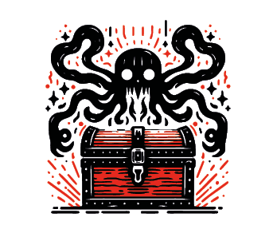 <strong>Trap</strong></td>
<td>Model gets hit by the following attack. Counts as a Ranged Attack. 
ATK 3, HTV 4+, DMG 3, CRT 4</td>
<td>0</td>
</tr>
<tr>
<td>12</td>
<td>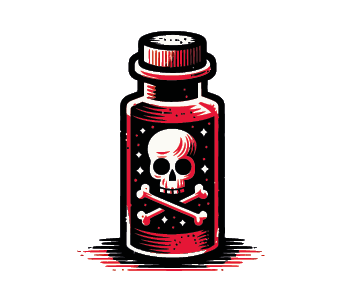 <strong>Poison</strong></td>
<td>The weapons of the model gain the Poison trait.</td>
<td>10</td>
</tr>
<tr>
<td>13</td>
<td>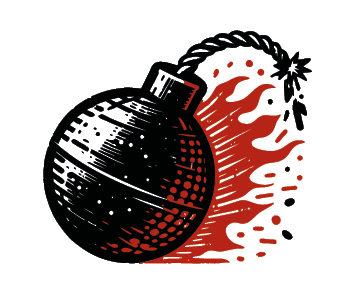 <strong>Fire Bomb</strong></td>
<td>Counts as a Ranged Weapon: 
RNG 6″, ATK 4, HTV 4+, DMG 3, CRT 4 
Blast, Limited</td>
<td>13</td>
</tr>
<tr>
<td>14</td>
<td>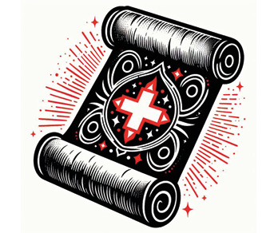 <strong>Magic Scroll of Healing</strong></td>
<td>This model may perform the special action HEAL once. Remove after use.</td>
<td>10</td>
</tr>
<tr>
<td>15</td>
<td>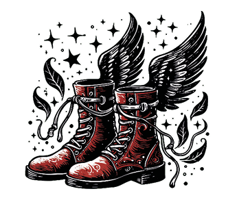 <strong>Boots of Flying</strong></td>
<td>Grants the trait Fly.</td>
<td>12</td>
</tr>
<tr>
<td>16</td>
<td>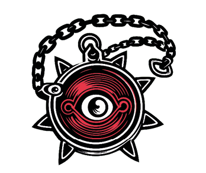 <strong>Amulet of Protection</strong></td>
<td>Grants the trait Protected.</td>
<td>12</td>
</tr>
<tr>
<td>22</td>
<td>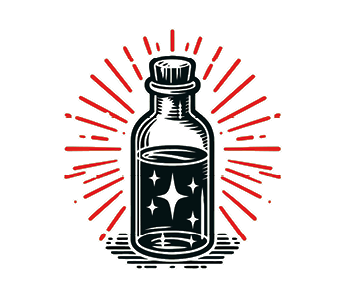 <strong>Blessed Water</strong></td>
<td>This model may use the special action CLEANSE. Remove after use.</td>
<td>4</td>
</tr>
<tr>
<td>23</td>
<td>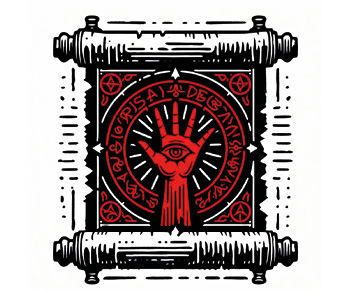 <strong>Magic Scroll of Reanimate the Dead</strong></td>
<td>Grants the special action CAST A SPELL with the ability <strong>Reanimate the Dead</strong>: Any defeated model within 8″ can be revived as a Zombie with its original weapons: MOV 4″, SAV 6+, VIT 8; Resilient, Slow, Necrotic Hunger. Usable once per game.</td>
<td>23</td>
</tr>
<tr>
<td>24</td>
<td>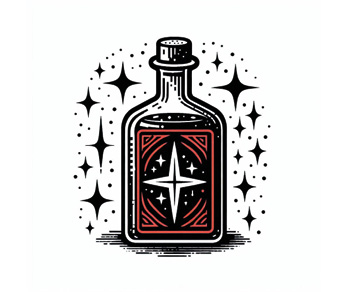 <strong>Alcohol</strong></td>
<td>Grants the Traits Fearless and Resilient until the end of the game. Remove after use.</td>
<td>11</td>
</tr>
<tr>
<td>25</td>
<td>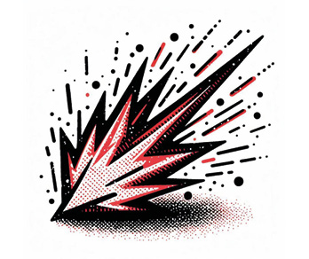 <strong>Flash Powder</strong></td>
<td>Reduces the ACT for the action FALL BACK to 1.</td>
<td>3</td>
</tr>
<tr>
<td>26</td>
<td>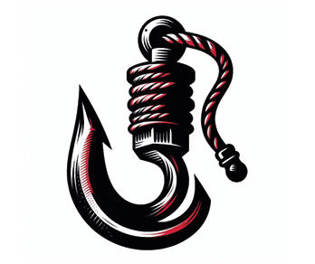 <strong>Grappling Hook</strong></td>
<td>This model can climb or drop without spending movement or suffering penalties. It may also climb even without climbing aids.</td>
<td>6</td>
</tr>
<tr>
<td>33</td>
<td>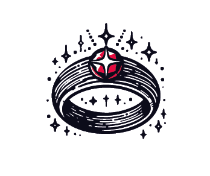 <strong>Spectral Band</strong></td>
<td>Grants the Spectral trait.</td>
<td>7</td>
</tr>
<tr>
<td>34</td>
<td>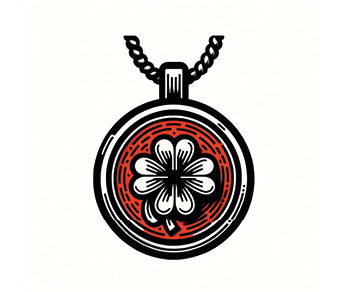 <strong>Lucky Charm</strong></td>
<td>This model gains 1 Reroll per turn.</td>
<td>8</td>
</tr>
<tr>
<td>35</td>
<td>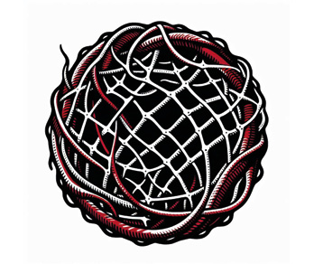 <strong>Net</strong></td>
<td>Opponents in Close Combat cannot use the FALL BACK action.</td>
<td>5</td>
</tr>
<tr>
<td>36</td>
<td>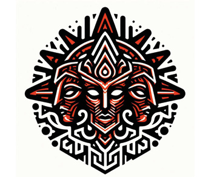 <strong>Idol of the Gods</strong></td>
<td>Generates 1 additional Fate Die per turn.</td>
<td>15</td>
</tr>
<tr>
<td>44</td>
<td> <strong>Magic Mushrooms</strong></td>
<td>This model may perform the special action OVEREXERTION until the end of the game. Remove after use.</td>
<td>17</td>
</tr>
<tr>
<td>45</td>
<td>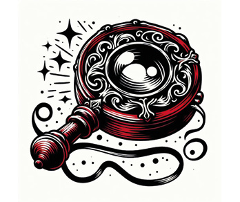 <strong>Spy Glass</strong></td>
<td>When making a Ranged Attack, the target does not benefit from Cover.</td>
<td>5</td>
</tr>
<tr>
<td>46</td>
<td>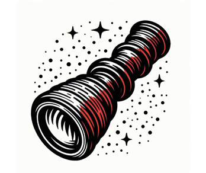 <strong>Telescope</strong></td>
<td>HTV improved by 1 for all ranged attacks made by this model.</td>
<td>8</td>
</tr>
<tr>
<td>55</td>
<td>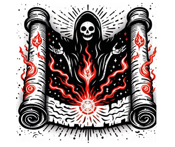 <strong>Magic Scroll of Cursed Souls</strong></td>
<td>Select one enemy model. That model immediately gains the status effect Cursed. Remove after use.</td>
<td>6</td>
</tr>
<tr>
<td>56</td>
<td>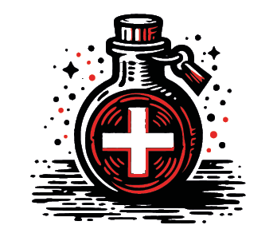 <strong>Healing Potion</strong></td>
<td>Select a friendly model within 1″. That model regains 2D6 lost Vitality. If this healing fully restores the model's VIT to its original value, any existing Injury effects are also removed.</td>
<td>12</td>
</tr>
<tr>
<td>66</td>
<td> <strong>Magic Scroll of Resurrection</strong></td>
<td>Grants the special action CAST A SPELL with the ability <strong>Resurrection</strong>: This model may choose a friendly model that is Defeated. On a roll of 4+, the model returns to life with half its VIT value. Remove after use.</td>
<td>25</td>
</tr>
</tbody>
</table>

Print the equipment cards and place them next to the model card of the model carrying the item. You will not have to come back to this table during play.

Example A looting roll goes wrong

The Swordsman (Human: VIT 10; Chainmail, SAV 4+) stands within 1″ of a Loot Site and spends 1 ACT on INTERACT to loot it.

1.  It rolls the D66: \[1\] and \[1\]. The result is **11**: a Trap.
2.  The Trap counts as a Ranged Attack with ATK 3, HTV 4+, DMG 3, CRT 4. Roll its three Attack Dice: \[6\] \[4\] \[2\]. That is one critical success and one normal success.
3.  The Swordsman is the Defender and rolls its 3 Defense Dice against SAV 4+: \[5\] \[3\] \[1\]. One normal success.
4.  A normal Defense success can only discard a normal success, so it cancels the \[4\]. The \[6\] stays.
5.  The critical success deals CRT 4 damage: VIT 10 drops to 6. Because it was a critical hit, the Swordsman rolls on the Critical Injuries Table: \[5\], a Fleshwound with no effect.

The Swordsman finds no item, loses 4 Vitality and has spent the ACT. Had it rolled \[3\] then \[4\], the result 34 would have given it a Lucky Charm.

## Model Traits

**At a glance**

- Model traits are special abilities of the model itself. Its model card names them.
- Many traits unlock an action (CAST A SPELL, COMMAND, HEAL, TAKE AIM …). Without the trait the model cannot use it.
- Buckler and Shield grant Block Dice for Close Combat. Armor itself grants no traits.
- A model can have no more than 5 Traits in total. Traits from equipment do not count.

<table>
<colgroup>
<col style="width: 50%" />
<col style="width: 50%" />
</colgroup>
<thead>
<tr>
<th>Trait</th>
<th>Rule</th>
</tr>
</thead>
<tbody>
<tr>
<td><strong>Ambush</strong> 
<em>In reserve. From turn 2, deploy 9″ from enemies.</em></td>
<td>This model starts the game in reserve. At any turn after the first, deploy it anywhere, at least 9″ from any enemy model.</td>
</tr>
<tr>
<td><strong>Arcane</strong> 
<em>May CAST A SPELL.</em></td>
<td>Allows the CAST A SPELL action.</td>
</tr>
<tr>
<td><strong>Archmage</strong> 
<em>May CAST A SPELL multiple times each turn.</em></td>
<td>May cast multiple spells per turn using the CAST A SPELL action.</td>
</tr>
<tr>
<td><strong>Artificer</strong> 
<em>May use COMMAND on Constructs.</em></td>
<td>May use COMMAND, but only targeting a model with the Construct trait.</td>
</tr>
<tr>
<td><strong>Assassin</strong> 
<em>HTV improved by 1 as Attacker in melee.</em></td>
<td>Gets HTV improved by 1 if the model is the Attacker in Close Combat.</td>
</tr>
<tr>
<td><strong>Balanced</strong> 
<em>May reroll 1 Attack Die once per Close Combat.</em></td>
<td>Once per combat, you may reroll one Attack Die in Close Combat.</td>
</tr>
<tr>
<td><strong>Buckler</strong> 
<em>+1 Block Die. Cannot block a critical.</em></td>
<td>Grants 1 Block Die. It cannot block a critical success.</td>
</tr>
<tr>
<td><strong>Ceaseless</strong> 
<em>May reroll 1s on Attack Dice.</em></td>
<td>Re-roll any Attack Dice results of 1.</td>
</tr>
<tr>
<td><strong>Channeler</strong> 
<em>Roll 3D6 for Arcane Energy.</em></td>
<td>Roll 3D6 instead of 2D6 when generating Arcane Energy.</td>
</tr>
<tr>
<td><strong>Cleric</strong> 
<em>Can use CLEANSE. CLEANSE also heals D3.</em></td>
<td>May use the CLEANSE special action. When using CLEANSE, the target also regains D3 Vitality.</td>
</tr>
<tr>
<td><strong>Conduit</strong> 
<em>1s on Arcane Energy rolls cause no damage.</em></td>
<td>Rolls of 1 when generating Arcane Energy do not cause damage.</td>
</tr>
<tr>
<td><strong>Creature</strong> 
<em>No INTERACT, no weapons or equipment.</em></td>
<td>Cannot perform INTERACT. Cannot be given weapons or equipment; it only fights with the natural weapons listed in its profile.</td>
</tr>
<tr>
<td><strong>Creature Command</strong> 
<em>May use COMMAND on Creatures.</em></td>
<td>May use COMMAND, but only targeting a model with the Creature trait.</td>
</tr>
<tr>
<td><strong>Cursed</strong> 
<em>Model starts Cursed.</em></td>
<td>Starts the game with the Cursed status effect.</td>
</tr>
<tr>
<td><strong>Divine</strong> 
<em>Can use CLEANSE and INVOCATION.</em></td>
<td>May use the CLEANSE and INVOCATION actions.</td>
</tr>
<tr>
<td><strong>Duellist</strong> 
<em>Retain 1 Attack Die as a success; Parry only.</em></td>
<td>In Close Combat, retain 1 Attack Die as a normal success without rolling it. It may only be spent to Parry.</td>
</tr>
<tr>
<td><strong>Fast</strong> 
<em>Gets +2″ MOV for CHARGE or FALL BACK.</em></td>
<td>Gets +2″ MOV for CHARGE or FALL BACK actions.</td>
</tr>
<tr>
<td><strong>Fear</strong> 
<em>Crits cause Fearful.</em></td>
<td>Each critical hit that causes damage gives the enemy model the Fearful status.</td>
</tr>
<tr>
<td><strong>Fearless</strong> 
<em>Immune to Fearful.</em></td>
<td>Immune to the Fearful status effect.</td>
</tr>
<tr>
<td><strong>Fly</strong> 
<em>Ignores terrain; start and end on open ground.</em></td>
<td>Ignores terrain and obstacles when moving. The model's movement must start and end on open terrain.</td>
</tr>
<tr>
<td><strong>Fungus Brew</strong> 
<em>D6 each activation: random trait until turn end.</em></td>
<td>Model may roll a D6 at the beginning of its activation. It gets the following traits or status effect until the end of the turn: <strong>1</strong> Stupidity, <strong>2-3</strong> Fearful, <strong>4-5</strong> Resilient, <strong>6</strong> Ceaseless.</td>
</tr>
<tr>
<td><strong>Furious</strong> 
<em>May FIGHT twice per activation.</em></td>
<td>May perform the FIGHT action twice per activation.</td>
</tr>
<tr>
<td><strong>Guard</strong> 
<em>Once per combat: re-roll 1 die to Parry/Block.</em></td>
<td>Once per Close Combat, this model may re-roll one of its Attack Dice or Block Dice. A re-rolled Attack Die can only be spent to Parry.</td>
</tr>
<tr>
<td><strong>Gunslinger</strong> 
<em>QUICK SHOT without HTV penalty.</em></td>
<td>When this model performs QUICK SHOT, ignore the HTV penalty.</td>
</tr>
<tr>
<td><strong>Hardened</strong> 
<em>Ignore first Critical Injury per game.</em></td>
<td>The first time this model would suffer a Critical Injury each game, ignore it.</td>
</tr>
<tr>
<td><strong>Hawkeye</strong> 
<em>Ranged 5+ are crits.</em></td>
<td>Ranged attack rolls of 5+ are critical successes.</td>
</tr>
<tr>
<td><strong>Helmet</strong> 
<em>Ignore Head Injuries.</em></td>
<td>Ignores Head Injuries (result 1) from Critical Injuries Table.</td>
</tr>
<tr>
<td><strong>Henchmen</strong> 
<em>May activate 2 models in succession.</em></td>
<td>Up to 2 models with this trait may activate in succession. Can only have traits from Body Type.</td>
</tr>
<tr>
<td><strong>Hero</strong> 
<em>Can use OVEREXERTION.</em></td>
<td>May use the OVEREXERTION action.</td>
</tr>
<tr>
<td><strong>Hunter</strong> 
<em>May SHOOT twice per activation.</em></td>
<td>May use SHOOT (including QUICK SHOT) twice per activation.</td>
</tr>
<tr>
<td><strong>Immobile</strong> 
<em>No Movement.</em></td>
<td>Cannot MOVE, RUN, CHARGE or FALL BACK.</td>
</tr>
<tr>
<td><strong>Invulnerable</strong> 
<em>SAV cannot be modified.</em></td>
<td>Save (SAV) value cannot be modified by any rule or weapon.</td>
</tr>
<tr>
<td><strong>Leader</strong> 
<em>Can COMMAND.</em></td>
<td>May use the COMMAND action.</td>
</tr>
<tr>
<td><strong>Life Link</strong> 
<em>Crit heals 1 Vitality.</em></td>
<td>Each Critical Hit that deals damage heals 1 Vitality.</td>
</tr>
<tr>
<td><strong>Lifeless</strong> 
<em>Immune to Fearful and Poisoned.</em></td>
<td>Immune to Fearful and Poisoned.</td>
</tr>
<tr>
<td><strong>Light Armor</strong> 
<em>No Climb or Traverse movement penalty.</em></td>
<td>No movement penalties for using Climb or Traverse. A trait for nimble creatures; armor does not grant it.</td>
</tr>
<tr>
<td><strong>Marksman</strong> 
<em>Can TAKE AIM.</em></td>
<td>May perform the TAKE AIM action.</td>
</tr>
<tr>
<td><strong>Massive</strong> 
<em>Damage −1. No Hide. Enemy ranged HTV improved.</em></td>
<td>Any successful resolved hit that inflicts Damage on this model is reduced by 1. This model can never gain the Hidden status. Enemy Ranged Attacks against this model improve their HTV by 1.</td>
</tr>
<tr>
<td><strong>Mastery</strong> 
<em>On crit, roll 1 extra Attack Die.</em></td>
<td>If you score at least one critical success in an Attack Roll, roll 1 additional Attack Die immediately. This die is resolved as part of the same attack sequence.</td>
</tr>
<tr>
<td><strong>Medic</strong> 
<em>Can HEAL.</em></td>
<td>May use the HEAL special action.</td>
</tr>
<tr>
<td><strong>Mounted</strong> 
<em>No climbing; crosses small obstacles freely.</em></td>
<td>Cannot climb. May traverse Small Objects and Field Defenses without penalty.</td>
</tr>
<tr>
<td><strong>Necrotic Hunger</strong> 
<em>Heal D6 when killing in melee.</em></td>
<td>Heals D6 Vitality when defeating an enemy in Close Combat.</td>
</tr>
<tr>
<td><strong>Protected</strong> 
<em>Retain 1 Attack or Defense Die as a success.</em></td>
<td>Retain 1 Attack Die (Close Combat) or 1 Defense Die (Ranged Combat) as a normal success without rolling it.</td>
</tr>
<tr>
<td><strong>Quick Draw</strong> 
<em>Reaction: Shoot at an enemy in LoS within 6″.</em></td>
<td>May use a Ranged Attack as a Reaction when an enemy model enters Line of Sight within 6″ during their activation.</td>
</tr>
<tr>
<td><strong>Regeneration</strong> 
<em>After damage, roll D6. 5+ ignore.</em></td>
<td>After receiving damage, roll 1D6. On 5+, ignore that damage.</td>
</tr>
<tr>
<td><strong>Relentless</strong> 
<em>Reroll all Attack Dice once per melee.</em></td>
<td>May re-roll all Attack Dice once per Close Combat.</td>
</tr>
<tr>
<td><strong>Resilient</strong> 
<em>Immune to Fearful and Critical Injuries.</em></td>
<td>Unaffected by Fearful and Critical Injuries.</td>
</tr>
<tr>
<td><strong>Robust</strong> 
<em>Immune to Critical Injuries.</em></td>
<td>Unaffected by Critical Injuries.</td>
</tr>
<tr>
<td><strong>Scout</strong> 
<em>Deploy last. Then move up to 2×MOV.</em></td>
<td>This model is deployed after all other models have been placed. Immediately after deployment, it may make a free move of up to 2× its MOV.</td>
</tr>
<tr>
<td><strong>Second Sight</strong> 
<em>Allies within 6″ reroll 1 Attack Die per turn.</em></td>
<td>Friendly models within 6″ may re-roll 1 Attack Die per turn.</td>
</tr>
<tr>
<td><strong>Shield</strong> 
<em>Grants 1 Block Die. May use RAISE SHIELD.</em></td>
<td>Grants 1 Block Die. Model may use RAISE SHIELD special action.</td>
</tr>
<tr>
<td><strong>Shield of Faith</strong> 
<em>+1 Block Die in melee, +1 Defense Die at range.</em></td>
<td>Grants 1 Block Die in Close Combat and 1 Defense Die in Ranged Combat.</td>
</tr>
<tr>
<td><strong>Slow</strong> 
<em>Cannot RUN or Jump.</em></td>
<td>Cannot RUN or Jump.</td>
</tr>
<tr>
<td><strong>Sniper</strong> 
<em>Shoots into melee. Take Aim. No range penalty.</em></td>
<td>May target enemies engaged in Melee without applying the Shoot into Combat disadvantage of potentially hitting a friendly model. May also use the TAKE AIM action. Has no Effective Range penalty.</td>
</tr>
<tr>
<td><strong>Spectral</strong> 
<em>Move through terrain, not end inside.</em></td>
<td>May move through terrain, but not end inside it. Cannot see through intervening terrain.</td>
</tr>
<tr>
<td><strong>Stalwart</strong> 
<em>Rolls one additional Defense Die.</em></td>
<td>This model rolls one additional Defense Die. A Body Type rule; it counts toward the limit of 5 Traits.</td>
</tr>
<tr>
<td><strong>Stealth</strong> 
<em>In Cover if partly obscured.</em></td>
<td>Considered in Cover if at least a part of its volume is obscured by a terrain feature.</td>
</tr>
<tr>
<td><strong>Strider</strong> 
<em>Ignores Difficult and Dangerous terrain.</em></td>
<td>Ignores the effects of Difficult or Dangerous terrain.</td>
</tr>
<tr>
<td><strong>Stupidity</strong> 
<em>Before action, roll D6. On 1, lose ACT.</em></td>
<td>Roll a D6 before using an action. On 1, the action is not performed and the ACT is lost.</td>
</tr>
<tr>
<td><strong>Swarm</strong> 
<em>3 models may activate in succession.</em></td>
<td>Up to 3 models with this trait may activate in succession.</td>
</tr>
<tr>
<td><strong>Swift</strong> 
<em>Ignore climb penalties.</em></td>
<td>Ignore climbing movement penalty.</td>
</tr>
<tr>
<td><strong>Taunt</strong> 
<em>TAUNT: foe within 8″ must attack you next.</em></td>
<td>Grants the special action TAUNT (1 ACT): choose an enemy model within 8″. In its next activation that model must attack this model if it can (SHOOT, including QUICK SHOT, or CHARGE); if it cannot, it must move towards this model.</td>
</tr>
<tr>
<td><strong>Teleport</strong> 
<em>Move 3×MOV straight; ends in melee = Charge.</em></td>
<td>Use the MOVE action to move the model up to 3× its MOV in a straight line to a position it can see. Ignore all obstacles and terrain in between. Counts as a CHARGE action if the movement ends in Base Contact with an enemy model.</td>
</tr>
<tr>
<td><strong>Tough</strong> 
<em>Damage reduced by 1.</em></td>
<td>Whenever this model suffers damage from a resolved normal or critical success, reduce that damage by 1.</td>
</tr>
<tr>
<td><strong>Tougher</strong> 
<em>Damage reduced by 2.</em></td>
<td>Whenever this model suffers damage from a resolved normal or critical success, reduce that damage by 2.</td>
</tr>
<tr>
<td><strong>Toughest</strong> 
<em>Damage reduced by 3.</em></td>
<td>Whenever this model suffers damage from a resolved normal or critical success, reduce that damage by 3.</td>
</tr>
<tr>
<td><strong>Veteran</strong> 
<em>Free Overwatch after each activation.</em></td>
<td>After finishing its activation, this model may enter Overwatch without spending ACT. All restrictions of the OVERWATCH action apply.</td>
</tr>
</tbody>
</table>

Example Tough against a crossbow

An Orc Brute (Orc: VIT 12, Tough) is hit by a Crossbow (DMG 3, CRT 4). After defense, one normal success and one critical success remain.

1.  The normal success would deal 3 damage. Tough reduces it by 1: the Orc Brute loses 2 Vitality.
2.  The critical success would deal 4 damage. Tough reduces it by 1: the Orc Brute loses 3 Vitality and rolls for a Critical Injury as normal.

The Orc Brute loses 5 Vitality instead of 7 and drops from 12 to 7. Tough applies to each resolved success separately, not once per attack.

## Weapon Traits

**At a glance**

- Weapon traits belong to one weapon profile and only work when the model attacks with that weapon.
- A weapon can carry several traits. Apply all of them; each one changes only the step it names.
- Many traits trigger on a critical success that inflicts damage (Blighted, Fire, Poison, Stun …).
- Traits such as Reloading, Black Powder and Warp Tech make the weapon unusable until a model reloads it with INTERACT.

<table>
<colgroup>
<col style="width: 50%" />
<col style="width: 50%" />
</colgroup>
<thead>
<tr>
<th>Trait</th>
<th>Rule</th>
</tr>
</thead>
<tbody>
<tr>
<td><strong>Ancient</strong> 
<em>Once per combat, reroll 1 failed Attack Die.</em></td>
<td>Once per combat, re-roll 1 failed Attack Die.</td>
</tr>
<tr>
<td><strong>Armor Piercing</strong> 
<em>Ranged: target SAV worsened by 1 (min 6+).</em></td>
<td>Ranged attacks: the Defender's SAV is worsened by 1 (min 6+).</td>
</tr>
<tr>
<td><strong>Armor Shatter</strong> 
<em>Ranged: target rolls 1 Defense Die fewer, SAV worsened by 1.</em></td>
<td>Ranged attacks: the Defender rolls one Defense Die fewer (min 1) and their SAV is worsened by 1 (min 6+).</td>
</tr>
<tr>
<td><strong>Black Powder</strong> 
<em>A 1 misfires. Interact to reload.</em></td>
<td>After making a Ranged Attack with this weapon, if any Attack Die shows a 1, roll once on the Misfire Table (see Ranged Combat). Resolve the misfire immediately before determining hits. After firing, this weapon must be reloaded using the INTERACT action before it can fire again.</td>
</tr>
<tr>
<td><strong>Blast</strong> 
<em>After the hit, attack all within 3″ at ATK −1.</em></td>
<td>When resolving a Ranged Attack with this weapon, after the initial target is resolved, all models within 3″ of that target are also attacked with the same weapon profile, but with ATK reduced by 1.</td>
</tr>
<tr>
<td><strong>Blessed</strong> 
<em>Crit heals 1 Vitality.</em></td>
<td>When this weapon inflicts damage with a critical success in combat, the bearer immediately heals 1 Vitality.</td>
</tr>
<tr>
<td><strong>Blighted</strong> 
<em>Crit curses target.</em></td>
<td>When this weapon inflicts damage with a critical success, the target also gains the Cursed status effect.</td>
</tr>
<tr>
<td><strong>Brutal</strong> 
<em>Only critical successes cancel its hits.</em></td>
<td>Only a critical success can cancel this weapon's successes, whether by Parry, a Block Die showing a 6, an Armor Save of 6, or a critical Defense Die.</td>
</tr>
<tr>
<td><strong>Cleave</strong> 
<em>With a crit retained, upgrade 1 normal to crit.</em></td>
<td>If you retain at least one critical success in an attack roll, you may upgrade one normal success to a critical success.</td>
</tr>
<tr>
<td><strong>Cover Breaker</strong> 
<em>Attacks ignore Cover.</em></td>
<td>Attacks ignore all benefits from Cover, including the SAV bonus.</td>
</tr>
<tr>
<td><strong>Critical</strong> 
<em>Attack rolls of 5+ are crits.</em></td>
<td>When making Attack Rolls with this weapon, rolls of 5+ count as critical successes.</td>
</tr>
<tr>
<td><strong>Deadly</strong> 
<em>Crits inflict Fatal Damage.</em></td>
<td>Successful critical attack dice from this weapon inflict Fatal Damage instead of normal damage. Fatal Damage cannot be blocked or saved.</td>
</tr>
<tr>
<td><strong>Disarming</strong> 
<em>On a crit: CRT, or DMG plus a free Parry.</em></td>
<td>On a critical success in Close Combat, choose: inflict CRT as normal, or inflict DMG and in addition Parry one of the opponent's unspent successes.</td>
</tr>
<tr>
<td><strong>Fire</strong> 
<em>Crit also applies Burning.</em></td>
<td>Critical success also applies Burning.</td>
</tr>
<tr>
<td><strong>First Strike</strong> 
<em>Resolves its first success first.</em></td>
<td>In Close Combat, during the Resolve Dice step, this model always resolves the first successful die. Then alternate as normal.</td>
</tr>
<tr>
<td><strong>Fusillade</strong> 
<em>Split Attack Dice across targets.</em></td>
<td>When making a Ranged Attack with this weapon, you may split your Attack Dice between multiple eligible targets within range and line of sight. Resolve each target's defense separately.</td>
</tr>
<tr>
<td><strong>Harmful</strong> 
<em>Rolls of 1 deal 1 DMG to attacker.</em></td>
<td>Results of 1 to hit inflict 1 DMG to the Attacker without a defense possibility.</td>
</tr>
<tr>
<td><strong>Heavy</strong> 
<em>Cannot attack if model moved.</em></td>
<td>This weapon cannot be used on a turn in which the model has moved.</td>
</tr>
<tr>
<td><strong>Impact</strong> 
<em>After CHARGE, deal D3 Fatal Damage.</em></td>
<td>After completing a CHARGE action, inflict D3 Fatal Damage against the charged target.</td>
</tr>
<tr>
<td><strong>Limited</strong> 
<em>Use once per battle.</em></td>
<td>May only be used once per battle.</td>
</tr>
<tr>
<td><strong>Master Parry</strong> 
<em>A normal success may Parry a critical.</em></td>
<td>In Close Combat, a normal success with this weapon may Parry a critical success.</td>
</tr>
<tr>
<td><strong>Melee Shot</strong> 
<em>May SHOOT at target in Base Contact.</em></td>
<td>This weapon may be used to make a SHOOT against a target in Base Contact.</td>
</tr>
<tr>
<td><strong>Necrotic</strong> 
<em>Crit in Close Combat heals D3.</em></td>
<td>When this weapon inflicts damage with a critical success in Close Combat, the bearer heals D3 Vitality.</td>
</tr>
<tr>
<td><strong>Phantom</strong> 
<em>Crit cannot be blocked by a Block Die.</em></td>
<td>A critical success of this weapon cannot be blocked by a Block Die.</td>
</tr>
<tr>
<td><strong>Poison</strong> 
<em>Crit poisons target.</em></td>
<td>When this weapon inflicts damage with a critical success, the target also gains the Poisoned status effect.</td>
</tr>
<tr>
<td><strong>Push</strong> 
<em>Crit pushes enemy 3″.</em></td>
<td>In Close Combat, when you inflict damage with a critical success, you may immediately push the enemy model back 3″, following normal movement rules.</td>
</tr>
<tr>
<td><strong>Reach</strong> 
<em>Can be used in melee or ranged.</em></td>
<td>Can be used in Close and Ranged Combat.</td>
</tr>
<tr>
<td><strong>Reloading</strong> 
<em>Must INTERACT to reload after shooting.</em></td>
<td>After this weapon is used to make a Ranged Attack, it must be reloaded by performing the INTERACT action before it can be fired again.</td>
</tr>
<tr>
<td><strong>Retribution</strong> 
<em>Critical Parry returns the damage as Fatal.</em></td>
<td>In Close Combat, when you Parry with a critical success, the cancelled die's damage (DMG or CRT) is inflicted on the opponent as Fatal Damage.</td>
</tr>
<tr>
<td><strong>Reveal</strong> 
<em>Hidden enemies within 6″ are revealed.</em></td>
<td>All Hidden enemy models within 6″ of this model are immediately revealed and can be targeted.</td>
</tr>
<tr>
<td><strong>Riposte</strong> 
<em>Each Parry deals 1 Fatal Damage to the enemy.</em></td>
<td>In Close Combat, each time you Parry with this weapon, the opponent suffers 1 Fatal Damage.</td>
</tr>
<tr>
<td><strong>Scatter Shot</strong> 
<em>Hit spreads to all within 2″ (ATK -1).</em></td>
<td>When resolving a Ranged Attack with this weapon, after the initial target is resolved, all other models (friend or foe) within 2″ of that target are also attacked with the same weapon profile, but with ATK reduced by 1 (minimum 1). Each affected model defends separately.</td>
</tr>
<tr>
<td><strong>Silent</strong> 
<em>Can HIDE and SHOOT in same activation.</em></td>
<td>May perform HIDE and SHOOT in the same activation.</td>
</tr>
<tr>
<td><strong>Snap Shot</strong> 
<em>Quick Shot with this weapon: no HTV penalty.</em></td>
<td>QUICK SHOT with this weapon does not worsen HTV.</td>
</tr>
<tr>
<td><strong>Stun</strong> 
<em>Crit stuns target.</em></td>
<td>When this weapon inflicts damage with a critical success, the target also gains the Stunned status effect.</td>
</tr>
<tr>
<td><strong>Sweep</strong> 
<em>Crit deals D3 Fatal to others within 1″.</em></td>
<td>In Close Combat, when this weapon inflicts damage with a critical success, each other enemy model within 1″ of the target suffers D3 Fatal Damage.</td>
</tr>
<tr>
<td><strong>Swift Strike</strong> 
<em>May retain 1 success Attack die without rolling.</em></td>
<td>In close combat, the model may retain 1 Attack Die as a normal success without rolling it.</td>
</tr>
<tr>
<td><strong>Throwable</strong> 
<em>Once per battle Ranged Attack, then lost.</em></td>
<td>May be used in Close Combat and for a single Ranged Attack per battle. After making the ranged attack, the weapon cannot be used again.</td>
</tr>
<tr>
<td><strong>Two-handed</strong> 
<em>No off hand, shield or buckler. Cannot RUN.</em></td>
<td>Cannot use an off-hand weapon, Shield or Buckler. Cannot RUN.</td>
</tr>
<tr>
<td><strong>Unwieldy</strong> 
<em>SHOOT or FIGHT costs 2 ACT. No Overwatch.</em></td>
<td>A SHOOT or FIGHT action with this weapon costs 2 ACT. This weapon cannot be used for an Overwatch reaction.</td>
</tr>
<tr>
<td><strong>Warp Tech</strong> 
<em>1–2 misfires. 5+ crits. Interact to reload.</em></td>
<td>After making a Ranged Attack with this weapon, if any Attack Die shows a 1 or 2, roll once on the Misfire Table (see Ranged Combat). Resolve the misfire immediately before determining hits. Results of 5 and 6 count as critical. After firing, this weapon must be reloaded using the INTERACT action before it can fire again.</td>
</tr>
</tbody>
</table>

Example Two traits on one crossbow

The Crossbowman (Human, ACT 2) carries a Crossbow: RNG 12″, ATK 3, HTV 4+, DMG 3, CRT 4; Armor Piercing, Reloading. It shoots at the Swordsman (Human: VIT 10; Chainmail, SAV 4+), who stands in Cover 7″ away.

1.  The Crossbowman spends 1 ACT on SHOOT. The target is within 8″, so there is no Effective Range penalty.
2.  The Swordsman's SAV: Chainmail 4+. Cover improves it by 1 to 3+. Armor Piercing worsens it by 1, back to 4+. Both modifiers apply.
3.  Attack Dice against HTV 4+: \[6\] \[5\] \[2\]. One critical and one normal success.
4.  Defense Dice against SAV 4+: \[4\] \[3\] \[1\]. One normal success, which discards the normal Attack success. Without Armor Piercing the \[3\] would also succeed, and two normal successes together could have discarded the critical one.
5.  The critical success deals CRT 4: the Swordsman drops from 10 to 6 VIT and rolls on the Critical Injuries Table.
6.  Now Reloading applies: the crossbow cannot fire again until it is reloaded. The Crossbowman spends its second ACT on INTERACT to reload it.

Armor Piercing changes only the Defender's SAV, Reloading only what happens after the shot. Had the Crossbowman spent its second ACT on anything else, the crossbow would stay unloaded, also for an OVERWATCH reaction.
