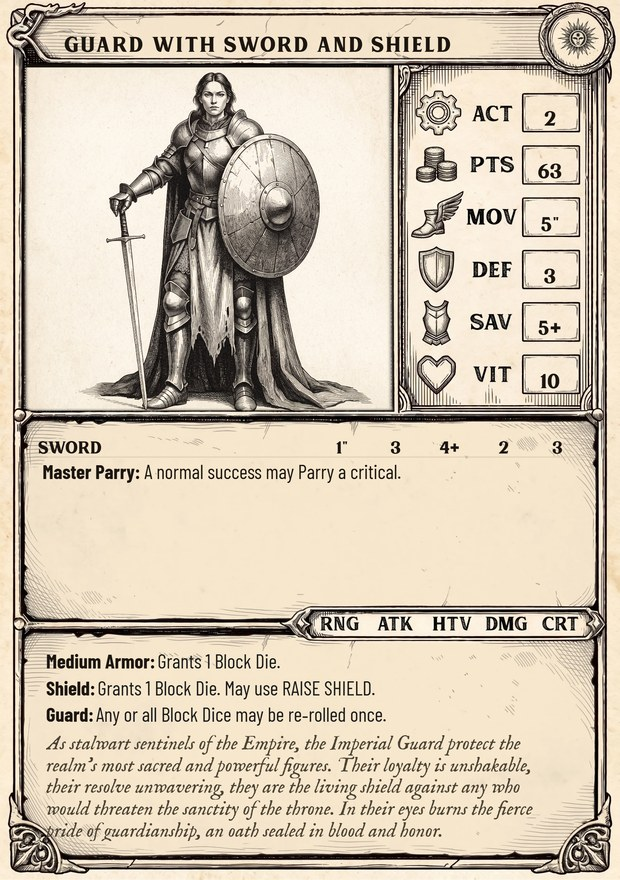
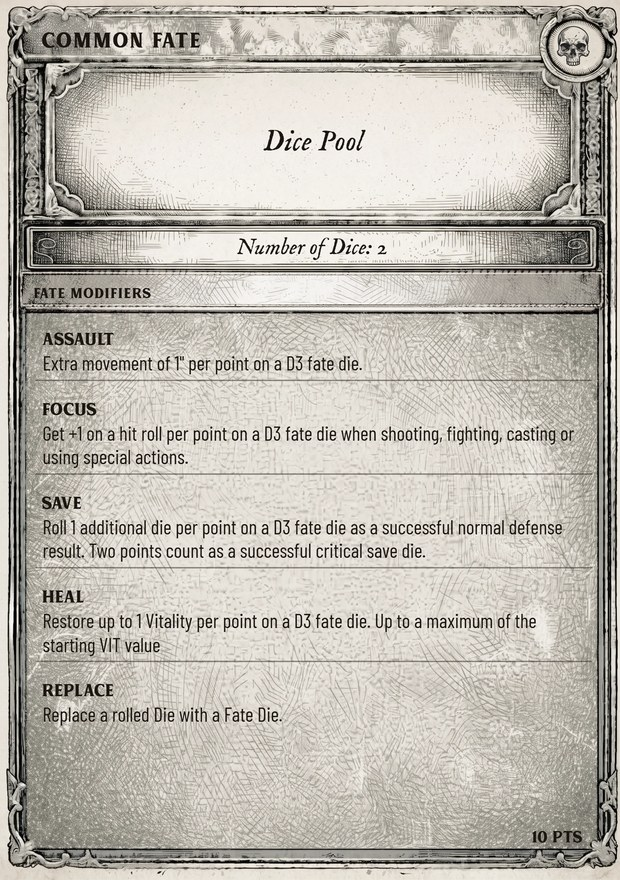

# Building a Warband

*Gather your fighters. This chapter explains the point limit, factions and Fate Modifiers, and shows how to read a model card.*

## Points and Size

**At a glance**

- Agree on a point limit. A normal game is 500 to 650 pts.
- Every model costs points. Add them up, plus your Fate Modifier.
- In a campaign, points are Gold.

Before the game, agree on a total point limit with your opponent. Each model costs points for its Faction, Body Type, Tier, Armor, Class, Weapons, Gear and Fate Modifier. The combined total is your warband’s cost. It must not exceed the agreed limit.

Points are the same as Gold in campaign play: a model worth 45 pts costs 45 Gold to recruit.

**Standard size**

Unless you agree on another limit, warbands are built to **600 points**. This is the standard for single games and for Encounter.

### Suggested warband sizes

| Size       | Points                                | Battlefield             |
|------------|---------------------------------------|-------------------------|
| **Small**  | under 500 pts                         | 30″ × 30″, or 24″ × 24″ |
| **Medium** | 500 to 650 pts · **600 pts standard** | 30″ × 30″               |
| **Large**  | up to 1200 pts                        | 30″ × 30″               |

## Choose a Faction

**At a glance**

- Every model belongs to one faction.
- One faction only: you may use its Fate Modifiers and lores.
- Mixed factions: a Mercenary warband. +5 pts per model, Common Fate, Lesser Magic and Minor Rites only.

Imperial

Undead

Primordial

Tribes

Mercenaries / All

If all models of your warband belong to the same faction, you may use that faction’s own Fate Modifiers, Arcane Lores and Divine Lores.

**Mercenary warband**

A warband with models from more than one faction is a Mercenary warband. Every model in it costs 5 points more. This is a faction surcharge, not a trait, and takes no trait slot. A Mercenary warband may only use the Common Fate Modifier and the lores Lesser Magic and Minor Rites.

Example Hiring outside your faction

A player fields four Imperial models and adds two Tribes models. Their warband is now a Mercenary warband.

1.  All six models cost 5 points more: 6 × 5 = **30 pts** extra.
2.  They must use the Common Fate Modifier instead of an Imperial one.
3.  Their Arcane models may only use Lesser Magic, their Divine models only Minor Rites.

The two hired fighters cost them 30 pts and their faction’s Fate Modifier.

## Fate Modifier

**At a glance**

- Choose one Fate Modifier. It costs points and gives you Fate Dice every turn.
- Roll all Fate Dice as D6 in the Fate Phase. Spend them in the Action Phase, also in the enemy’s activation.
- Each die is used once, for one effect. Unused dice are lost at the end of the turn.

Fate Modifiers are a pool of special dice you roll every turn to bend key moments: attacks, defence, movement, spells and similar effects. Each faction offers one or more Fate Modifiers that reflect its playstyle or its subfactions. A Fate Modifier adds to your warband’s cost and can only be chosen if all models share the faction. Mixed warbands use the Common Fate Modifier.

### Using Fate Dice

1.  **Roll.** At the start of the Fate Phase, roll all your Fate Dice as D6.
2.  **Choose an effect.** When you spend a Fate Die in the Action Phase, pick one available effect of your Fate Modifier.
3.  **Read the die.** The effect says how the die is read: as D6, D3, D2 or D1 (see Dice conversion). **Replace** uses the result as it is, without conversion.
4.  **Spend it.** The die is used once, on a single dice result or action, and is then gone.

- You may spend Fate Dice at any time during the Action Phase, also during the enemy’s activation.
- Fate Dice belong to the player, not to a model. They may affect any model or its action.
- Some models or effects grant extra Fate Dice. A warband worth at least 20 pts less than the opponent’s gains one more each turn (see Against the Odds).
- Unused Fate Dice expire at the end of the turn.
- The Fate Modifier’s cost is added to the warband total.

Example Saving a shot with Replace

In the Fate Phase the player rolls two Fate Dice: \[6\] and \[2\]. Later their Crossbowman shoots and rolls \[3\] \[4\] \[1\] against HTV 4+.

1.  They spend the \[6\] on a Replace effect and swaps it for the \[3\]. Replace uses the die as it is.
2.  The shot now shows \[6\] \[4\]: one critical and one normal success.

The \[2\] stays in their pool for the enemy’s turn. If they do not use it, it is lost at the end of the turn.

## Lores and Composition

### Arcane and Divine lores

Choose one Arcane Lore and one Divine Lore. Each lore is available only if your warband has at least one model with the matching trait, Arcane or Divine. Lores cost no points. Mercenary warbands may only choose Lesser Magic and Minor Rites (see Arcane & Divine Powers).

### Two ways to assemble a warband

1.  **Existing models and Iconic Warbands.** Take pre-built models or a complete Iconic Warband from the faction chapters, with full stats, weapons and traits.
2.  **Custom characters.** Build your own models with the Custom Character Builder.

You may include a Leader in your warband, but you do not have to.

Build and manage warbands, including custom models, online at grimheim.app.

## The Model Card

**At a glance**

- One card per model: picture, name and faction, points, stats, armament, traits.
- Stats: ACT, MOV, SAV, VIT. Weapons: RNG, ATK, HTV, DMG, CRT.
- At most 5 traits per model, counting traits from Body Type and Tier. Traits from equipment do not count.

Each model card holds everything you need to play that model. It has six parts:

1.  **Character image.** The picture shows who the model is. It has no game function. You may place status tokens on it during play.
2.  **Name and faction.** Who the model is and which faction it belongs to.
3.  **Points cost.** In the corner: the cost in points (PTS). The warband total must not exceed the agreed limit.
4.  **Stats.** The four characteristics below. The flavour text beside them has no game effect, and you may place dice there to track Vitality.
5.  **Armament.** The model’s weapons, each with its profile.
6.  **Traits.** Special abilities: extra actions, immunities, changed core rules.

### Stats

| Stat | Meaning | Better | Typical |
|----|----|----|----|
| ACT Actions | How many actions the model performs in its activation. | higher | 2 |
| MOV Movement | How far the model moves, in inches, with one movement action. | higher | 5″ |
| SAV Save | The roll each Defense Die needs to succeed, and the Armor Save against a normal Strike. | lower | 5+ |
| VIT Vitality | Health. At 0 the model is Defeated. | higher | 10 |

**Defense Dice**

Each model rolls three Defense Dice when defending in Ranged Combat. A model with Stalwart rolls one additional Defense Die.

### Armament

Every model has two hand slots: up to two one-handed weapons, one two-handed weapon, or a weapon and a shield. Each weapon is listed with its profile:

| Entry | Meaning | Better | Typical |
|----|----|----|----|
| **Name & Type** | The weapon and its category: close or range. |  |  |
| RNG Range | Maximum distance in inches. RNG 1″ weapons are used in close combat. | higher | 1″ / 12″ |
| ATK Attacks | How many Attack Dice the weapon rolls. | higher | 3 |
| HTV Hit Value | The roll each Attack Die needs to hit. | lower | 4+ |
| DMG Damage | Damage of a normal hit. | higher | 2 |
| CRT Critical | Damage of a critical hit, a roll of 6. | higher | 3 |
| **Weapon rules** | Traits of the weapon, listed under the profile (see Appendix). |  |  |

Example Reading a card: the Swordsman

The model used in many examples of this book:

| Model                                    | ACT | MOV | SAV | VIT |
|------------------------------------------|-----|-----|-----|-----|
| **Swordsman** (Human, Chainmail, Shield) | 2   | 5″  | 4+  | 10  |

| Weapon            | RNG | ATK | HTV | DMG | CRT | Traits       |
|-------------------|-----|-----|-----|-----|-----|--------------|
| **Sword** (close) | 1″  | 3   | 4+  | 2   | 3   | Master Parry |

The Swordsman acts twice per activation and moves 5″. In close combat it rolls 3 Attack Dice that hit on 4+, 4 when it is the Attacker; each hit deals 2 damage, a 6 deals 3. Its Shield grants a Block Die. Its Chainmail gives SAV 4+: each normal Strike against it is saved on a 4+. Against shots it rolls 3 Defense Dice that save on 4+.

### Traits

Traits are special abilities: they grant special actions, immunities or change core mechanics. **A model can have no more than 5 traits in total.** Traits from its Body Type or Tier count toward this limit; traits granted by equipment do not count and are not entered in the model’s profile.

## The Fate Modifier Card

Each faction has its own Fate Modifiers, some factions several for their subfactions. If your warband mixes factions, you must use the Common Fate Modifier. The card has six parts:

1.  **Name** of the Fate Modifier, for example Common Fate or Imperial Fate.
2.  **Points cost** to add it to the warband.
3.  **Number of Fate Dice** you roll in each Fate Phase.
4.  **Allowed factions** that may choose it.
5.  **Dice pool:** space to place your Fate Dice.
6.  **Effects:** what you can spend the dice on, and whether each effect reads the die as D6, D3, D2 or D1.

Fate Modifiers are used in the Action Phase.
