# Campaign Rules

*A single battle is forgotten by morning. A campaign remembers: the dead stay dead, the wounded limp into the next fight, and every Victory Point becomes Gold. This chapter explains how to link Missions into a campaign, what happens to your models after each battle, and how to spend Gold in the Grimheim Hub.*

## Core Campaign Rules

**At a glance**

- Agree on a Points value. Every Point you spend on models and equipment is 1 Gold invested.
- After each Mission your Victory Points become Gold: 20 Gold per VP, 30 Gold per VP for the Underdog.
- Between Missions run the After Battle Sequence: injuries, recovery, then a visit to the Hub.
- A model never has more than 5 Traits. Traits granted by equipment do not count.

Campaigns turn single skirmishes into a running story in which your warband grows, suffers setbacks and forges its legend across linked battles. Grimheim offers three campaign formats: Ongoing Campaigns for open-ended play with any number of players, Conquest Campaigns for a two-player war over territory, and Map Control Campaigns for a war over the districts of Grimheim itself. The rules in this section apply to every format.

### Starting Resources

Before the campaign begins, the players agree on a common Points value for building their starting warbands. In a campaign, Points and Gold are one system: every Point spent on models or equipment equals 1 Gold in value. Your starting warband's point cost is therefore your first investment in the campaign.

#### Build your warband

Build your starting warband within the agreed point limit, remembering that each point spent is Gold invested. Models recruited later in the campaign follow the same principle: their point value is their Gold cost. See Building a Warband for the complete construction rules, faction options and model costs.

### Victory Rewards

**Key rule**

After each Mission, the Victory Points (VP) you earned convert to Gold at a fixed rate of **20 Gold per VP**. The Underdog converts at **30 Gold per VP** instead.

**Underdog:** a player who received at least 5 VP fewer than any other player in the previous Mission is the Underdog for this Mission.

Gold is your main resource for developing your warband between battles. Spend Gold to:

- recruit new models at their point value cost;
- purchase equipment and upgrades;
- heal injuries at the Hub's various locations;
- access faction-specific services and training.

Conquest Campaigns also award Conquest Points (CP) for territorial conquest. CP decide the campaign separately from Gold earnings (see Conquest Campaign).

Example Gold from Victory Points, with the Underdog

Player A and Player B start a campaign. In the first Mission Player A scores 3 VP and Player B scores 9 VP. Neither player is the Underdog yet.

1.  Mission 1: A earns 3 × 20 = 60 Gold. B earns 9 × 20 = 180 Gold.
2.  A received 6 VP fewer than B. That is at least 5 fewer, so A is the Underdog for Mission 2.
3.  Mission 2: A scores 7 VP and B scores 5 VP. As the Underdog, A converts at 30 Gold: 7 × 30 = 210 Gold. B earns 5 × 20 = 100 Gold.
4.  For Mission 3 nobody is the Underdog: A scored more than B, and B trailed by only 2 VP.

After two Missions A has earned 270 Gold and B 280 Gold, although B scored 14 VP to A's 10.

### Side Quests

Side Quests are optional objectives that can be undertaken during Missions for additional Victory Points and narrative depth. See Side Quests.

In a campaign every extra VP is also 20 Gold (or 30 for the Underdog).

### The Campaign Cycle

Between Missions your warband determines the lasting consequences of the battle. The After Battle Sequence has three steps:

1.  **Determine lasting consequences.** Roll on the injury tables for Defeated or seriously wounded models.
2.  **Heal and recover.** Restore wounds and remove temporary effects.
3.  **Visit the Hub.** The warband returns to its faction's Hub to spend earned Gold on new models, upgrades or special benefits.

### Campaign End

- **Ongoing Campaign:** the campaign ends on an agreed date, or never. The player with the most ranking points wins: 3 for a win, 1 for a draw, 0 for a loss. Total Victory Points break ties.
- **Conquest Campaign:** the campaign ends when one player captures the Enemy Stronghold (immediate victory), or when both players agree to conclude. In that case the highest Conquest Points determine the winner.

### Campaign Legacy

A campaign's end need not end your warband's story. Veteran warbands may continue into new campaigns with their accumulated experience, equipment and battle-hardened warriors, creating stories that span several campaigns.

Alternatively, successful warbands can retire with honour, their legends told in the taverns and halls of Grimheim, while you begin afresh with a new warband and new challenges.

### Traits Limit

Additional Traits can only be gained during a Campaign if the total of 5 is not exceeded. This counts every Trait from Body Type, Tier, Survivor results and training; traits granted by equipment do not count (see The Model Card).

## Campaign Types

**At a glance**

- Ongoing: any number of players, any agreed Mission, ranking by wins.
- Conquest: two players in a tug of war over five zones toward the enemy Stronghold.
- Map Control: two to six players on a map of Grimheim's districts. Rules in preparation.

The three formats differ in structure and victory conditions.

| Format | Players | Structure | Victory | Best for |
|----|----|----|----|----|
| **Ongoing** | Any number; players join and leave | Any agreed Mission; every warband keeps a Roster | Most ranking points (win 3, draw 1, loss 0) | Open groups, campaign nights with changing players, long-running narratives |
| **Conquest** | Two | Five zones, from your Stronghold to the enemy's | Capture the Enemy Stronghold, or most CP when both players conclude | Epic two-player campaigns with dramatic escalation and territorial conquest |
| **Map Control** | Two to six | A map of tiles held through a control mechanism | In preparation | Groups who want a shared map and a long game |

### Ongoing Campaign

An Ongoing Campaign links any number of Missions into an open-ended story. Players join and leave while the campaign runs, warbands grow between battles, and nobody has to be present for every game.

#### Campaign structure

- **Missions.** Players play any Mission they agree on. Consequences carry forward between battles: injuries, equipment and warband changes.
- **Roster.** Every warband keeps a Roster of all its models, equipment and Gold. Before each Mission the player picks a warband from the Roster up to the agreed mission limit (600 points unless agreed otherwise). Models left in the Roster earn no Gold and suffer no injuries. A Roster has no maximum; the mission limit bounds each game.
- **Joining and leaving.** A player who joins a running campaign builds a warband worth the average Roster value of the other players, at most the mission limit plus 100 Gold. Leaving freezes the Roster; a returning player continues with the frozen Roster.
- **Pairing.** Any player may challenge any other, but nobody plays the same opponent three times in a row, and the player with the fewest games played challenges first. When everyone is at the table, pair players with equal numbers of wins and resolve the rest with a Roll-off. If two Rosters differ by more than 100 points, the weaker player chooses the Mission.

#### Victory conditions

- The campaign ends on an agreed date, or never.
- Ranking by wins: 3 points for a win, 1 for a draw, 0 for a loss. Total Victory Points break ties.

Example A new player joins an Ongoing Campaign

The group plays with a mission limit of 600 points. Three players already take part, with Roster values of 780, 690 and 630 points.

1.  The average Roster value of the other players is (780 + 690 + 630) ÷ 3 = 700.
2.  The cap is the mission limit plus 100 Gold: 600 + 100 = 700. The average does not exceed it, so the new player builds a warband worth 700. Had the Rosters averaged 760, the new player would still build only 700.
3.  Before each Mission the new player picks models from the Roster up to 600 points. The 100 points left behind earn no Gold and suffer no injuries in that Mission.
4.  Later the 630-point player meets the 780-point player. Their Rosters differ by 150 points, more than 100, so the 630-point player chooses the Mission.

The newcomer owns as much as the average veteran, but fights at the same 600 points as everyone else.

### Conquest Campaign

Two warbands fight along five zones toward each other's Stronghold. The full rules follow in Conquest Campaign and Conquest Missions and Defender Bonuses.

### Map Control Campaign (in preparation)

A war for the districts of Grimheim. The city becomes a campaign map of tiles that grant different advantages, held through a control mechanism. Two to six players.

Best for groups who want a shared map and a long game. The full rules are in preparation and follow in a later edition.

## Conquest Campaign

**At a glance**

- Two warbands fight along five zones. Every campaign starts at Neutral Grounds.
- The winner of a battle moves the campaign one zone toward the enemy Stronghold; the loser falls back one zone.
- Every win earns Conquest Points (CP). Capturing the Enemy Stronghold wins the campaign at once.
- On home ground the Defender gets Defender Bonuses.

A Conquest Campaign simulates territorial warfare: a back-and-forth struggle for control of Grimheim. Two warbands fight through escalating zones, from Neutral Grounds through Enemy Territory, with the ultimate goal of capturing and destroying the enemy's Stronghold.

### Campaign Structure

- Territorial progression through five zones: Your Stronghold, Your Territory, Neutral Grounds, Enemy Territory, Enemy Stronghold.
- Victory pushes into enemy territory; defeat forces a retreat toward your own Stronghold.
- Defenders gain powerful bonuses when fighting on home ground.
- Before the campaign begins, each player selects one Stronghold Mission (faction-tagged) and three Territory Missions.
- In addition to Victory Points, Conquest Campaigns award Conquest Points (CP) to track how well you fare during the campaign.

#### Victory conditions

- Capture and destroy the Enemy Stronghold for immediate victory, **or**
- have the highest Conquest Points when both players agree to conclude.

### The Territorial System

**Fig. 6.1** The Conquest track, seen from your side. Every campaign starts at Neutral Grounds. A win at the Enemy Stronghold ends the campaign at once; a successful Stronghold defence sends the fight back into the defender's Territory, and the defender picks that Territory Mission.

#### Your Stronghold / Enemy Stronghold

- The ultimate defensive position and seat of power.
- Heavily fortified, with powerful defender bonuses.
- Falling here means campaign defeat.
- Accessed only after pushing through all previous zones.
- You are always the Defender in your Stronghold and the Attacker in the Enemy Stronghold.

#### Your Territory / Enemy Territory

- Home ground with moderate defender advantages.
- Contains three missions chosen by the defending player before the campaign starts.
- The Attacker selects which mission to play when this zone is contested.
- You are always the Defender in your Territory and the Attacker in the Enemy Territory.

#### Neutral Grounds

- The starting point of every Conquest Campaign.
- No defender bonuses (balanced combat).
- If the Mission has roles, a Roll-off determines Attacker and Defender.
- Contains three missions, played in sequence on repeated visits.

### Conquest Points (CP)

In addition to Victory Points (which convert to Gold for warband development), Conquest Campaigns award Conquest Points to track territorial conquest and to determine overall campaign victory. Victory Points and Conquest Points are tracked separately.

| Zone            | Attacker wins | Defender wins |
|-----------------|---------------|---------------|
| Neutral Grounds | 3 CP          | 3 CP          |
| Territory       | 5 CP          | 4 CP          |
| Stronghold      | Total Win     | 4 CP          |

### Campaign Flow

All Conquest Campaigns begin at Neutral Grounds. The campaign is a tug of war along the five zones: Enemy Stronghold, Enemy Territory, Neutral Grounds, Your Territory, Your Stronghold. After each battle the winner moves the campaign one zone toward the enemy's Stronghold, and the loser one zone back toward their own.

#### After each battle

1.  **Award Conquest Points** to the winner (table above).
2.  **Move the campaign.** Win: proceed one zone toward the enemy Stronghold. Lose: retreat one zone toward your own Stronghold. A win by the Attacker in a Stronghold is a Total Win instead and ends the campaign.
3.  **Conduct the After Battle Sequence.**
4.  **Set up the next Mission** (see Mission Selection).

A successful Stronghold defence pushes the campaign back into the defender's Territory; the defender then chooses the Territory Mission.

**A drawn battle**

If a Conquest battle ends in a draw, each player gains 1 CP and the campaign stays in the same zone. On Neutral Grounds the next Mission of the pool is played; in a Territory the Attacker chooses again.

Example A Conquest Campaign through the zones

Player A and Player B begin at Neutral Grounds. "Your" and "Enemy" below are seen from Player A's side.

1.  **Battle 1, Neutral Grounds.** A Roll-off decides Attacker and Defender; there are no Defender Bonuses. They play the first Base Mission of their pool. A wins: +3 CP (A 3, B 0). The campaign moves into B's Territory.
2.  **Battle 2, B's Territory.** A is the Attacker and chooses one of B's three Territory Missions. B reveals that mission's secret value and takes that many Defender Bonuses. B wins as Defender: +4 CP (A 3, B 4). The campaign moves back to Neutral Grounds.
3.  **Battle 3, Neutral Grounds.** They play the second Base Mission of the pool. A wins: +3 CP (A 6, B 4). The campaign moves into B's Territory again.
4.  **Battle 4, B's Territory.** A wins as Attacker: +5 CP (A 11, B 4). The campaign moves to B's Stronghold.
5.  **Battle 5, B's Stronghold.** B plays the chosen Stronghold Mission with 2 Defender Bonuses and holds: +4 CP (A 11, B 8). The campaign is pushed back into B's Territory, and this time B, not A, chooses the Territory Mission.
6.  **Battle 6, B's Territory.** A wins as Attacker: +5 CP (A 16, B 8) and advances to B's Stronghold once more.

If A now takes B's Stronghold, A wins the campaign at once. If both players agree to stop instead, A wins on Conquest Points, 16 to 8.

## Conquest Missions and Defender Bonuses

**At a glance**

- Before the campaign: agree on 3 Base Missions for Neutral Grounds; each player picks 3 Territory Missions and 1 Stronghold Mission.
- In a Territory the Attacker picks which of the defender's three Missions to play.
- The defender secretly marks those three Missions with 2, 1 and 0 Defender Bonuses.
- In a Stronghold the defender always takes 2 Defender Bonuses.

### Mission Selection

Before the campaign begins, the players pre-select their mission pools based on mission tags (see Setup for the tags Base, Territory, Stronghold and Special).

<table>
<colgroup>
<col style="width: 33%" />
<col style="width: 33%" />
<col style="width: 33%" />
</colgroup>
<thead>
<tr>
<th>Zone</th>
<th>Pool</th>
<th>Which Mission is played</th>
</tr>
</thead>
<tbody>
<tr>
<td><strong>Neutral Grounds</strong></td>
<td>3 missions tagged <strong>Base</strong>, agreed by both players before the campaign</td>
<td>Played in rotation: on each visit to Neutral Grounds, the next mission of the pool. If the campaign returns to Neutral Grounds multiple times, cycle through these missions in sequence.</td>
</tr>
<tr>
<td><strong>Territory</strong></td>
<td>3 missions tagged <strong>Territory</strong> per player, for their own Territory. Record them before the campaign begins.</td>
<td>The Attacker chooses which of the defender's 3 Territory Missions to play. 
<strong>Exception:</strong> if the Defender successfully defends their Stronghold and pushes back to their Territory, the Defender chooses the Territory Mission, not the Attacker.</td>
</tr>
<tr>
<td><strong>Stronghold</strong></td>
<td>1 mission tagged <strong>Stronghold</strong> per player, for their final defensive stand</td>
<td>When a Stronghold is attacked, the Defender uses their chosen Stronghold Mission.</td>
</tr>
</tbody>
</table>

An example Neutral Grounds pool: Encounter, Iron Seals, The Buried Index. The Missions chapter lists the tags of every Mission; the overview table at its start shows at a glance which Missions are Base, Territory or Stronghold.

### Defender Bonuses

As a Defender, you may select from the Defender Bonus List below. A Defender Bonus may be selected twice unless stated otherwise.

| Zone            | Defender Bonuses |
|-----------------|------------------|
| Neutral Grounds | none             |
| Territory       | 0 – 2            |
| Stronghold      | 2                |

#### In a Stronghold

Before a Stronghold Mission is played, the Defender selects two Defender Bonuses from the Defender Bonus List.

#### In a Territory

1.  **Assign in secret.** Before a Territory Mission is selected, the Defender secretly assigns Defender Bonus values to their three Territory Missions: one mission gets 2, one gets 1, one gets 0. The value is how many Defender Bonuses will be available if that mission is played.
2.  **Attacker chooses.** The Attacker chooses the Territory Mission.
3.  **Reveal and select.** The Defender reveals the value assigned to that mission and selects that many Defender Bonuses from the Defender Bonus List.

#### Defender Bonus List

Defender Bonuses are effects of the Mission. They are not Traits and do not count toward the five-Trait limit.

| Bonus | Effect |
|----|----|
| **Fortified Position** | After deployment, place 3 additional Barricades anywhere on the battlefield except in the enemy Deployment Zone. |
| **Militia** | 50 Gold worth of reinforcements, this mission only. Does not add to the warband value. |
| **Home Advantage** | All models gain the Scout trait. |
| **Familiar Ground** | Models ignore Difficult Terrain. |
| **Arcane Wards** | Gains one additional Fate Die during the Fate Phase. |
| **Desperate Resolve** | Models in the deployment zone gain Relentless. Not in Siege of the Tower. |
| **Sacred Ground** | Models in the deployment zone gain Protected. Not in Siege of the Tower. |
| **Last Stand** | When a model is Defeated, roll a D6. On a 5+ it returns at the start of the next turn within 3″ of your Leader (on your table edge if you have no Leader), not in Base Contact with an enemy, with 1 Vitality (once per model). |
| **Siege Preparations** | Deploy 1 Stationary Weapon that can be used by a model within 1″ as a ranged weapon (immobile; RNG 18″, ATK 4, HTV 4+, DMG 4, CRT 6). |

Example Hidden bonus values

Player A attacks B's Territory. B's three Territory Missions are called T1, T2 and T3 here.

1.  B secretly notes: T1 = 2, T2 = 0, T3 = 1.
2.  A, the Attacker, suspects that T1 is well guarded and chooses T3.
3.  B reveals the value 1 and selects one bonus, Fortified Position: after deployment B places 3 additional Barricades anywhere except in A's Deployment Zone.
4.  Later A attacks B's Stronghold. B selects two Defender Bonuses and takes Militia twice, since a bonus may be selected twice: 2 × 50 = 100 Gold of reinforcements for this mission only, not added to B's warband value.

Because the values are hidden, the Attacker's choice is a gamble: the mission that looks best for the defender may carry no bonus at all.

## After Battle Sequence

**At a glance**

- Roll a D6 for every model that was Defeated and for every model that ended the Mission with Critical Injuries.
- Defeated: 1 dead, 2 to 4 Permanent Wound, 5 healed, 6 Survivor. Injured only: 1 to 4 the injuries persist, 5 healed, 6 Survivor.
- A Permanent Wound (D3: Head, Arm, Leg) stays until it is removed in the Hub.
- A Survivor rolls a D6 for a permanent bonus.

Between Missions in a campaign, warbands return to their Camp in the Grimheim Hub to recover, resupply and prepare for the next battle. Work through these steps in order:

1.  **Lasting Consequences.** Every model that was Defeated or remains Injured at the end of the Mission rolls on the appropriate table.
2.  **Heal and Recover.** Restore wounds, remove temporary effects and redistribute Equipment.
3.  **Visit the Hub.** Convert Victory Points to Gold and spend it (see Visit the Hub).

### Step 1 · Lasting Consequences

All models that were Defeated or remain Injured at the end of the Mission must roll on the appropriate table below to determine their fate.

#### Defeated models

When a model was Defeated during the Mission, roll a D6:

| D6 | Result | Effect |
|----|----|----|
| 1 | **Dead** | The model is permanently removed from your warband. |
| 2–4 | **Permanent Wound** | Roll on the Permanent Wounds table. |
| 5 | **Healed** | The model has recovered fully with no lasting effects. |
| 6 | **Survivor** | The model has recovered. Roll on the Survivor table for a bonus trait. |

#### Injured models

When a model ended the Mission with one or more Critical Injuries (see Vitality) but was not Defeated, roll a D6:

| D6 | Result | Effect |
|----|----|----|
| 1–4 | **Permanent Wound** | The injuries persist. |
| 5 | **Healed** | The model has recovered fully with no lasting effects. |
| 6 | **Survivor** | The model has recovered. Roll on the Survivor table for a bonus trait. |

#### Permanent Wounds table

Models that suffer Permanent Wounds gain lasting penalties. Roll a D3:

| D3 |  | Result | Effect |
|----|----|----|----|
| 1 |  | **Head** | HTV worsened by 1 (harder to hit enemies). |
| 2 | 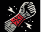 | **Arm** | ATK −1 (fewer attack dice). |
| 3 |  | **Leg** | MOV −1 (reduced movement). |

A model may accumulate multiple Permanent Wounds over the course of a campaign. Track them on the model's card or in the Grimheim Companion.

**Healer:** Permanent Wounds can be removed by a Healer in the Hub (see Standard Locations; the Tavern and the Temple offer chancier cures).

#### Survivor table

Models that beat the odds gain experience from their near-death encounter. Roll a D6:

| D6 | Result | Effect |
|----|----|----|
| 1 | **Fleet-Footed** | MOV +1″ |
| 2 | **Stalwart** | Gains Stalwart. A model that already has Stalwart rolls again. |
| 3 | **Onslaught** | ATK +1 for the main-hand weapon. |
| 4 | **Expertise** | Main-hand HTV improved by 1. |
| 5–6 | **Veteran** | Gain the Veteran trait (free OVERWATCH after each activation). |

Survivor bonuses are permanent and remain with the model for the rest of the campaign. The Veteran and Stalwart traits count toward the five-Trait limit; a model that already has five Traits rolls again.

### Step 2 · Heal and Recover

Restore wounds and remove temporary effects. What remains are the results of Step 1: Permanent Wounds, Survivor bonuses and the gaps left by the dead.

**Redistribute Equipment**

Equipment can be freely redistributed between the models of the warband. Equipment of Defeated models returns to the warband.

### Step 3 · Visit the Hub

The warband returns to the Hub to convert its Victory Points to Gold and spend it on new models, upgrades or special benefits. See Visit the Hub.

Example A full After Battle Sequence

Player A's warband of five Humans (MOV 5″) ends a Mission with 6 VP. The Captain, the Swordsman and a Spearman were Defeated. The Crossbowman survived with an Arm Injury from a critical hit. The Witchhunter is unharmed and rolls nothing.

SpearmanDefeated table \[1\] Dead. The Spearman is removed from the warband. SwordsmanDefeated table \[3\] Permanent Wound. D3 \[3\] Leg: MOV 5″ becomes 4″. CaptainDefeated table \[6\] Survivor. Survivor table \[2\] Stalwart: the Captain gains Stalwart and now rolls four Defense Dice. CrossbowmanInjured table \[5\] Healed. The Arm Injury does not persist.

1.  **Lasting Consequences:** as rolled above. The Swordsman keeps MOV 4″ until the Leg wound is removed.
2.  **Heal and Recover:** the four survivors restore their wounds, and temporary effects from the Mission end.
3.  **Visit the Hub:** Player A was not the Underdog, so 6 VP × 20 = 120 Gold.

The warband has lost the Spearman, gained a tougher Captain and carries one Leg wound into the Hub with 120 Gold to spend.

## Visit the Hub

**At a glance**

- Convert VP to Gold (20 per VP, Underdog 30) and sell looted Equipment for its Gold value.
- Each model may visit one location per After Battle Sequence.
- The Healer and the Tavern are always open. Merchants and Trainers are rolled for.
- Your faction may have locations of its own.

After determining the fate of all casualties, players may spend their earned Gold at the locations of their Camp in the Grimheim Hub.

### Gold

**Gold earned:** convert the Victory Points earned during the Mission to Gold at a rate of 20 Gold per VP.

**Underdog:** a player who received at least 5 VP fewer than any other player in the previous Mission converts Victory Points at 30 Gold per VP in this Mission (see Victory Rewards).

**Equipment:** a player may sell any Equipment that has been looted during a Mission for its corresponding Gold value.

Gold is the campaign's core resource. Use it to recruit new models, upgrade models, recover from lasting injuries and unlock faction-based bonuses.

### Hub Locations

**Key rule**

Each model may visit **one** location during the After Battle Sequence.

<table>
<colgroup>
<col style="width: 33%" />
<col style="width: 33%" />
<col style="width: 33%" />
</colgroup>
<thead>
<tr>
<th>Locations</th>
<th>Available</th>
<th>Limit</th>
</tr>
</thead>
<tbody>
<tr>
<td><strong>Standard Locations</strong> 
Healer, Tavern</td>
<td>Always, for all factions</td>
<td>Each model may use one service</td>
</tr>
<tr>
<td><strong>Merchants</strong> 
Alchemist, Enchanter, Ye Olde Shoppe, Temple, Blacksmith</td>
<td>Roll a D6 after each battle</td>
<td>At most 2 models per warband may buy</td>
</tr>
<tr>
<td><strong>Trainers</strong> 
Marksman, Gladiator, Magus, Old Sage, Rogue</td>
<td>Roll a D6 after each battle</td>
<td>Each Trainer trains one model per warband</td>
</tr>
<tr>
<td><strong>Faction-Specific Activities</strong></td>
<td>Always, in addition to the standard locations</td>
<td>See your faction's rules</td>
</tr>
</tbody>
</table>

### Standard Locations

Some locations, like the Healer and the Tavern, are always available in your camp and accessible to all factions. Each model may use one service at Standard Locations.

#### Healer

<table>
<thead>
<tr>
<th></th>
<th>Service</th>
<th>Effect</th>
<th>Gold</th>
</tr>
</thead>
<tbody>
<tr>
<td>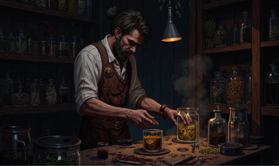</td>
<td colspan="3"><em>The Healer's tent is a sanctuary of herbs, bandages and whispered incantations. Here the wounded find respite, and Permanent Wounds can be mended, for a price.</em></td>
</tr>
<tr>
<td></td>
<td><strong>Heal Minor Wound</strong></td>
<td>Remove one Permanent Wound from a model.</td>
<td>20</td>
</tr>
<tr>
<td></td>
<td><strong>Full Recovery</strong></td>
<td>Remove all Permanent Wounds from a model. That model cannot participate in the next mission.</td>
<td>40</td>
</tr>
</tbody>
</table>

The Healer's services are the primary way to remove Permanent Wounds from your models. Without treatment, these injuries will hinder your warband throughout the campaign.

#### Tavern

<table>
<thead>
<tr>
<th></th>
<th>Service</th>
<th>Effect</th>
<th>Gold</th>
</tr>
</thead>
<tbody>
<tr>
<td>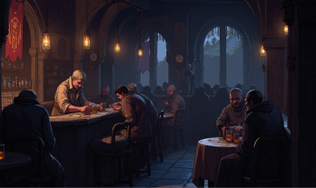</td>
<td colspan="3"><em>The tavern is the heart of the camp: a place where warriors drink, gamble and hear rumours of battles to come.</em></td>
</tr>
<tr>
<td></td>
<td><strong>Recruitment</strong></td>
<td>Add a new model to your warband. 1 Gold equals 1 Point.</td>
<td>–</td>
</tr>
<tr>
<td></td>
<td><strong>Rest</strong></td>
<td>Roll a D6. On a 4+, remove one Permanent Wound from the model through natural recovery.</td>
<td>10</td>
</tr>
<tr>
<td></td>
<td><strong>Gamble</strong></td>
<td>Roll a D6. 1: lose your stake · 2: 5 Gold · 3: 10 Gold · 4: 20 Gold · 5: 30 Gold · 6: 50 Gold.</td>
<td>20</td>
</tr>
<tr>
<td></td>
<td><strong>Gossip</strong></td>
<td>Roll a D6. On a 5+, you may choose a second Side Quest before the next mission.</td>
<td>10</td>
</tr>
<tr>
<td>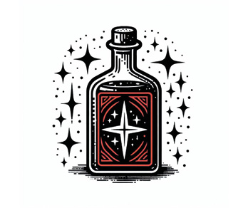</td>
<td><strong>Buy Alcohol</strong></td>
<td>Grants the special rules Fearless and Resilient until the end of the game. Remove after use.</td>
<td>11</td>
</tr>
</tbody>
</table>

Example Healer and Tavern

After the sequence in the previous example, Player A has 120 Gold. During the Mission the Crossbowman looted a Healing Potion.

1.  A sells the looted Healing Potion for its Gold value of 12: 120 + 12 = 132 Gold.
2.  The Swordsman visits the Healer and pays 20 Gold for Heal Minor Wound. The Leg wound is removed and MOV is back to 5″. 112 Gold left.
3.  The Witchhunter visits the Tavern and pays 10 Gold for Gossip. The roll is \[5\], so A may choose a second Side Quest before the next Mission. 102 Gold left.

The Swordsman could have tried Rest at the Tavern instead: half the price, but the wound only goes on a 4+.

The Swordsman is fit again, the next Mission brings an extra Side Quest, and 102 Gold remain. The Swordsman and the Witchhunter have used their one visit.

### Faction-Specific Activities

Certain factions have access to unique locations and services. These are always available in addition to the standard locations. Refer to your faction's rules section for the available services, costs and effects.

## Merchants

**At a glance**

- After each battle roll a D6 to see which merchant is in the Hub. On a 6 all of them are.
- At most 2 models per warband may buy from merchants.
- A purchase goes to the model at once and stays with it for the campaign unless noted.

Not all merchants are present in the Hub after every battle. Roll 1D6 to determine which Vendors and Artisans are available:

| D6 |  | Available merchant |
|----|----|----|
| 1 | 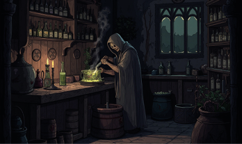 | Alchemist |
| 2 | 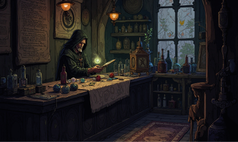 | Enchanter |
| 3 | 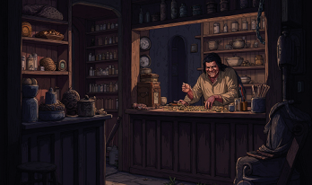 | Ye Olde Shoppe |
| 4 | 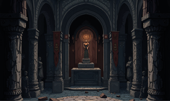 | Temple |
| 5 | 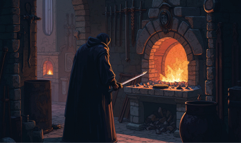 | Blacksmith |
| 6 |  | All merchants are available |

A maximum of 2 models per warband may purchase items or services from merchants.

Merchants offer Equipment for purchase. The complete list of all available Equipment is in the Appendix. Equipment purchased from vendors is added to the model immediately and can be redistributed as described in Redistribute Equipment.

### Alchemist

<table>
<thead>
<tr>
<th></th>
<th>Offer</th>
<th>Effect</th>
<th>Gold</th>
</tr>
</thead>
<tbody>
<tr>
<td></td>
<td colspan="3"><em>In his cluttered workshop, the alchemist held a vial up to the light, the liquid inside swirling like molten gold. “One drop could grant eternal life,” he whispered, but his trembling hands betrayed the truth: he had never dared to test it.</em></td>
</tr>
<tr>
<td>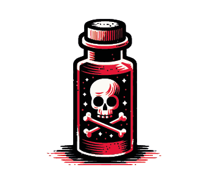</td>
<td><strong>Buy Poison</strong></td>
<td>The weapons of the model gain the Poison special rule.</td>
<td>10</td>
</tr>
<tr>
<td>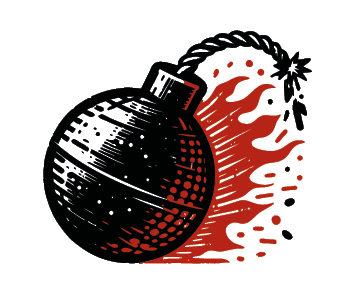</td>
<td><strong>Buy Fire Bomb</strong></td>
<td>Counts as a Ranged Weapon: RNG 6″, ATK 4, HTV 4+, DMG 3, CRT 4; Blast, Limited.</td>
<td>13</td>
</tr>
<tr>
<td>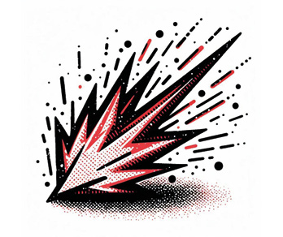</td>
<td><strong>Buy Flash Powder</strong></td>
<td>Reduces the ACT cost of the FALL BACK action to 1.</td>
<td>3</td>
</tr>
<tr>
<td>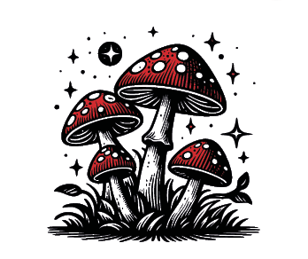</td>
<td><strong>Buy Magic Mushrooms</strong></td>
<td>This model may perform the special action OVEREXERTION until the end of the game. Remove after use.</td>
<td>17</td>
</tr>
<tr>
<td>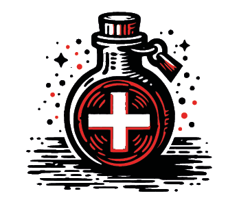</td>
<td><strong>Buy Healing Potion</strong></td>
<td>Select a friendly model within 1″. That model regains 2D6 lost Wounds. If this healing fully restores the model's VIT to its original value, any existing Injury effects are also removed.</td>
<td>12</td>
</tr>
</tbody>
</table>

### Enchanter

<table>
<thead>
<tr>
<th></th>
<th>Offer</th>
<th>Effect</th>
<th>Gold</th>
</tr>
</thead>
<tbody>
<tr>
<td></td>
<td colspan="3"><em>With a flick of his hand, glowing runes appeared in the air, swirling in intricate patterns. As the final symbol faded, the blade on the table hummed with dark energy. “It's ready,” he whispered, though the cost of such power lingered heavy in the air.</em></td>
</tr>
<tr>
<td>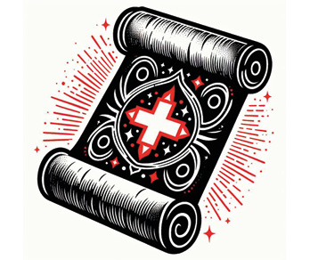</td>
<td><strong>Buy Magic Scroll of Healing</strong></td>
<td>This model may perform the special action HEAL once. Remove after use.</td>
<td>10</td>
</tr>
<tr>
<td>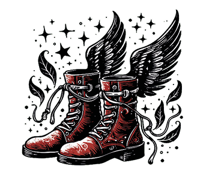</td>
<td><strong>Buy Boots of Flying</strong></td>
<td>Grants the special rule Fly.</td>
<td>12</td>
</tr>
<tr>
<td>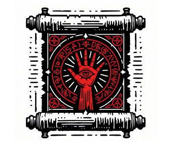</td>
<td><strong>Buy Magic Scroll of Reanimation</strong></td>
<td>Grants the special action CAST A SPELL with the ability Reanimate the Dead: any defeated model within 8″ can be revived as a Zombie with its original weapons: MOV 4″, SAV 6+, VIT 8; Resilient, Slow, Necrotic Hunger. Usable once per game.</td>
<td>23</td>
</tr>
<tr>
<td>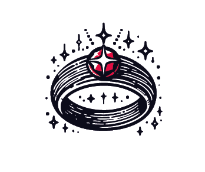</td>
<td><strong>Buy Spectral Band</strong></td>
<td>Grants the Spectral special rule.</td>
<td>7</td>
</tr>
<tr>
<td>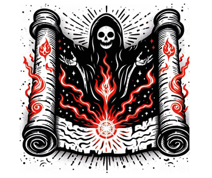</td>
<td><strong>Buy Magic Scroll of Cursed Souls</strong></td>
<td>Select one enemy model. That model immediately gains the status effect Cursed. Remove after use.</td>
<td>6</td>
</tr>
<tr>
<td>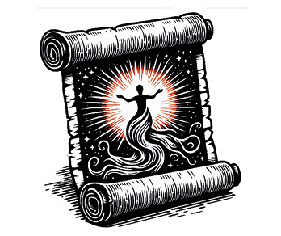</td>
<td><strong>Buy Magic Scroll of Resurrection</strong></td>
<td>Grants the special action CAST A SPELL with the ability Resurrection: this model may choose a friendly model that is Defeated. On a roll of 4+, the model returns to life with half its VIT value. Remove after use.</td>
<td>25</td>
</tr>
</tbody>
</table>

### Ye Olde Shoppe

<table>
<thead>
<tr>
<th></th>
<th>Offer</th>
<th>Effect</th>
<th>Gold</th>
</tr>
</thead>
<tbody>
<tr>
<td></td>
<td colspan="3"><em>In the dimly lit shop, shelves overflowed with strange trinkets and forgotten relics. The shopkeeper watched silently as customers browsed, knowing that some items carried more than just a price: they carried stories best left untold.</em></td>
</tr>
<tr>
<td>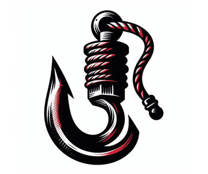</td>
<td><strong>Buy Grappling Hook</strong></td>
<td>This model can climb or drop without spending movement or suffering penalties. It may also climb even without climbing aids.</td>
<td>6</td>
</tr>
<tr>
<td>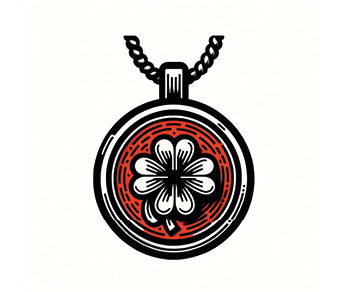</td>
<td><strong>Buy Lucky Charm</strong></td>
<td>This model gains 1 Reroll per turn.</td>
<td>8</td>
</tr>
<tr>
<td>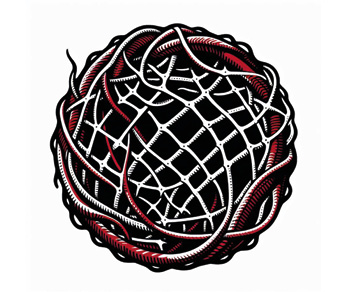</td>
<td><strong>Buy Net</strong></td>
<td>Opponents in Close Combat cannot use the FALL BACK action.</td>
<td>5</td>
</tr>
<tr>
<td>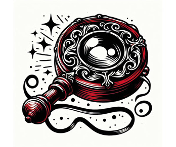</td>
<td><strong>Buy Spy Glass</strong></td>
<td>When making a Ranged Attack, the target does not benefit from Cover.</td>
<td>5</td>
</tr>
<tr>
<td>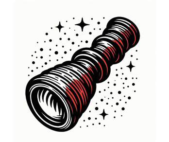</td>
<td><strong>Buy Telescope</strong></td>
<td>Improve the HTV by 1 for all ranged attacks made by this model.</td>
<td>8</td>
</tr>
</tbody>
</table>

### Temple

<table>
<thead>
<tr>
<th></th>
<th>Offer</th>
<th>Effect</th>
<th>Gold</th>
</tr>
</thead>
<tbody>
<tr>
<td></td>
<td colspan="3"><em>Tucked between narrow streets, the small temple stood as a quiet refuge in the bustling city. Its candles burned day and night, though few dared enter: rumours claimed the gods within listened too closely to those who prayed.</em></td>
</tr>
<tr>
<td>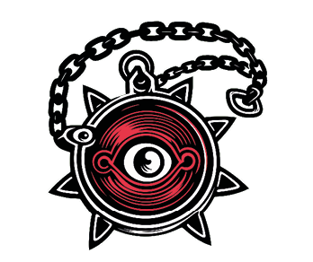</td>
<td><strong>Buy Amulet of Protection</strong></td>
<td>Grants the special rule Protected.</td>
<td>12</td>
</tr>
<tr>
<td></td>
<td><strong>Blessing</strong></td>
<td>Get 1 extra Fate Die for the next played scenario.</td>
<td>15</td>
</tr>
<tr>
<td></td>
<td><strong>Prayer</strong></td>
<td>Roll a D6. On a 4+ you can remove 1 Permanent Wound from a model.</td>
<td>10</td>
</tr>
<tr>
<td>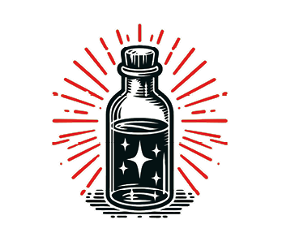</td>
<td><strong>Buy Blessed Water</strong></td>
<td>This model may use the special action CLEANSE. Remove after use.</td>
<td>4</td>
</tr>
<tr>
<td>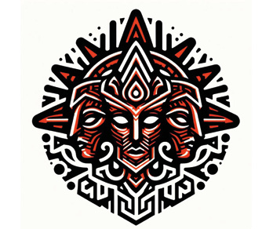</td>
<td><strong>Buy Idol of the Gods</strong></td>
<td>Generates 1 additional Fate Die per turn.</td>
<td>15</td>
</tr>
</tbody>
</table>

### Blacksmith

<table>
<thead>
<tr>
<th></th>
<th>Offer</th>
<th>Effect</th>
<th>Gold</th>
</tr>
</thead>
<tbody>
<tr>
<td></td>
<td colspan="3"><em>The forge blazed as hammer struck metal, each blow ringing out with purpose. Sparks flew, casting shadows on the walls, but the true magic lay in the smith's hands, shaping weapons that would decide the fate of empires.</em></td>
</tr>
<tr>
<td></td>
<td><strong>Weapon Upgrade</strong></td>
<td>Improve the HTV of one of the model's weapons by 1. Can only be used once per weapon.</td>
<td>30</td>
</tr>
<tr>
<td></td>
<td><strong>Armor Upgrade</strong></td>
<td>Level up the SAV value of a model by 1. Can only be used once per model.</td>
<td>25</td>
</tr>
<tr>
<td></td>
<td><strong>Buy Shield</strong></td>
<td>The Shield trait (see the Appendix).</td>
<td>7</td>
</tr>
<tr>
<td></td>
<td><strong>Buy Sword</strong></td>
<td>Weapon from the Character Builder: 1″, ATK 3, HTV 4+, DMG 2, CRT 3, Master Parry.</td>
<td>12</td>
</tr>
<tr>
<td></td>
<td><strong>Buy Spear</strong></td>
<td>Weapon from the Character Builder: 2″, ATK 3, HTV 4+, DMG 2, CRT 3, Reach.</td>
<td>12</td>
</tr>
<tr>
<td></td>
<td><strong>Buy Crossbow</strong></td>
<td>Weapon from the Character Builder: 12″, ATK 3, HTV 4+, DMG 3, CRT 4, Armor Piercing, Reloading.</td>
<td>19</td>
</tr>
<tr>
<td></td>
<td><strong>Buy Blunderbuss</strong></td>
<td>Weapon from the Character Builder: 8″, ATK 3, HTV 4+, DMG 3, CRT 4, Armor Piercing, Scatter Shot, Black Powder.</td>
<td>18</td>
</tr>
<tr>
<td></td>
<td><strong>Buy Handgun</strong></td>
<td>Weapon from the Character Builder: 16″, ATK 3, HTV 4+, DMG 3, CRT 4, Armor Shatter, Black Powder.</td>
<td>24</td>
</tr>
</tbody>
</table>

Example Buying from a merchant

Player A has 102 Gold left after the Healer and the Tavern. The Swordsman and the Witchhunter have used their visit; the Captain and the Crossbowman have not.

1.  A rolls for merchants: \[3\]. Only Ye Olde Shoppe is open.
2.  The Crossbowman buys a Telescope for 8 Gold. Its ranged attacks are now made with HTV 3+ instead of 4+. 94 Gold left.
3.  The Captain keeps its visit for the Trainers.

On a \[6\] every merchant would be open, but still no more than 2 models of the warband could buy.

The Telescope stays with the Crossbowman for the rest of the campaign; 94 Gold remain.

## Trainers

**At a glance**

- After each battle roll a D6 to see which Trainer is in the Hub. On a 6 choose two.
- Each available Trainer trains one model per warband; different Trainers may train different models.
- A learned Trait is permanent, counts toward the limit of 5, and cannot be learned twice.

Not all trainers are present after every battle. Roll 1D6 to determine which Trainers are available:

| D6 |  | Available trainer |
|----|----|----|
| 1 | 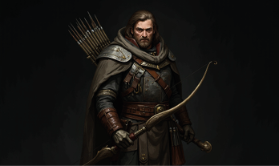 | Marksman |
| 2 | 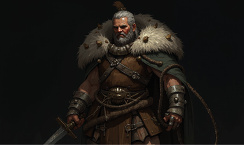 | Gladiator |
| 3 | 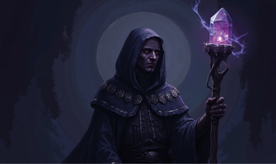 | Magus |
| 4 | 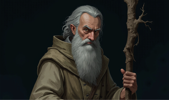 | Old Sage |
| 5 | 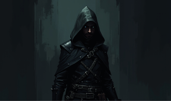 | Rogue |
| 6 |  | Choose two from the list |

Trainers teach Traits that enhance a model's capabilities. All Traits and their effects are listed in the Appendix.

- Newly learned Traits are permanent and count toward a model's maximum of 5 Traits. A model cannot learn a Trait it already possesses or exceed the 5 Trait limit.
- Each available Trainer may train only one model per warband during the After Battle Sequence. If multiple Trainers are available, different models may be trained by different Trainers. For example, if both the Marksman and the Old Sage are available (rolled a 6), one model may learn a Trait from the Marksman and a different model may learn a Trait from the Old Sage.

### Marksman

<table>
<thead>
<tr>
<th></th>
<th>Trait</th>
<th>Effect</th>
<th>Gold</th>
</tr>
</thead>
<tbody>
<tr>
<td></td>
<td colspan="3"><em>The seasoned marksman notched an arrow, his gaze fixed on the distant target. “Precision is everything,” he murmured to his students, releasing the arrow in one smooth motion. It struck dead centre, proof that a steady hand and sharper mind won every battle.</em></td>
</tr>
<tr>
<td></td>
<td><strong>Learn Gunslinger</strong></td>
<td>When this model performs QUICK SHOT, ignore the HTV penalty.</td>
<td>8</td>
</tr>
<tr>
<td></td>
<td><strong>Learn Hunter</strong></td>
<td>May use SHOOT (including QUICK SHOT) twice per activation.</td>
<td>6</td>
</tr>
<tr>
<td></td>
<td><strong>Learn Sniper</strong></td>
<td>May target enemies engaged in Melee without applying the Shoot into Combat disadvantage of potentially hitting a friendly model. May also use the TAKE AIM action. Has no Effective Range penalty.</td>
<td>14</td>
</tr>
<tr>
<td></td>
<td><strong>Learn Hawkeye</strong></td>
<td>Ranged attack rolls of 5+ are critical successes.</td>
<td>4</td>
</tr>
</tbody>
</table>

### Gladiator

<table>
<thead>
<tr>
<th></th>
<th>Trait</th>
<th>Effect</th>
<th>Gold</th>
</tr>
</thead>
<tbody>
<tr>
<td></td>
<td colspan="3"><em>The blade stopped an inch from his student's throat, steady and unshaken. “Strength means nothing without control,” the master growled, lowering his weapon. “Survive the first strike, and the battle is already half won.”</em></td>
</tr>
<tr>
<td></td>
<td><strong>Learn Furious</strong></td>
<td>May perform the FIGHT action twice per activation.</td>
<td>5</td>
</tr>
<tr>
<td></td>
<td><strong>Learn Relentless</strong></td>
<td>May re-roll all Attack Dice once per Close Combat.</td>
<td>13</td>
</tr>
<tr>
<td></td>
<td><strong>Learn Guard</strong></td>
<td>Once per Close Combat, this model may re-roll one of its Attack Dice or Block Dice. A re-rolled Attack Die can only be spent to Parry.</td>
<td>6</td>
</tr>
<tr>
<td></td>
<td><strong>Learn Taunt</strong></td>
<td>Grants the special action TAUNT (1 ACT): choose an enemy model within 8″. In its next activation that model must attack this model if it can (SHOOT, including QUICK SHOT, or CHARGE); if it cannot, it must move towards this model.</td>
<td>6</td>
</tr>
</tbody>
</table>

### Magus

<table>
<thead>
<tr>
<th></th>
<th>Trait</th>
<th>Effect</th>
<th>Gold</th>
</tr>
</thead>
<tbody>
<tr>
<td></td>
<td colspan="3"><em>Cloaked in swirling robes, they raised a hand, drawing energy from the very air. The atmosphere crackled as ancient magic surged through their veins, bending reality itself to their silent command.</em></td>
</tr>
<tr>
<td></td>
<td><strong>Learn Archmage</strong></td>
<td>May cast multiple spells per turn using the CAST A SPELL action.</td>
<td>18</td>
</tr>
<tr>
<td></td>
<td><strong>Learn Conduit</strong></td>
<td>Rolls of 1 when generating Arcane Energy do not cause damage.</td>
<td>18</td>
</tr>
<tr>
<td></td>
<td><strong>Learn Channeler</strong></td>
<td>Roll 3D6 instead of 2D6 when generating Arcane Energy.</td>
<td>7</td>
</tr>
<tr>
<td></td>
<td><strong>Learn Teleport</strong></td>
<td>Use the MOVE action to move the model up to 3× its MOV in a straight line to a position it can see. Ignore all obstacles and terrain in between. Counts as a CHARGE action if the movement ends in Base Contact of an enemy model.</td>
<td>9</td>
</tr>
</tbody>
</table>

### Old Sage

<table>
<thead>
<tr>
<th></th>
<th>Trait</th>
<th>Effect</th>
<th>Gold</th>
</tr>
</thead>
<tbody>
<tr>
<td></td>
<td colspan="3"><em>The elder gazed into the flickering flames, his face etched with years of knowledge. “Truth is not found in answers, but in the questions you ask,” he said quietly. “Seek not the end of your journey, but the lessons along the way.”</em></td>
</tr>
<tr>
<td></td>
<td><strong>Learn Balanced</strong></td>
<td>Once per combat, you may reroll one Attack Die in Close Combat.</td>
<td>2</td>
</tr>
<tr>
<td></td>
<td><strong>Learn Hero</strong></td>
<td>May use the OVEREXERTION action.</td>
<td>5</td>
</tr>
<tr>
<td></td>
<td><strong>Learn Resilient</strong></td>
<td>Unaffected by Fearful and Critical Injuries.</td>
<td>8</td>
</tr>
<tr>
<td></td>
<td><strong>Learn Reveal</strong></td>
<td>All Hidden enemy models within 6″ of this model are immediately revealed and can be targeted.</td>
<td>6</td>
</tr>
<tr>
<td></td>
<td><strong>Learn Mastery</strong></td>
<td>If you score at least one critical success in an Attack Roll, roll 1 additional Attack Die immediately. This die is resolved as part of the same attack sequence.</td>
<td>9</td>
</tr>
</tbody>
</table>

### Rogue

<table>
<thead>
<tr>
<th></th>
<th>Trait</th>
<th>Effect</th>
<th>Gold</th>
</tr>
</thead>
<tbody>
<tr>
<td></td>
<td colspan="3"><em>In the shadows of the candlelit room, he laid out a series of coded messages. “Information is the deadliest weapon,” he whispered to his apprentice. “Move unseen, speak little, and know everything; only then can you control the game without ever being noticed.”</em></td>
</tr>
<tr>
<td></td>
<td><strong>Learn Ambush</strong></td>
<td>This model starts the game in reserve. At any turn after the first, deploy it anywhere, at least 9″ from any enemy model.</td>
<td>4</td>
</tr>
<tr>
<td></td>
<td><strong>Learn Scout</strong></td>
<td>This model is deployed after all other models have been placed. Immediately after deployment, it may make a free move of up to 2× its MOV.</td>
<td>6</td>
</tr>
<tr>
<td></td>
<td><strong>Learn Silent</strong></td>
<td>May perform HIDE and SHOOT in the same activation.</td>
<td>4</td>
</tr>
<tr>
<td></td>
<td><strong>Learn Stealth</strong></td>
<td>Considered in Cover if at least a part of its volume is obscured by a terrain feature.</td>
<td>4</td>
</tr>
<tr>
<td></td>
<td><strong>Learn Strider</strong></td>
<td>Ignores the effects of Difficult or Dangerous terrain.</td>
<td>6</td>
</tr>
<tr>
<td></td>
<td><strong>Learn Swift</strong></td>
<td>Ignore climbing movement penalty.</td>
<td>3</td>
</tr>
</tbody>
</table>

Example Hiring a Trainer

Player A has 94 Gold left. Of the surviving models only the Captain has not visited a location yet. The Captain carries 3 Traits.

1.  A rolls for Trainers: \[6\]. A chooses two from the list: the Gladiator and the Old Sage.
2.  A fourth Trait keeps the Captain within the limit of 5, and the Captain does not have Guard yet.
3.  The Captain learns Guard from the Gladiator for 6 Gold: from now on, once per Close Combat, it may re-roll one of its Attack Dice or Block Dice. 88 Gold left.
4.  The Old Sage could train a different model, but every surviving model has already used its one visit, so the Old Sage stays idle this time.

Over the whole Hub visit Player A healed a wound, bought a Telescope, taught the Captain Guard and kept 88 Gold.
