# Game Rules

*The core of the game. This chapter explains how a battle is set up, how a turn runs, what models can do, and how sight, movement, terrain, combat, damage, status effects and magic work.*

## Setup

**At a glance**

- Agree on a point limit (600 PTS is the standard) and a Mission. Without another agreement, play Encounter.
- The Mission tells you how to build the table, who attacks and who defends, where the objectives lie and where the warbands deploy.
- Score Victory Points for controlling and holding objectives (within 2″ and in Line of Sight) and 2 VP the first time each enemy model is Defeated.

Every battle is fought as a Mission. Agree on a point limit (see Points and Size) and on a Mission before the game. Unless you agree on another one, play Encounter, the standard Mission and the example used throughout this book.

### The setup in five steps

1.  **Mission and Region.** Choose a Mission, a Battlefield Region and, if you like, one Battle Condition (see Regions of Grimheim).
2.  **Terrain.** Build the battlefield as the Mission says (see Setup Terms). The standard battlefield is 30″ × 30″.
3.  **Roles and objectives.** Settle the roles and place the objectives as the Mission says.
4.  **Side Quests.** Each player may choose one Side Quest.
5.  **Deployment.** Deploy as the Mission says; by default the players alternate, one model at a time, each wholly within their own Deployment Zone.

The player with the most Victory Points (VP) at the end of the game wins. Equal VP is a draw.

#### Terrain

Use a mix of large and small terrain pieces for varied lines of sight, routes and cover. Before you place it, agree on the type of every terrain piece (see Terrain). Each Region of Grimheim lists suitable pieces and how many of them to use.

#### Deployment Zones

A Deployment Zone is the area in which a player sets up their models before the game. Its size and position depend on the Mission. In Encounter each zone is the band within 6″ of a player's table edge, so the zones lie 18″ apart.

#### Objectives

Objectives are points of interest that give Victory Points as the Mission describes: Objective Markers spread over the table, or one Objective Area at its centre (see Mission Rules).

#### Looting

Looting is optional. A model within 1″ of a Loot Site may use the INTERACT action to loot it: roll on the Equipment Table (see Appendix) to see what, if anything, it finds. **Each Loot Site can be looted once per game.** In Encounter every Objective Marker is also a Loot Site. Looting gives no Victory Points unless the Mission says so.

Looting carries a small risk: a roll of 11 on the Equipment Table triggers a trap.

### Scoring

Earn Victory Points from the mission goals:

- controlling and holding objectives,
- defeating enemy models,
- completing Side Quests,
- mission-specific goals.

**Control and hold**

A player **controls** an objective if at least one of their models is within 2″ of it and has Line of Sight to it. Both players can control the same objective. A player **holds** it if more of their models control it than enemy models do. In Encounter: **1 VP** for each objective you control and **+1 VP** for each objective you hold, at the end of each turn.

**Fig. 3.1** A and D control the marker, and so does C. B is within 2″, but the wall blocks its Line of Sight: it does not count.

Example Scoring one objective

At the end of the turn the situation is as in Fig. 3.1.

1.  Friendly A and D are within 2″ and see the marker: the friendly player controls it, **1 VP**.
2.  Enemy C is within 2″ and sees the marker: the enemy player also controls it, **1 VP**.
3.  Enemy B is within 2″ but the wall blocks its sight, so it does not count.
4.  Two friendly models control the marker against one enemy: the friendly player holds it, **+1 VP**.

Friendly player 2 VP, enemy player 1 VP from this objective.

#### Defeating enemy models

Each player scores **2 VP** the first time an enemy model is Defeated in this game. A model that returns to play and is Defeated again gives no further VP. NPCs, Garrison models and Structures are not enemy models for this rule.

## Turns

**At a glance**

- A battle lasts 4 turns. A 5th turn, Overtime, is played if one player trails by 5 VP or more.
- Each turn: Initiative, Fate, Actions, End.
- Players alternate activating one model at a time. A model spends its ACT, then it is done for the turn.

**Fig. 3.2** The turn wheel. **1** Initiative, **2** Fate, **3** Actions, **4** End. Four turns make a battle.

A standard battle lasts 4 turns. Each turn has four phases:

1.  **Initiative Phase.** Both players roll a D6. The higher result has the initiative this turn. Roll again on a tie.
2.  **Fate Phase.** Each player rolls their Fate Dice.
3.  **Action Phase.** Players alternate activating their models, starting with the player who has the initiative.
4.  **End Phase.** Unused Fate Dice expire and VP are scored.

### 1 · Initiative Phase

Both players roll a D6. The higher result gains the initiative for the turn. On a tie, roll again.

**Overtime**

Overtime is checked after scoring in turn 4. If one player then has at least 5 VP fewer than their opponent, a 5th turn is played. Side Quests judged at the end of the game do not count toward this check. Stronghold Missions are never extended by Overtime.

### 2 · Fate Phase

Each player rolls as many Fate Dice as their Fate Modifier gives (see Fate Modifier). Fate Dice are spent in the Action Phase.

**Against the Odds**

If your warband’s total point cost is at least 20 points lower than your opponent’s, you gain +1 Fate Die each turn.

Example Against the Odds

Warband A costs 598 pts, warband B costs 625 pts. The difference is 27 pts, at least 20, so the player of warband A rolls one extra Fate Die in every Fate Phase of the game.

### 3 · Action Phase

Players take turns activating ready models, starting with the player who has the initiative.

- A model performs actions by spending its Actions (ACT).
- After it has spent all ACT, or used the PASS action, the model is no longer ready.
- Players alternate until no ready models remain.
- If one player has no ready models left, the other player activates all of their remaining ready models one after another.

#### Group Activation

Models with the Henchmen or Swarm trait may be activated one after another, before the opponent activates their next model.

#### Outnumbered

At the start of the turn, if your warband has at least 2 models fewer than your opponent’s, you gain 1 free OVERWATCH for every 2 models fewer, rounded down.

- A free Overwatch may be given to any model, even one that has already been activated this turn.
- The restrictions of the Overwatch action apply: not while in Base Contact.

Example Outnumbered

At the start of turn 3 player A has 7 models left and player B has 3. B has 4 models fewer: 4 ÷ 2 = **2 free Overwatch**. With 6 against 3 it would be 3 ÷ 2 = 1.5, rounded down to **1**.

B gives one free Overwatch to their Crossbowman, who has already acted this turn, and one to their Captain. The Captain is in Base Contact with an enemy and cannot take it. B gives it to another model instead.

#### Reactions

Only models on Overwatch may react when an enemy action is declared, for example to dodge a shot or to intercept a movement. Reactions are resolved before the enemy action and cost no ACT: the ACT was paid when the model went on Overwatch. See Reactions.

### 4 · End Phase

- The turn ends when no ready models remain.
- Unused Fate Dice expire.
- Score VP as the active mission describes.

Use tokens or turn the model cards to track which models have activated.

## Actions

**At a glance**

- A model spends its ACT on actions. Most cost 1 ACT, RUN and FALL BACK cost 2.
- A model may not perform the same action twice in one activation, unless a rule allows it.
- Some actions exclude others in the same activation. The table below shows which.

The following actions are available to all models. A model may not perform the same action more than once per activation, unless a rule says otherwise.

### Action menu

| Action | ACT | Base Contact | Not in the same activation as |
|----|----|----|----|
| MOVE | 1 | not allowed | RUN, CHARGE, FALL BACK, SHOOT, TAKE AIM |
| RUN | 2 | not allowed | MOVE, CHARGE, FALL BACK, SHOOT, QUICK SHOT, OVERWATCH, TAKE AIM |
| CHARGE | 1 | not allowed (ends in it) | MOVE, RUN, FALL BACK, HIDE, OVERWATCH, TAKE AIM |
| FIGHT | 1 | required |  |
| SHOOT | 1 | not allowed | MOVE, RUN, FALL BACK, HIDE, QUICK SHOT, OVERWATCH |
| QUICK SHOT | 1 | not allowed | RUN, HIDE, SHOOT, OVERWATCH |
| FALL BACK | 2 | required | MOVE, RUN, CHARGE, SHOOT, TAKE AIM |
| OVERWATCH | 1 | not allowed | RUN, CHARGE, SHOOT, QUICK SHOT |
| HIDE | 1 | not allowed | SHOOT, QUICK SHOT, CHARGE, TAKE AIM |
| INTERACT | 1 | not allowed, unless stated | may be repeated |
| RECOVER | 1 | not allowed, unless stated |  |
| PASS | 1 | allowed | may be repeated |

The table lists each restriction from both sides: SHOOT forbids HIDE, so HIDE also lists SHOOT. TAKE AIM is a special action and appears here only as a restriction.

Move

Move the model up to its MOV in inches. It may not move through other models or impassable terrain, or into Base Contact with enemies.

Not while in Base Contact with an enemy model.

Run

Move up to twice the model’s MOV. It may not move through other models or impassable terrain, or into Base Contact with enemies. Counts as a MOVE action.

Not while in Base Contact with an enemy model, and not in the same activation as MOVE, CHARGE or FALL BACK.

Charge

Move up to MOV + 2″. The move must end in Base Contact with an enemy model. The charger gets +1 ATK in the following Close Combat. Jumping down from a height of up to 3″ grants +1 critical hit in that fight.

Not while already in Base Contact, and not in the same activation as MOVE, FALL BACK or HIDE.

Fight

Start a Close Combat as the Attacker (see Close Combat).

Only while in Base Contact with an enemy model.

Shoot

Make a Ranged Attack with one of the model’s ranged weapons (see Ranged Combat).

Not while in Base Contact, and not in the same activation as MOVE, RUN, FALL BACK, HIDE or OVERWATCH.

Quick Shot

Make a Ranged Attack with one of the model’s ranged weapons. Its HTV is worsened by 1 (minimum 6+). Counts as a SHOOT action.

Not while in Base Contact, and not in the same activation as RUN, HIDE or OVERWATCH.

Fall Back

Move as with a normal MOVE, but the model may pass through Base Contact with enemies. It must not end in Base Contact.

Only while in Base Contact. Not in the same activation as MOVE, CHARGE or SHOOT.

Overwatch

Place the model on Overwatch. While on Overwatch it may declare one Reaction. Overwatch ends when that Reaction is resolved or when the model is next activated, whichever comes first.

Not while in Base Contact, and not in the same activation as RUN, CHARGE, SHOOT or QUICK SHOT. A Veteran’s free Overwatch after its activation ignores the SHOOT and QUICK SHOT restriction.

Hide

If the model is in Cover and out of every enemy’s Line of Sight, it becomes Hidden (see Hidden).

Not while in Base Contact, and not in the same activation as SHOOT or CHARGE.

Interact

Use an Objective, a Weapon or an Entryway within 1″, or hand over an item to a friendly model within 1″. May be used several times in the same activation.

Not while in Base Contact, unless stated otherwise.

Recover

Remove the status effects Burning, Fearful, Stunned and Frozen.

Not while in Base Contact, unless stated otherwise.

Pass

No effect. May be used several times in the same activation, to end the model’s activation early.

Example Planning an activation

An Archer (ACT 2, MOV 5″) with a Long Bow (RNG 18″, ATK 3, HTV 3+) stands in the open, 20″ from the nearest enemy, out of range.

1.  The Archer cannot MOVE and then SHOOT: SHOOT is not allowed in the same activation as MOVE.
2.  It can MOVE 5″ to a low wall, now 15″ from the enemy, and use QUICK SHOT. QUICK SHOT worsens its HTV by 1, and Effective Range worsens it by 1 more because the target is over 8″ away: it hits on 5+.
3.  Next turn it stays behind the wall and uses SHOOT at HTV 4+ (only Effective Range applies). With its second ACT it cannot HIDE, because HIDE is not allowed in the same activation as SHOOT. Nor can it go on OVERWATCH after shooting, so its second ACT is a PASS. If the player would rather watch the lane, the Archer gives up the shot and goes on OVERWATCH instead.

Moving costs accuracy. Standing still keeps it. Shooting and watching are two different turns.

 Example Charge and fight

The Swordsman (MOV 5″) is 6″ from a Skeleton Warrior.

1.  A MOVE of 5″ does not reach, and MOVE may not end in Base Contact anyway.
2.  CHARGE moves up to MOV + 2″ = 7″. It ends in Base Contact and gains +1 ATK for the following fight.
3.  With its second ACT it declares FIGHT and rolls 3 + 1 + 1 = 5 Attack Dice: its ATK, +1 for the charge and +1 for Attacker’s Advantage.

CHARGE is the only way into Base Contact, and it pays for itself with the extra attack.

### Interact in detail

The INTERACT action lets a model use objects on the battlefield on purpose. It may be used several times in the same activation, as long as the model has ACT left. What it does depends on the object:

- **Entryways.** Doors and gates within 1″ can be opened or closed.
- **Weapons and equipment.** Some weapons and items need an interaction to work. Black powder weapons must be reloaded with INTERACT after firing. INTERACT may also clear jams or restore a weapon, if its rules say so.
- **Objectives and Loot Sites.** Within 1″ of the object, a model can loot it, take resources or fulfil a mission goal. The mission defines how often and for what.
- **Mission objects.** Some missions have special objects with their own INTERACT effects. Their briefing overrides the standard rules.
- **Hand over.** Give one item from the Equipment table to a friendly model within 1″. Weapons and armor cannot be handed over. The recipient can use the item’s trait only while it carries the item.

#### Looting

When a model is within 1″ of a Loot Site, it may spend one action to INTERACT with it and loot it.

- A Loot Site can be looted once per game. Roll on the Equipment Table to find out which item is found.
- In Encounter all Objective Markers count as Loot Sites. Other missions may name other or additional Loot Sites.
- Looting gives no Victory Points unless the Mission says so.

Print the equipment cards you find and place them next to the model card.

## Special Actions

**At a glance**

- Special actions are only available if a trait, the faction or an item grants them.
- They count as actions, cost ACT, and cannot be repeated in one activation unless stated.

Special actions can only be performed if a trait, a faction ability or a piece of equipment grants them. They count as actions. Unless stated otherwise, a model cannot perform the same special action more than once per activation.

Take Aim

The next Ranged Attack this model makes in this activation has its HTV improved by 1 (minimum 2+).

Not while in Base Contact, and not in the same activation as MOVE, RUN, CHARGE, FALL BACK or HIDE.

Command

Choose one friendly model within 12″. If it has not activated this turn, it gains +1 ACT for its activation. If it has already activated this turn, it immediately performs one action.

Raise Shield

Until the start of the model’s next activation or action, it counts as being in Cover against Ranged Attacks. This does not stack with Cover from terrain.

Not while in Base Contact with an enemy model.

Overexertion

Gain +2 ACT this turn. The model may use SHOOT or FIGHT twice. Next turn the model can only use HIDE, RECOVER or PASS.

Heal

Choose a friendly model within 1″. It regains 2D3 lost Vitality and loses the Poisoned status. If this restores its full original VIT, its Injury effects are also removed.

Not while in Base Contact with an enemy model.

Cleanse

Choose a friendly model within 1″; the model may choose itself. Remove any of these status effects: Burning, Cursed, Poisoned, Fearful, Stunned, Frozen.

Not while in Base Contact with an enemy model.

Cast a Spell

Roll 2D6 for Arcane Energy and cast a spell of your Arcane Lore with equal or lower cost. Each 1 rolled causes 2 Fatal Damage. Magic Scrolls are cast without rolling (see Arcane & Divine Powers).

Invocation

Roll 2D6 for Divine Energy and invoke a power of your Divine Lore with equal or lower cost.

Example Command

The Captain uses COMMAND on two different turns.

1.  Turn 1: it chooses a friendly Crossbowman, 9″ away, who has not activated yet. When the Crossbowman activates, it has 2 + 1 = 3 ACT.
2.  Turn 2: the Swordsman has already activated and stands in Base Contact with an Orc. The Captain commands it, and the Swordsman immediately performs one action: a FIGHT.

Before activation, COMMAND adds an ACT. After activation, it buys one extra action at once.

Example Taking aim from a roof

A Marksman with a Bow (HTV 3+) stands on a rooftop and has not moved. It uses TAKE AIM, then SHOOT. Its HTV becomes 2+. Had the target been more than 8″ away, Effective Range would worsen it again to 3+.

## Reactions

**At a glance**

- Only a model on Overwatch can react, once, when an enemy declares an action that meets a trigger.
- The Reaction is resolved first, then the enemy action finishes.
- Four Reactions: Retreat, Dodge, Intercept, Reaction Shot.

Sometimes a warrior’s reflexes are faster than any plan. A model that has taken the OVERWATCH action can interrupt an enemy the moment it acts. Reactions count as an action.

### The reaction sequence

1.  **Declare.** An enemy model declares an action.
2.  **React.** Before any dice are rolled, one friendly model that is on Overwatch and meets a trigger may declare one Reaction.
3.  **Resolve.** Resolve the Reaction immediately, then finish the enemy action.

### Rules for reacting

- The reacting model must be on Overwatch. Models not on Overwatch cannot react.
- Overwatch ends when the Reaction is resolved or when the model is next activated, whichever comes first.
- The model must not be Stunned, Frozen or Defeated.
- One Reaction per enemy action. Reactions never trigger further Reactions.
- Reactions cost no ACT: the ACT was paid when Overwatch was declared.
- A model is either on Overwatch or not. A free Overwatch (Veteran, Outnumbered) does not stack with a paid one or with another free one.
- All normal rules for Line of Sight, Cover and weapon restrictions apply.

Retreat

**Trigger:** a CHARGE declared against the reacting model.

The model immediately moves D3 + 1″ directly away from the charging enemy, following normal movement rules. It must not end in Base Contact with any enemy and may not pass through enemy models. If the distance is more than the charger’s remaining movement, the models are no longer in Base Contact and the CHARGE fails. The charger ends its move at its maximum range toward the target.

Dodge

**Trigger:** a SHOOT or CAST A SPELL action that targets the reacting model.

The model rolls one additional Defense Die against that single attack. Apply this before Fate Dice or other modifiers.

Intercept

**Trigger:** an enemy model moves within 2″ of the reacting model at any point of a MOVE, RUN, CHARGE or FALL BACK.

The model makes 1 attack with one of its weapons, its ATK worsened by 1. The attack is resolved like a ranged attack: the target makes only a defence roll and cannot strike back. Resolve it at once, then the enemy continues its move if it can.

Reaction Shot

**Trigger:** an enemy model comes within 8″ of the reacting model at any point of a MOVE, RUN, CHARGE or FALL BACK.

Make a Ranged Attack against the triggering model with ATK reduced by 1 (minimum 1) and HTV worsened by 1 (minimum 6+).

**Fig. 3.3** B runs along the lane. The moment it comes within 8″ of A, A may make a Reaction Shot. Then B finishes its run, if it still can.

Example Reaction Shot

The Marksman with a Bow (RNG 14″, ATK 3, HTV 3+) went on OVERWATCH last activation. An Orc Brute declares a RUN across the lane.

1.  The trigger is met when the Orc comes within 8″ of the Marksman. The Marksman declares a Reaction Shot.
2.  ATK 3 − 1 = 2 dice, HTV 3+ worsened to 4+. The Marksman rolls \[5\] \[2\]: one success.
3.  The Orc rolls its Defense Dice as usual, damage is applied, and then the Orc finishes its run.

The Marksman’s Overwatch ends after this Reaction.

Example Retreat breaks a charge

The Swordsman (MOV 5″) charges a Skeleton Warrior on Overwatch 5″ away. CHARGE allows up to 7″.

1.  The Skeleton declares Retreat and rolls D3 + 1: \[5\] reads as 3 on a D3, so it moves 4″ straight back.
2.  The Swordsman had 7″ for the whole charge. 5″ to the old position plus 4″ is 9″, more than it has.
3.  The charge fails: the Swordsman ends its move 7″ toward the target, not in Base Contact.

The CHARGE action is spent, and the Swordsman has no FIGHT this activation.

Reactions reward position: keep an eye on your remaining ACT and on your opponent’s next move.

## Sight & Targeting

**At a glance**

- A model sees a target if any part of it is visible and it is not Hidden. Models see all around and through friends.
- **Cover:** within 1″ of terrain and mostly hidden by it. Improves SAV by 1 against ranged attacks. No Cover against an attacker within 2″.
- **Hidden:** HIDE in Cover and out of every enemy’s sight. Cannot be targeted except from Base Contact.

Some actions, ranged attacks above all, need the model to see its target.

**Line of Sight**

A model has Line of Sight (LoS) to a target if the target is at least partly visible and not Hidden. Models see all around them (360°) and see through friendly models.

### Checking visibility

Look from behind the attacking model. If you can trace a clear, unobstructed line from its head to any part of the target’s body, the target is visible.

Use the model’s base as the reference for Line of Sight and Cover. Ignore decorative parts and anything that sticks out over the base.

### Cover

A model is in **Cover** if both are true:

- it is within 1″ of a terrain feature, small or large, and
- most of its volume is hidden by that feature, seen from the attacker.

Models within 2″ of an attacker gain no Cover from it: they are too close.

**Cover bonus**

A model in Cover improves its SAV by 1 (to a minimum of 2+) against Ranged Attacks. Cover never gives more than this, whatever its source.

**Fig. 3.5** The shooter **S** aims at three targets. **1** stands in the open. **2** stands behind the low wall: it is in Cover. **3** is out of Line of Sight behind the house: it cannot be targeted at all.

### Hidden

**Fig. 3.6** The rogue **R** is in Cover and out of Line of Sight of **A**: it can become Hidden. Enemy **B** stands in Base Contact and may still target it.

If a model performs HIDE while it is in Cover and outside the Line of Sight of every enemy model, it becomes Hidden. A Hidden model cannot be targeted by enemies that are not in Base Contact with it.

It stays Hidden until it moves or performs an action that is not compatible with HIDE.

Hidden models can still control objectives.

Example Going into hiding

A Goblin scout ends a MOVE behind a ruined wall, within 1″ of it. No enemy can see any part of it.

1.  With its second ACT it uses HIDE. It is in Cover and out of every enemy’s sight, so it becomes Hidden.
2.  In the enemy’s activation, a Crossbowman walks around the wall and now sees the Goblin. It stays Hidden: it has not moved or acted, and Hidden only ends by its own actions.
3.  Next turn the Goblin MOVEs. Hidden ends.

Only an enemy in Base Contact could have attacked it while it was Hidden.

## Movement

**At a glance**

- A model moves up to its MOV in inches per movement action.
- Climb costs 1″ extra and needs a ladder or rope. Jump gaps up to half MOV. Traverse low obstacles for 2″. Drop 2″ for free.
- **Base Contact:** bases touch or are within 1″. Needed for close combat.

Unless stated otherwise, a model moves a number of inches up to its MOV. Some kinds of movement change how far it gets or how it deals with terrain and other models.

**Base Contact**

Two models are in Base Contact when their bases touch or are within 1″ of each other. Base Contact is required for Close Combat, and CHARGE, PUSH, INTERACT and many special rules refer to it.

**Fig. 3.7** The Swordsman charges: the move is measured along the path from the front of its base and must end in Base Contact.

| Movement | Rule |
|----|----|
| **Climb** | Reduce movement by 1″ to climb up or down vertically. Unless stated otherwise, the model needs a climbing aid such as a ladder or rope. |
| **Jump** | Jump across a gap of up to half the model’s MOV. Counts as part of normal movement. |
| **Traverse** | Move over an obstacle lower than the model by spending 2″ of movement. |
| **Drop** | Drop down up to 2″ without spending MOV. For a higher drop, roll a Defense Die for each inch above 2″: each failed roll causes 1 damage. |
| **Push** | A move action. See below. |
| **Run** | The RUN action doubles the model’s MOV for this move. It cannot be combined with other kinds of movement, except Jump or Push. |
| **Fly, Teleport** | Models with the Fly or Teleport trait ignore all obstacles and terrain while moving. The move must start and end on open terrain. |
| **Falling** | If a model falls by accident from more than 2″, roll a Defense Die for each inch above 2″. Each failed roll causes 1 damage. A roll of 1 also Stuns the model. |
| **Jump Attack** | A model that CHARGEs from a height of up to 3″ and enters Base Contact as part of a Drop gains one additional critical hit in the following Close Combat. |

**Fig. 3.8a** A ruined house with an upper floor. **1** the archer stands on Elevated Ground, **2** a fighter climbs the ladder, **3** a fighter on the ground.

Example Up the ladder

An Elf (MOV 5″) stands 1″ from a ladder that leads 3″ up to a ruined floor.

1.  Walk to the ladder: 1″.
2.  Climb 3″ up: 3″ plus 1″ for climbing = 4″.

Total 5″: one MOVE brings the Elf onto the floor. Without the ladder it could not climb at all.

Example A long drop

A Swordsman (SAV 4+) jumps down 4″ from a wall on purpose. The first 2″ are free. For the 2″ above that it rolls two Defense Dice: \[5\] \[2\]. One roll failed, so it takes **1 damage**.

Had the Swordsman been pushed off by accident, it would be a Fall: the same two dice, and a roll of \[1\] would also Stun it.

### Push

A move action. Push an enemy model of equal or smaller height up to 2″ directly away.

1.  The pushing model must start out of Base Contact with the target and end in Base Contact with it.
2.  The target rolls one Defense Die against its SAV.
3.  **On a failure** the target is pushed up to 2″ directly away.
4.  **On a success** the push fails, and the move counts as a CHARGE in every respect: the models are in Base Contact and the pusher may follow up with a FIGHT as normal.

**Fig. 3.8** **P** is in Base Contact with **T**. T fails its Defense Die and is pushed 2″ straight back, over the edge of the platform: it falls.

## Terrain

**At a glance**

- Agree on the type of every terrain piece before the game.
- Walls, buildings and large rocks are impassable and block sight.
- Nine terrain types, from Open Terrain to Dangerous Terrain, each with one short rule.

Terrain shapes the battlefield and every move your warriors make. It affects movement, Line of Sight, the actions available and Cover.

- Before the game, agree on the type and rules of every terrain piece. Consistent classification keeps the game fair.
- Walls, buildings, large rocks and the like are impassable and block Line of Sight.

**Fig. 3.9** Four kinds of terrain: **1** rubble (Difficult Terrain), **2** mire (Difficult or Dangerous, as agreed), **3** barricade (Field Defense), **4** stone wall (impassable, blocks Line of Sight).

|  | Type | Examples | Rule |
|----|----|----|----|
| 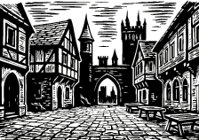 | **Open Terrain** | Grass fields, roads, open plazas | No special effects. Models move normally and may be targeted without penalty. |
| 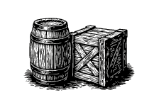 | **Small Objects** | Barrels, crates, gravestones, rubble piles, small barricades | Objects up to 1″ high. Grant Cover. Can be Traversed without movement penalty. |
| 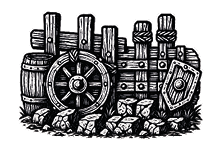 | **Field Defenses** | Barricades, stone wall sections, fallen statues | Lower than the model. Grant Cover. Can be Traversed by spending 2″ of movement. |
| 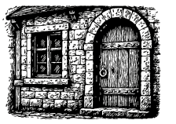 | **Entryways** | Doors, gates, grills, windows | Passable only when unlocked. Use INTERACT to lock or unlock. |
| 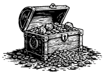 | **Loot Sites** | Treasure chests, weapon racks, supply crates | Within 1″, use INTERACT to search. Roll D66 on the Equipment Table. Once per object. Each mission defines which Loot Sites are available. |
| 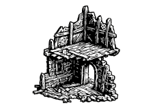 | **Elevated Ground** | Upper floors, roofs, hills, towers, lookouts | At least 3″ above ground level. Models standing here gain the TAKE AIM special action. |
| 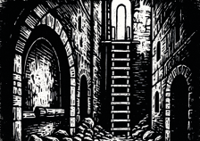 | **Climbing Gear** | Ladders, ropes | Models may climb up or down by spending 1″ of movement. |
| 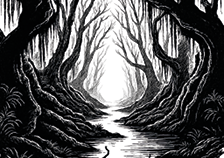 | **Difficult Terrain** | Woods, shallow water, swamp, rubble, thick undergrowth | Models cannot use RUN while moving through it. |
| 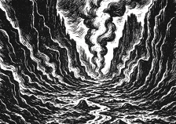 | **Dangerous Terrain** | Deadly or poisonous plants, quicksand, flames | Models cannot use RUN while moving through it. A model takes D3 Fatal Damage per movement action. |

Example Agreeing on terrain

Before the game the players go through the table piece by piece: the ruined house is impassable and blocks sight, its upper floor is Elevated Ground with a ladder as Climbing Gear, the stone wall sections are Field Defenses, the barrels are Small Objects, the dead wood is Difficult Terrain, and the chest in the square is a Loot Site.

Two minutes of agreement save every argument later.

## Close Combat

**At a glance**

- Both models roll their Attack Dice, plus Block Dice from shields. The Attacker rolls one extra Attack Die. Hits on HTV or more, a 6 is critical.
- Then spend one die at a time, Attacker first: **Strike** (deal damage; a normal Strike allows an Armor Save, a critical ignores armor), **Parry** (cancel an enemy success with an Attack Die), **Block** (cancel an enemy success with a Block Die of equal or higher value).
- A Strike cannot be undone. Spend your best die first.

The model that declares a FIGHT action while in Base Contact is the **Attacker**. The enemy it fights is the **Defender**. Both models fight: either of them can deal damage.

### The close combat sequence

1.  **Engage.** The Attacker chooses one enemy model in Base Contact (1″). It becomes the Defender.
2.  **Choose weapons.** Each player picks one close combat weapon profile for their model.
3.  **Roll dice.** Both players roll their Attack Dice and their Block Dice, kept apart. The Attacker rolls one extra Attack Die.
4.  **Resolve dice.** Spend one die at a time, Attacker first, alternating, until all successes are spent or a model is Defeated.

### 1 · Engage

**Fig. 3.9** Base Contact. **1** The Swordsman’s base touches the Orc’s: they are in Base Contact (1″). **2** A second Swordsman stands a gap away and is not.

Choose one enemy model in Base Contact with the Attacker. It becomes the Defender.

### 2 · Choose weapons

Each player picks one close combat weapon profile (type close) for their model.

#### Main hand and off hand

A model with two close combat weapons may attack with both. Declare first which is the main hand and which the off hand. The off-hand weapon makes only 1 ATK.

#### Unarmed

A model without a close combat weapon fights with the Unarmed profile: fists or whatever lies at hand.

| Profile     | RNG | ATK | HTV | DMG | CRT |
|-------------|-----|-----|-----|-----|-----|
| **Unarmed** | 1″  | 2   | 5+  | 1   | 1   |

### 3 · Roll dice

Both players roll their Attack Dice and, if they have any, their Block Dice. Keep the two kinds apart.

**Attacker’s Advantage**

The Attacker rolls one additional Attack Die with its main-hand weapon.

- A 6 is always a critical success and may trigger additional rules.
- A 1 is always a failure and may trigger additional rules.
- Dice that do not succeed are removed.

| Die | How many | Success | Used for |
|----|----|----|----|
| **Attack Die** \[4\] | The weapon’s ATK. | HTV or higher. A 6 is critical. | Strike or Parry. |
| **Block Die** \[5\] | Bonus dice from Shields or other rules. | No HTV: the number rolled is what counts. | Block only. It can never Strike. |

#### Retained dice

Some rules let a model keep a die as a normal success without rolling it. A retained Attack Die counts as showing the weapon’s HTV.

**Assist**

Each friendly model that is also in Base Contact with the Defender improves the Attacker’s HTV by 1 (to a minimum of 2+).

### 4 · Resolve dice

The Attacker spends one die first. Then the players alternate, one die at a time, until every success has been spent or a model is Defeated. A die is spent in one of three ways:

Strike

Spend a successful Attack Die to deal damage. A normal success deals the weapon’s DMG unless the struck model makes its Armor Save. A critical success deals its CRT, and the struck model rolls on the Critical Injuries table at once.

Parry

Spend a successful Attack Die to cancel one unspent enemy success. A normal success cancels a normal success. A critical success cancels any success. Both dice are removed.

Block

Spend a Block Die to cancel one unspent enemy success of equal or lower value. Both dice are removed. A Block Die showing 6 can block a critical success. Block Dice can only be spent this way.

- Damage from a Strike is applied at once. A die spent to Strike can no longer be parried or blocked.
- If one player runs out of dice, the other spends all of their remaining dice in any order.
- A model reduced to 0 Vitality is Defeated and removed from the game.

**Armor Save**

Each time a normal success is spent to Strike, the struck model rolls one die. On a result equal to or higher than its SAV, the Strike deals no damage. A critical success cannot be saved: it deals CRT and causes a roll for Critical Injuries.

Example A full exchange

Both models have HTV 4+ and ATK 3. Player 1 is the Attacker, so it rolls one extra Attack Die, and it has a Shield. Player 2 has no Block Dice.

Player 1Attack \[6\] \[4\] \[2\] \[1\] · Block \[5\] Player 2Attack \[5\] \[5\] \[3\]

The \[2\], the \[1\] and the \[3\] are failures and are removed.

1.  Player 1 **Strikes** with the \[6\]: a critical hit. A critical ignores armor: Player 2 takes CRT damage and rolls for Critical Injuries. The 6 is spent and can no longer be parried.
2.  Player 2 **Parries** Player 1’s \[4\] with a \[5\]. Normal cancels normal, both dice are removed.
3.  Player 1 **Blocks** Player 2’s remaining \[5\] with the Block Die \[5\]. Equal value, so the block works. Both dice are removed. A Block Die showing 4 could not have blocked the 5.

No dice remain. Player 1 dealt one critical hit, Player 2 dealt nothing. Spending your best die first denies the opponent the chance to parry it.

Example The Orc charges

An Orc Brute (VIT 12, Tough, Great Axe: ATK 3, HTV 3+, DMG 2, CRT 4, Cleave) charges the Swordsman (VIT 10, Sword: ATK 3, HTV 4+, DMG 2, CRT 3; Chainmail SAV 4+, Shield gives 1 Block Die). The Orc wears Thick Hide (SAV 5+). The charge gives it +1 ATK and Attacker’s Advantage one more Attack Die, so it rolls 3 + 1 + 1 = 5 Attack Dice.

OrcAttack \[6\] \[5\] \[3\] \[2\] \[1\] SwordsmanAttack \[6\] \[4\] \[2\] · Block \[5\]

1.  **Cleave.** The Orc keeps a critical success, so it may upgrade one normal success: its \[5\] becomes a critical. It now has \[6\] \[5\] \[3\].
2.  The Orc **Strikes** with a critical: 4 damage, no Armor Save. The Swordsman drops to 6 VIT and rolls on the Critical Injuries table: \[5\], a flesh wound with no effect.
3.  The Swordsman **Parries** the Orc’s other critical with its own \[6\]. Only a critical can parry a critical, so this is its best use of it.
4.  The Orc **Strikes** with the \[3\], a normal success. The Swordsman makes its Armor Save and rolls \[4\], equal to its SAV 4+: the Strike deals no damage. Its Block Die \[5\] could have stopped the 3 too, but the Orc spent it first.
5.  The Swordsman **Strikes** with its \[4\]. The Orc rolls \[3\] against its SAV 5+ and fails: 2 damage, reduced by 1 for Tough. The Orc is at 11 VIT. The Swordsman’s Block Die has nothing left to block.

The Swordsman lost 4 VIT, the Orc 1. The Chainmail saved 2 VIT. Block Dice only help if the enemy still has unspent successes when your turn to spend comes.

Example Assist

The Swordsman and the Captain both stand in Base Contact with a Skeleton Warrior. The Swordsman declares FIGHT. The Captain assists: the Swordsman’s HTV improves from 4+ to 3+. Had a second friend also been in Base Contact, it would improve to 2+, the minimum.

### Traits that change close combat

| Trait | Effect |
|----|----|
| **Buckler** | Grants 1 Block Die. It cannot block a critical success. |
| **Shield** | Grants 1 Block Die. |
| **Master Parry** | 1 normal success may parry 1 enemy critical. |
| **Guard** | Once per Close Combat, this model may re-roll one of its Attack Dice or Block Dice. A re-rolled Attack Die can only be spent to Parry. |
| **Cleave** | If you keep at least one critical success, you may upgrade one normal success to a critical success. |
| **First Strike** | When resolving dice, this model spends the first die. Then alternate as normal. |

Example Master Parry

The Swordsman’s Sword has Master Parry. Against the Orc above, the Swordsman could have parried the Orc’s second critical with its normal \[4\] and kept its \[6\] for a 3-damage critical Strike that ignores the Orc’s armor.

## Ranged Combat

**At a glance**

- Pick a weapon and a visible target in range, at least 2″ away. If a legal target is within 8″, you must shoot the closest one.
- Attacker rolls ATK against HTV. Defender rolls three Defense Dice against SAV and cancels hits: a critical cancels any hit, a normal cancels a normal, two normals cancel a critical.
- Remaining hits deal DMG, criticals deal CRT and cause a Critical Injury roll. Beyond 8″ the HTV is worsened by 1.

The model that declares a SHOOT action is the **Attacker**. Its target is the **Defender**.

### The ranged combat sequence

1.  **Select weapon.** Choose one ranged weapon profile (type range).
2.  **Acquire target.** A target in Line of Sight, within range, at least 2″ away. Mind Nearest Foe.
3.  **Roll Attack Dice.** ATK dice against HTV.
4.  **Roll Defense Dice.** Three Defense Dice against SAV.
5.  **Resolve Defense Dice.** The Defender cancels hits.
6.  **Deal damage.** The Attacker resolves the hits that are left.

### 1 · Select weapon

The Attacker chooses one of the model’s ranged weapon profiles (type range).

### 2 · Acquire target

- The target must be in the model’s Line of Sight and within the weapon’s maximum range.
- The target must be at least 2″ away.
- The target becomes the Defender.

**Nearest Foe**

If any enemy model within 8″ is a legal target (in Line of Sight, not Hidden, within the weapon’s range), the Attacker must target the closest such enemy. Enemies that are not legal targets are ignored for this rule. NPCs and Structures are ignored for this rule too.

### 3 · Roll Attack Dice

- The Attacker rolls as many D6 as the weapon’s ATK.
- A result of HTV or higher is a normal success. A 6 is a critical success and may trigger additional rules.
- A 1 is always a failure and may trigger additional rules.
- Dice that do not succeed are removed.

### 4 · Roll Defense Dice

**Defense Dice.** Each model rolls three Defense Dice when defending in Ranged Combat. A model with Stalwart rolls one additional Defense Die.

- A result of SAV or higher is a normal success. A 6 is a critical success and may trigger additional rules.
- A 1 is always a failure and may trigger additional rules.
- Dice that do not succeed are removed.

### 5 · Resolve Defense Dice

The Defender spends its successes first:

- **Critical success:** discards one of the Attacker’s normal or critical successes.
- **Normal success:** discards one normal success. Two normal successes together may discard one critical success.

Remove each Defense Die after it is spent.

### 6 · Deal damage

- Each remaining normal success deals the weapon’s DMG.
- Each remaining critical success deals the weapon’s CRT, and the model rolls for Critical Injuries at once.

Reduce the Defender’s Vitality. A model at 0 Vitality is Defeated and removed from the game.

Example An arrow at 10″

An Archer with a Long Bow (RNG 18″, ATK 3, HTV 3+, DMG 2, CRT 3, Armor Piercing) shoots an Orc Brute 10″ away (Leather SAV 5+, VIT 12, Tough).

1.  **Range.** The target is more than 8″ away: HTV 3+ becomes 4+.
2.  **Attack.** \[6\] \[4\] \[2\]: one critical, one normal success.
3.  **Defense.** Armor Piercing worsens the Orc’s SAV from 5+ to 6+. The Orc rolls \[6\] \[5\] \[1\]: one critical success.
4.  **Resolve.** The Orc’s critical discards the Archer’s critical, the bigger threat.
5.  **Damage.** The normal hit deals 2, Tough reduces it to 1.

The Orc drops from 12 to 11 VIT. Without Armor Piercing its 5 would have saved the normal hit too.

Example Two normals against a critical

The Swordsman (SAV 4+) is hit by \[6\] \[4\]. It rolls \[5\] \[4\] \[2\]. It may spend both normal successes together to discard the critical. The normal hit still gets through. Or it spends one normal on the normal hit and takes the critical. It chooses the first: 2 damage instead of 3 plus a Critical Injury roll.

### Traits and rules that change ranged combat

| Rule | Effect |
|----|----|
| **Cover** | The Defender’s SAV is improved by 1 (minimum 2+). See Cover. |
| **Shoot into Combat** | If the Defender is in Base Contact with a friendly model, all failed Attack Dice must be re-rolled. The re-rolled dice are resolved against the friendly model instead. |
| **Take Aim** | A model on Elevated Ground may declare TAKE AIM before shooting. See Special Actions. |
| **Armor Piercing** | The Defender’s SAV is worsened by 1 (to a minimum of 6+). |
| **Armor Shatter** | The Defender rolls one Defense Die fewer (minimum 1), and its SAV is worsened by 1 (minimum 6+). |
| **Cleave** | If you keep at least one critical success, you may upgrade one normal success to a critical success. |

**Effective Range**

Ranged weapons lose accuracy at long distance. Against a target more than 8″ away, the Attacker’s HTV is worsened by 1. This applies to weapons only. Spells suffer no HTV penalty.

Example Shooting into a melee

A Crossbowman (HTV 4+) shoots an Orc that is in Base Contact with a friendly Swordsman. The Crossbowman rolls \[5\] \[3\] \[1\]. Both failed dice must be re-rolled: \[4\] \[2\]. The 4 is now a hit against **its own Swordsman**, who rolls Defense Dice against it as usual.

### Misfire table

When a weapon with the Black Powder or Warp Tech trait calls for a Misfire check, roll 1D6:

| D6 | Result | Effect |
|----|----|----|
| 1 | **Flashback** | Burning powder ignites the wielder. The wielder suffers D3 Fatal Damage and gains the Burning status effect. |
| 2–3 | **Jammed** | The mechanism is fouled. Two INTERACT actions are needed to clear it and reload. |
| 4–6 | **Minor Spark** | The shot fails. Reload normally with one INTERACT action. |

## Vitality

**At a glance**

- Damage lowers VIT. At 0 the model is Defeated and removed.
- Fatal Damage cannot be blocked or saved.
- Every critical hit that deals damage means a roll on the Critical Injuries table. Healing to full VIT removes the injuries.

Each model has a Vitality (VIT) characteristic: its total health. Whenever it suffers damage, reduce its VIT by that amount.

|  |  |
|----|----|
| **Fatal Damage** | Cannot be blocked or saved: no Block Die, no Defense roll, no Armor Save. |
| **Defeated** | A model is Defeated when its VIT drops to 0 or less. Remove it from the game at once. |
| **Healing** | A model can be healed, but never above its starting VIT. If it is healed to full VIT, remove any Critical Injuries it suffered in this game. |

### Critical Injuries

Whenever a model suffers damage from a critical hit in combat, roll on the Critical Injuries table and apply the result at once.

- Each injury lasts for the rest of the game.
- A model can suffer each type of injury only once per game.
- In a campaign, roll on the Injured Models table after the mission to see whether an injury stays (see Campaign Rules).

| D6 |  | Injury | Effect |
|----|----|----|----|
| 1 |  | **Head** | HTV worsened by 1 |
| 2 | 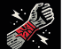 | **Arm** | ATK −1 |
| 3 |  | **Leg** | MOV −1 |
| 4–6 |  | **Flesh wound** | No effect |

**Helmet:** ignore a result of 1 (Head) on the Critical Injuries table.

Use tokens or a marker to track injuries.

Example Wounded, then healed

The Swordsman (VIT 10) takes a critical hit for 3 damage and rolls \[2\]: Arm Injury, its ATK drops by 1. Later it takes 4 more damage: 3 VIT left.

1.  A friend uses HEAL on it: 2D3 rolls \[6\] \[5\], read as 3 + 3 = 6 VIT. The Swordsman is at 9.
2.  A second HEAL in another activation gives 2D3 = 3. It would reach 12, but healing stops at its starting VIT of 10.
3.  It is back at full VIT, so the Arm Injury is removed.

Full healing undoes the injuries of this game.

## Status Effects

**At a glance**

- Status effects stay until a rule or an action removes them.
- A model cannot have the same status twice.
- RECOVER removes Stunned, Burning, Frozen and Fearful. CLEANSE removes all six. HEAL removes Poisoned.

Some rules, attacks and spells leave lasting conditions on a model: status effects. Each changes what the model can do until it is removed.

- Status effects remain until a rule or an action removes them.
- A model cannot be affected by the same status effect more than once.

|  | Status | Effect | Removed by |
|----|----|----|----|
|  | **Stunned** | Can only perform RECOVER or PASS. | RECOVER, CLEANSE |
|  | **Burning** | Suffers 1D3 Fatal Damage at the start of each turn. | RECOVER, CLEANSE |
|  | **Frozen** | Movement is reduced by 2″. | RECOVER, CLEANSE |
|  | **Fearful** | HTV worsened by 1 for all attacks. | RECOVER, CLEANSE |
|  | **Poisoned** | Suffers 1 Fatal Damage at the end of each turn. | HEAL, CLEANSE |
| 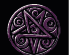 | **Cursed** | Each roll of 1 on an Attack or Block Die causes 1 Fatal Damage. | CLEANSE |
|  | **Head Injury** | HTV worsened by 1. | Healing to full VIT, also by HEAL |
|  | **Arm Injury** | −1 ATK: fewer Attack Dice. | Healing to full VIT, also by HEAL |
|  | **Leg Injury** | −1 MOV: shorter moves. | Healing to full VIT, also by HEAL |

Example Burning and a choice of actions

A Goblin (VIT 8) is set Burning by a Fire attack. At the start of the next turn it suffers 1D3 Fatal Damage: \[4\] reads as 2. No Defense roll is allowed. The Goblin is at 6 VIT.

1.  In its activation it uses RECOVER: Burning is removed.
2.  With its second ACT it may act normally again.

Had it also been Stunned, it could only have used RECOVER or PASS, and one RECOVER removes both statuses.

## Arcane & Divine Powers

**At a glance**

- Arcane models CAST A SPELL, Divine models use INVOCATION. Both cost 1 ACT.
- Roll 2D6 for energy. You may use one power from your lore that costs that much or less.
- Arcane only: each 1 rolled deals 2 Fatal Damage to the caster. Divine energy never harms.

Some models command supernatural forces through Arcane Magic or Divine Invocations. These powers are special actions, available only to models with the matching trait. Every power needs energy: Arcane Energy or Divine Energy.

### Arcane Magic

Models with the Arcane trait may perform CAST A SPELL to generate Arcane Energy and cast a spell from their warband’s Arcane Lore.

1.  Roll 2D6. The total is your Arcane Energy (AE).
2.  Choose a spell whose cost is equal to or less than the AE.
3.  Each die that shows 1 deals 2 Fatal Damage to the caster.

- Arcane Energy is spent in the same action. It cannot be stored or passed on.
- Spells from Magic Scrolls are cast without rolling for Arcane Energy.

### Divine Invocations

Models with the Divine trait may perform INVOCATION to call on a power from a Divine Lore.

1.  Roll 2D6. The total is your Divine Energy (DE).
2.  Choose a power whose cost is equal to or less than the DE.

Divine Energy is spent in the same action. Low rolls do no harm, and it cannot be stored or passed on.

Example A risky spell

A Hedge Mage with the Arcane trait casts from Lesser Magic. It rolls \[1\] \[5\]: 6 AE.

1.  It may cast any spell with cost 6 or less, for example Fireball (5) or Arcane Barrier (6).
2.  The \[1\] deals the Hedge Mage 2 Fatal Damage.

Had it rolled two 1s, it would have 2 AE, nothing to cast above that, and 4 Fatal Damage.

### Lores

Each warband may choose one Arcane Lore and one Divine Lore, each only if it fields a model with the matching trait.

- Arcane Lores contain spells, usable only by models with the Arcane trait.
- Divine Lores contain invocations, usable only by models with the Divine trait.
- Each power may be used once per activation.
- Mixed warbands, such as Mercenaries, may only choose the two universal lores below.
- Further lores are described with the factions.

#### Lesser Magic

Arcane Lore, available to Arcane models in all warbands.

| Spell | Effect | AE |
|----|----|----|
| **Fog of War** | Target a friendly model within 12″. It counts as Hidden until the end of its next activation. | 3 |
| **Teleport** | Move the caster up to 12″ in a straight line to a visible position, ignoring terrain and obstacles. If it ends in Base Contact with an enemy, this counts as a CHARGE. | 4 |
| **Fireball** | Make a ranged attack: RNG 12″, ATK 3, HTV 4+, DMG 3, CRT 4, with the Fire weapon rule. | 5 |
| **Healing Touch** | Counts as performing a HEAL action. | 5 |
| **Arcane Barrier** | Target a model within 12″. It gains Protected until the end of its next turn: it may keep one defence die as a normal save or block without rolling. | 6 |
| **Fortune’s Thread** | Target a model within 24″. It may re-roll one upcoming dice result. The second result must be accepted. | 9 |

#### Minor Rites

Divine Lore, available to Divine models in all warbands.

| Invocation | Effect | DE |
|----|----|----|
| **Soothing Chant** | Select a friendly model within 12″. Remove any of these status effects: Burning, Cursed, Poisoned, Fearful, Stunned, Frozen. | 3 |
| **Guiding Steps** | Choose a friendly model within 12″. It gains +1″ MOV until the end of its next activation. | 4 |
| **Balancing Touch** | Target a friendly model within 6″. Until the end of the round it may re-roll one defense die in any defense roll. | 6 |
| **Ritual of Endurance** | Choose a friendly model within 6″. It heals D3 Vitality. No status effects are removed. | 7 |

Example A safe prayer

A Priest with the Divine trait uses INVOCATION and rolls \[1\] \[2\]: 3 DE, and no harm from the 1. Enough for Soothing Chant: a Fearful friendly Swordsman 10″ away is freed of the status.
