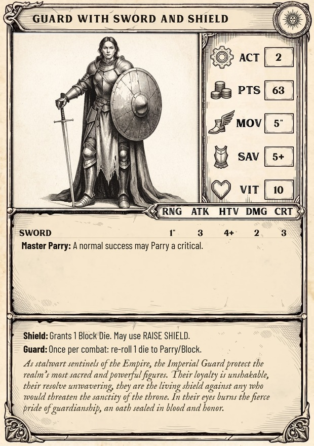
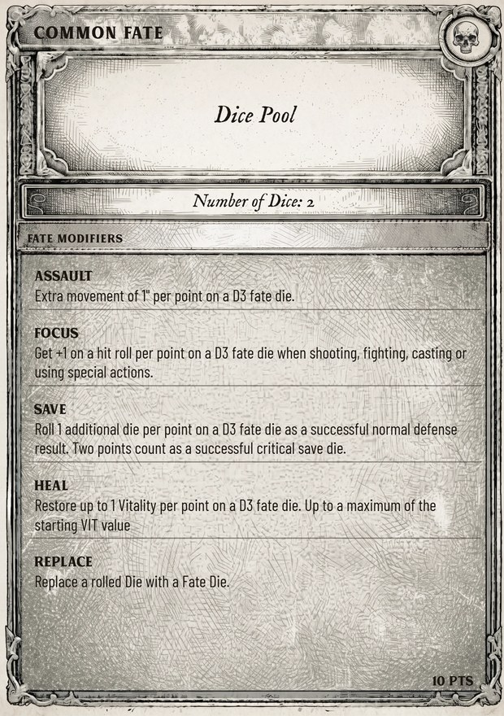

# How to Play

*Before the first blade is drawn. This chapter explains what you need on the table, how dice are read in Grimheim, and which kinds of game you can play.*

## General Principle

**At a glance**

- Play fair, keep the game moving, agree on unclear cases.
- If you cannot agree, settle it with a Roll-off.
- Distances are in inches (″). You may measure at any time.

Grimheim aims to be a fun and fair tactical game. The rules try to be clear, but no rulebook covers every situation. Use common sense, put the flow of the game first, and agree with your opponent on unclear cases. If you cannot agree, perform a Roll-off.

**Roll-off**

Each player rolls one D6. The higher result wins. Roll again on a tie.

### Distances and measuring

All distances are in inches (″). You may measure any distance at any time during the game, also before you decide what a model does.

### Models

A model is one miniature on the battlefield: a warrior, creature or character of your warband. Each model has its own characteristics, weapons and abilities, listed on its model card (see The Model Card).

Example Settling a question

The players disagree whether a crate is high enough to give Cover. They roll off: \[3\] against \[3\], a tie, so both roll again: \[5\] against \[2\]. The first player wins and the crate counts as Cover for the rest of the game.

Agree on every terrain piece before the game starts and most of these questions never come up (see Terrain).

## What You Need

**At a glance**

- A 30″ × 30″ table, terrain, your models, a few D6 and an inch ruler.
- Model cards and rules cards, printed or in the Grimheim Companion.

### Required

- A flat surface or game mat, standard 30″ × 30″
- Miniatures for your warband
- Terrain pieces
- Six-sided dice (D6)
- An inch ruler
- Model cards or the Grimheim Companion
- Rules cards or the Grimheim Companion

Small warbands up to 500 pts may play on 24″ × 24″ (see Encounter).

### Helpful

- Tokens or polyhedral dice (D10, D12, D20) to track Vitality and effects
- Dice in different colours, so Attack Dice, Block Dice and Fate Dice are easy to tell apart

### Recommended creators

**Miniatures**

VaeVictis · Titan Forge · Punga Miniatures · Moshartz · Highlands Miniatures · Magori Miniatures · Landor Miniatures · Axia

**Terrain**

MyDungeon · Tired World Studio

**Game mats**

Kraken Wargames · PWork Wargames · Urban Matz

Links to every creator are collected on grimheim.de.

## Cards

Grimheim comes with a set of cards that keep the rules at hand during play. All of them are also part of the Grimheim Companion at grimheim.app.

| Card | What it shows |
|----|----|
| **Model Cards** | All stats and abilities of one model. |
| **Fate Modifier Cards** | The bonuses of your warband’s Fate Modifier. |
| **Arcane & Divine Lores** | Spells and invocations of a lore. |
| **Mission Cards** | Setup, deployment and scoring of a mission. |
| **Equipment Cards** | Items that can be looted or bought, with effects, traits and campaign value. |
| **Rules Reference** | The core rules and actions in short form. |

A model card (see The Model Card)

A Fate Modifier card (see The Fate Modifier Card)

## Dice and Notation

**At a glance**

- Grimheim uses six-sided dice. “4+” means a roll of 4, 5 or 6.
- A Fate Die is always rolled as a D6 and then read as a D6, D3, D2 or D1, depending on the effect it is used for.
- A die can be re-rolled only once. The second result stands.

Grimheim uses six-sided dice (D6). The same D6 can be read in different ways, depending on the rule that asks for it.

### Roll types

| Notation | How to roll | Range |
|----|----|----|
| **D6** | Roll one die. | 1 to 6 |
| **X+** | A target number. The die succeeds on X or higher. | “4+” = 4, 5, 6 |
| **2D6** | Roll two dice and add the results. | 2 to 12 |
| **D6+1** | Roll one die and add 1. | 2 to 7 |
| **D3, D2, D1** | Roll a D6 and convert it with the table below. | see table |
| **D66** | Roll two dice. The lower die is the tens, the higher the units (a 5 and a 3 read 35). | 11 to 66 |
| **D33** | Roll two D3. The first is the tens, the second the units. | 11 to 33 |

### Dice conversion

| Read as | Range  | \[1\] | \[2\] | \[3\] | \[4\] | \[5\] | \[6\] |
|---------|--------|-------|-------|-------|-------|-------|-------|
| **D6**  | 1 to 6 | 1     | 2     | 3     | 4     | 5     | 6     |
| **D3**  | 1 to 3 | 1     | 1     | 2     | 2     | 3     | 3     |
| **D2**  | 1 to 2 | 1     | 1     | 1     | 2     | 2     | 2     |
| **D1**  | 0 to 1 | 0     | 0     | 0     | 1     | 1     | 1     |

### Dice mechanics

- **Re-roll:** roll one die again. The second result stands. A die can be re-rolled only once.
- **Replace:** swap a die result for the result of a Fate Die, as it is, without conversion.
- **Roll-off:** each player rolls 1D6, the higher result wins, re-roll ties.

Example Reading the same die four ways

At the start of the turn a player rolls a Fate Die and gets \[5\]. Later they spend it:

- for an effect read as D6 it is worth 5,
- as D3 it is worth 3,
- as D2 it is worth 2,
- as D1 it is worth 1.

They pick the effect first, then read the die. The die itself never changes.

Example D66 and D33

For a D66 roll the player rolls \[5\] and \[3\]: the lower die is the tens, so the result is **35**. For a D33 they roll two dice and convert each to D3: \[6\] becomes 3 and \[2\] becomes 1, so the result is **31**.

## Game Modes

**At a glance**

- **Quick Game:** one battle, 30 to 60 minutes, start here.
- **Campaign:** linked battles in which your warband grows and suffers. Three formats: Ongoing, Conquest, Map Control.

Grimheim can be played in different formats, each with its own depth and progression. Choose the one that fits your time and your group.

### Quick Game

A standalone battle with immediate tactical action and no long-term commitment. Quick Games suit tournaments and casual evenings and take 30 to 60 minutes.

1.  **Set the point limit.** Agree on a common point value for both warbands.
2.  **Build your warband.** Use the Character Builder or field a pre-built Iconic Warband from the faction chapters.
3.  **Choose a mission.** The standard mission is Encounter. Decide which warbands face off.
4.  **Play for victory.** Score the most Victory Points from objectives and defeated enemies.

### Campaign Play

Campaigns turn single skirmishes into a story: your warband grows, suffers setbacks and earns its legend across linked battles. Grimheim offers three campaign formats; the third is still in preparation. The full rules are in Campaign Rules.

| Format | In short | Best for |
|----|----|----|
| **Ongoing Campaign** | Open-ended, any number of players. Warbands keep a Roster and grow with earned Gold. Players may join or leave while it runs. Ranking by wins, Victory Points break ties. | Open groups, campaign nights with changing players, long-running stories. |
| **Conquest Campaign** | Two warbands fight across five zones, from Neutral Grounds to the enemy Stronghold. A win pushes into enemy territory, a loss forces a retreat. Defenders gain advantages on home ground. Goal: take the enemy Stronghold. | Two players who want escalation and territory. |
| **Map Control Campaign** | A war for the districts of Grimheim on a campaign map of tiles with different advantages. Two to six players. Rules in preparation. | Groups who want a shared map and a long game. |
