# Missions

*A Mission is the reason two warbands are standing in the same ruin. It sets the ground, the prize and what counts as winning.*

## How Missions Work

**At a glance**

- Every battle is a Mission. Each Mission is its own scenario with its own table, roles, objectives, deployment and scoring.
- Three things are always your choice: the Battlefield Region, one optional Battle Condition and each player’s Side Quest.
- Missions use the same Setup Terms and the same Mission Rules, so the same words always mean the same thing.

Every battle in Grimheim is fought as a Mission. Each Mission is its own scenario: it tells you how to build the battlefield, who attacks and who defends, where the objectives lie, where the warbands deploy and how Victory Points are scored. Three things are always your choice: the Battlefield Region, one optional Battle Condition and each player’s Side Quest.

This chapter holds fourteen Standard Missions for any game, four Stronghold Missions for the decisive battles of a campaign and two Special Modules with their own play area. **Encounter** is the standard Mission. Play it when no other Mission is agreed.

### Difficulty

- Difficulty ●○○ short and straightforward, ideal for a first game.
- Difficulty ●●○ standard length and depth.
- Difficulty ●●● long or asymmetric, best for experienced players.

### Tags

| Tag | Meaning |
|----|----|
| **Base** | Single games, Ongoing Campaigns and the Neutral Grounds of a Conquest Campaign. |
| **Territory** | Territory battles of a Conquest Campaign. |
| **Stronghold** | The battle for a Stronghold. |
| **Solo** | Playable by one warband against NPCs; the Mission names the goal. |
| **Asymmetric** | Attacker and Defender score differently. |

Every Mission can be chosen for a Quick Game. Special Modules are not part of the campaign Mission pools.

### The Missions at a glance

| No. | Mission | Difficulty | Tags | Length |
|----|----|----|----|----|
| 01 | **Encounter** | Difficulty ●○○ | Base · Territory | 4 turns · Overtime |
| 02 | **The Last Foothold** | Difficulty ●●○ | Base · Territory | 4 turns · Overtime |
| 03 | **Iron Seals** | Difficulty ●●○ | Base · Territory | 4 turns · Overtime |
| 04 | **The Buried Index** | Difficulty ●●○ | Base · Territory | 4 turns · Overtime |
| 05 | **Bred in the Dark** | Difficulty ●●● | Territory · Solo | 4 turns · Overtime |
| 06 | **The Numbered Dead** | Difficulty ●●● | Base · Territory · Solo | 4 turns · Overtime |
| 07 | **Cut the Sinews** | Difficulty ●●○ | Territory · Asymmetric | 4 turns · Overtime |
| 08 | **The Pilgrim’s Path** | Difficulty ●●○ | Territory · Asymmetric | 4 turns · Overtime |
| 09 | **Run the Checkpoints** | Difficulty ●●○ | Territory · Asymmetric | 4 turns · Overtime |
| 10 | **Under the Whisper** | Difficulty ●●○ | Base · Territory | 4 turns · Overtime |
| 11 | **Until Sunrise** | Difficulty ●●● | Territory · Asymmetric | 4 turns · Overtime |
| 12 | **The Bruchgasse** *(playtest)* | Difficulty ●●○ | Base · Territory | 4 turns · Overtime |
| 13 | **Home Before Dark** *(playtest)* | Difficulty ●●○ | Base · Territory | 4 turns · Overtime |
| 14 | **Spades and Knives** *(playtest)* | Difficulty ●●● | Territory · Asymmetric | 4 turns · Overtime |
| 15 | **Stronghold Assault** | Difficulty ●●● | Stronghold · Asymmetric | 6 turns · no Overtime |
| 16 | **Burn the Banner** | Difficulty ●●● | Stronghold · Asymmetric | 4 turns · no Overtime |
| 17 | **Before He Wakes** | Difficulty ●●● | Stronghold · Asymmetric | 6 turns · no Overtime |
| 18 | **Siege of the Tower** | Difficulty ●●● | Stronghold · Asymmetric | 6 turns · no Overtime |
| 19 | **Grave Goods** | Difficulty ●●○ | Territory · Solo | 4 turns · Overtime |
| 20 | **The Black Moon** | Difficulty ●○○ | Base | 4 turns · Overtime |

## What Every Mission Shares

**Battlefield**

30″ × 30″, a grid of 6″ cells (columns A to E, rows 1 to 5), unless the Mission gives its own Mission Map. Small warbands (up to 500 PTS) may use 24″ × 24″ where the Mission allows it.

**Game length**

4 turns. Overtime is checked after scoring in turn 4: if one player then has at least 5 VP fewer, a 5th turn is played (see Turns). Stronghold Missions set their own length and are never extended by Overtime. A Mission never ends early.

**Turns**

Initiative is rolled every turn, unless the Mission gives one player initiative in turn 1.

**Objectives**

Objective Markers, tokens spread over the table, or one Objective Area, a central place that must be held: a House, a Hill or an Object (see Mission Rules).

**Scoring**

VP are scored in the End Phase unless a result is scored when it happens. Every Mission scores 2 VP the first time an enemy model is Defeated. Objectives are controlled within 2″ and in Line of Sight; a player holds an objective if more of their models control it.

**Side Quests**

Chosen before deployment. A Mission names the Side Quests that cannot be completed in it.

Everything else, the Mission decides. It does so with the Setup Terms below.

## Setup Terms

Each Mission’s Setup names one term per line: Terrain, Roles, Objectives, Deployment and, where it matters, First turn.

### Terrain

**Shared Build**

Both players build the table together from the Region.

**Piece by Piece**

Perform a Roll-off. The loser places the first terrain piece, then the players alternate, large pieces first, until the Region’s terrain quantity is reached.

**Mission Map**

The Mission gives the layout; the players only add scatter terrain.

### Roles

**Roll for Roles**

Perform a Roll-off; the winner chooses to be Attacker or Defender.

**Underdog’s Choice**

The player whose warband is worth fewer PTS chooses the role. If both are equal, the player with fewer models chooses; if that is equal too, perform a Roll-off.

**Campaign Roles**

The campaign assigns the roles, as in Territory and Stronghold battles.

Missions without roles call the players simply “the players”.

### Objectives

**Defender Places**

The Defender places the tokens.

**Blind Placement**

Before anyone has chosen a side, the players place the tokens one at a time in turns, starting with the winner of a Roll-off. Each token goes on an Objective Point more than 6″ from every table edge and at least 8″ from every other token.

**Fixed Points**

The Mission names the points.

**Objective Area**

The Mission’s central House, Hill or Object, set up before the other terrain.

An **Objective Point** is the centre of a 6″ cell or a point inside the battlefield where grid lines cross. No token is placed on impassable terrain; if terrain covers the point, use the nearest free Objective Point.

### Deployment

**Edge Band X″**

Wholly within X″ of the player’s table edge.

**Corner X″**

Wholly within X″ of the player’s table corner.

**Around X″**

Wholly within X″ of a named point or feature.

**Choose an Edge**

The named player chooses a table edge (or corner); the opponent takes the opposite one.

**Alternate Deployment**

Starting with the named player, the players take turns placing one model at a time. This is the default.

**Deploy All**

The named player places the whole warband first, then the opponent.

**Keep Your Distance X″**

No model may be placed within X″ of an enemy model.

**Scattered X″**

No model may be placed within X″ of a friendly model.

**Reserves**

Models held back arrive later as the Mission describes; they are placed touching the named edge in the NPC Step and may act that turn.

Models with Scout are placed after all other models, in the same order. Models with Ambush start the game in reserve. Both work as usual unless the Mission restricts them.

**Fair by design**

Tables are built and tokens placed before anyone knows which side they will fight from, so a placement that favours one side favours nobody. Where a Mission splits two small advantages, such as choosing the edge and choosing who deploys first, the Roll-off gives one to each player.

## Mission Rules

These rules apply in every Mission.

#### Objective Markers

A marker is a flat round token 32 to 40 mm across. Models may move over it and stand on it. Measure to its nearest point, and draw Line of Sight to it as if it were a model on a 32 mm base.

#### Control and hold

A player controls a marker if at least one of their models is within 2″ of it and has Line of Sight to it. Both players can control the same marker. A player holds a marker if more of their models control it than enemy models do; only one player can hold a marker. Mission features that can be controlled or held work the same way, measured to their nearest point.

#### Objective Areas

Some Missions are won by holding a place instead of a token. An Objective Area is no more than 8″ across and is one of three kinds:

- **House:** a building shell whose inside, on any floor, is the area; at least two doorways.
- **Hill:** a mound whose slopes and crown are the area; no more than 3″ high.
- **Object:** a feature up to 3″ across; the area is everything within 2″ of it, with Line of Sight as for markers.

A model is in the area if its base is at least partly inside it. A player controls the area if at least one of their models is in it, and holds it if more of their models are in it than enemy models. Hidden models count; NPCs, Garrison models and Structures never count.

#### Mission objects

Markers, Crates, sites and ladders are used with the INTERACT action: the model must be within 1″ of the object and not in Base Contact with an enemy model or an NPC. Models with the Creature trait cannot INTERACT.

#### Carrying

Some tokens can be carried. A model within 1″ picks one up with INTERACT and carries at most one. While carrying, its MOV is reduced by 2″ and it cannot Teleport or become Hidden. A carrier may put its token down within 1″ at any time during its activation, and a friendly model within 1″ of a carrier may take the token with INTERACT. If the carrier is Defeated, the opponent places the token within 1″ of where it stood.

#### Structures

Some Missions place a Structure with its own SAV and VIT. The side that must destroy it treats it as an enemy model: its models may CHARGE it, FIGHT it while within 1″ of it, and SHOOT it. A Structure rolls no Attack Dice. When it is attacked, in Close Combat or by a Ranged Attack, it rolls three Defense Dice against its SAV, as the target of a Ranged Attack does. Assist applies. A Structure is never in Cover and ignores Critical Injuries and status effects; Fatal Damage affects it normally. At 0 VIT it is destroyed and stays on the table as impassable rubble. Being within 1″ of a Structure is not Base Contact for any other rule. A Structure is not a model: it gives no VP for being Defeated and is ignored for Nearest Foe.

#### NPCs

Non-player characters belong to neither player. They act in the **NPC Step**, at the start of each turn after the Fate Phase and before the Action Phase. The player with initiative moves the NPCs and rolls their dice; where their rules leave a choice, the other player decides. Unless the Mission says otherwise, an NPC moves toward the nearest model of either warband by the shortest route; if it can reach Base Contact with a CHARGE (MOV + 2″), it CHARGES and FIGHTS it, otherwise it moves its full MOV toward it. NPCs are enemies to every model: Base Contact, Close Combat, SHOOT, Push and Reactions work against them as against enemy models. NPCs never control or hold objectives, never count for Outnumbered and are ignored for Nearest Foe. Defeating an NPC gives VP only if the Mission says so.

#### Garrison

Some Stronghold Missions give the Defender Garrison models. The Defender activates them like their own models, but they are not part of the warband: they give no VP for being Defeated, do not count for Outnumbered or Side Quests, and take no part in the After Battle Sequence.

#### End of the game

Side Quests judged at the end of the game are scored after the last turn played; they do not count toward the Overtime check. The player with the most VP wins. Equal VP is a draw.

## Side Quests

**At a glance**

- Before deployment each player may take one Side Quest: roll D33 twice and pick one of the two results. Quests are not secret.
- If a Side Quest cannot be completed in the Mission, roll again.

Side Quests are optional secondary goals. They add tactical choices and a small story to every battle. Before the models are deployed, each player may select a Side Quest: roll D33 twice and choose one of the two entries. Completing it awards the bonus Victory Points listed. Side Quests are not secret. If a Side Quest cannot be completed in the Mission, roll again; each Mission lists the quests it rules out.

| D33 | Quest | Goal | VP |
|----|----|----|----|
| 11 | **Blood Price** | Before deployment your opponent names one of their models. Defeat it. | 2 |
| 12 | **Lost Relic** | When one of your models uses INTERACT on a mission object or a Loot Site, roll a D6: on a 6 it finds the relic. Missions without mission objects or Loot Sites rule this quest out. | 2 |
| 13 | **First Cut** | Be the first player to Defeat an enemy model, and do it in Close Combat. If the first model Defeated in the game falls to anything else, the quest fails. | 2 |
| 21 | **Slayer** | One of your models Defeats 3 or more enemy models. | 4 |
| 22 | **Capture the Flag** | Before deployment place a token in the enemy Deployment Zone. Pick it up with INTERACT and end any activation with the carrier wholly within your own Deployment Zone (see Carrying). | 4 |
| 23 | **Defy the Gods** | Do not use any Fate Dice during the entire game. | 4 |
| 31 | **Deep Raid** | At the end of the game at least half of your models (rounded up) are wholly within 6″ of your opponent’s table edge. | 6 |
| 32 | **Survivors** | Win without any of your models being Defeated. | 6 |
| 33 | **Threshold** | No enemy model ends an activation wholly within your Deployment Zone during the entire game. | 3 |

Example Choosing a quest

The first D33 roll is \[4\] \[6\]: read as D3 they are 2 and 3, so the result is **23**, Defy the Gods. The second is \[5\] \[1\]: 3 and 1, so **31**, Deep Raid. The player’s warband is fast and their Fate Modifier is weak. They pick Deep Raid for 6 VP and will push half their models up to the enemy edge by the end of the game.

In a Solo game only Lost Relic, Defy the Gods and Survivors can be chosen.

## Battle Conditions

A Battle Condition is an optional effect on the whole battle. Both players agree on one before the game, or play without. Battle Conditions are agreed, not rolled.

| Condition | Effect |
|----|----|
| **Dead Lanterns** | Line of Sight is limited to 12″. A Hidden model does not lose Hidden when it performs SHOOT. |
| **Sea Fret** | The HTV of all Ranged Attacks is worsened by 1. A CHARGE moves up to MOV + 4″ instead of MOV + 2″. |
| **Bloodmoon** | Each player gains 1 additional Fate Die each turn. When a model rolls on the Critical Injuries table, roll twice and apply the lower result. |
| **Magic Storm** | At the start of each turn, choose one random model of either warband and roll a D6. On a 1 to 3 it suffers D3 Fatal Damage; on a 4 to 6 it regains D3 VIT. |
| **Earthquake** | At the start of turn 3 (and of turn 6 in longer Missions), each model on Elevated Ground rolls a D6. On a 1 it falls to the ground below and suffers D3 Fatal Damage. |
| **Heavy Rain** | Black Powder weapons misfire on an Attack Die result of 1 or 2. Burning ends at the start of each turn. |
| **Whispers of Doom** | A model’s first CHARGE of the game moves only up to its MOV, without the extra 2″. Fearless has no effect. |
| **Seeping Dread** | At the start of each turn, roll a D6. On a 1 to 3 each player chooses one of their models; it gains Fearful. Not with Under the Whisper. |
| **Open Scar** | After a model performs RUN, roll a D6. On a 1 it suffers D3 Fatal Damage. |

## Standard Missions

Fourteen Missions for single games and for the Neutral Grounds and Territories of a campaign.

## 01 · Encounter

*Standard Mission · 4 turns · Overtime · Difficulty ●○○ · Base · Territory*

Nobody draws borders on the ruin maps anymore. They draw themselves, in blood, whenever two crews want the same cellar.

The standard Mission. Play it when no other Mission is agreed, and to learn the game.

### Battlefield

**Recommended Regions**

- **The Broken Streets**: the default table of the city
- **Basilica Square**: open square with stalls
- **The Kupferkai**: cargo as scatter

**Terrain · Standard**

- 2 to 3 large building shells, one per third of the table
- 4 small ruins or rubble fans spread between the zones
- 8 to 12 scatter pieces near the likely marker points

Markers are placed after the terrain, so build first and leave the Objective Points more than 6″ from the edges open.

### Setup

|  |  |
|----|----|
| Terrain | Piece by Piece. |
| Roles | None; both players score the same way. |
| Objectives | Blind Placement of **three** Objective Markers. On a 24″ battlefield, markers may be placed more than 3″ from every edge. |
| Deployment | Roll-off. The winner chooses an edge (Choose an Edge); the loser chooses who deploys first. Edge Band 6″. Alternate Deployment. |

Small warbands may play this Mission on a 24″ × 24″ battlefield.

### Special Rules

#### Looting

Each marker is a Loot Site, once per game.

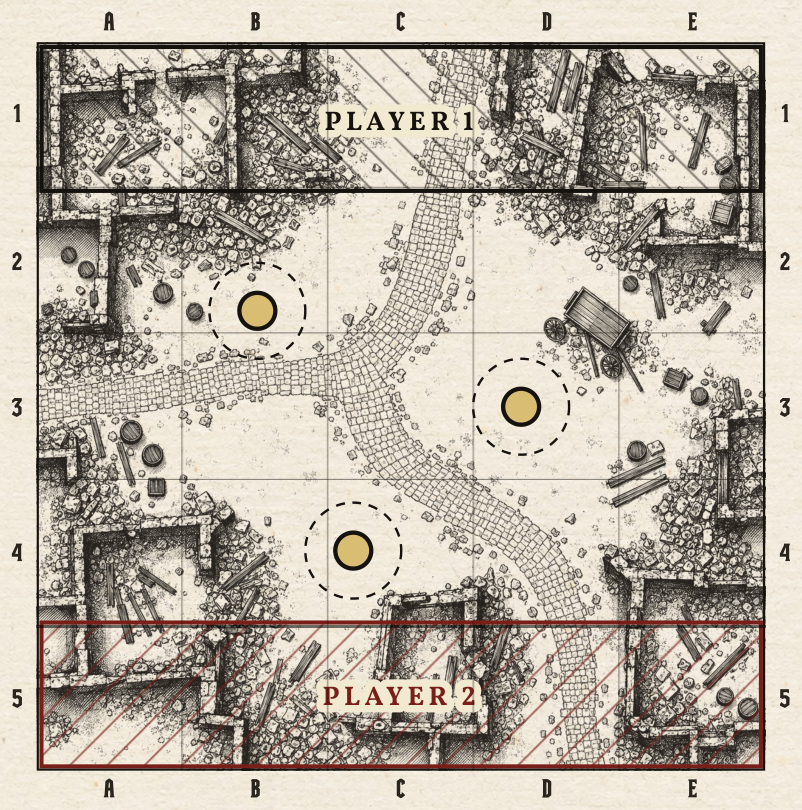

*markers placed in turns, more than 6″ from every edge. Terrain is an example; build it from the recommended Regions.*

### Scoring

| Goal                                         | VP         |
|----------------------------------------------|------------|
| Control an Objective Marker                  | 1 VP each  |
| Hold an Objective Marker                     | +1 VP each |
| Defeat an enemy model (first time this game) | 2 VP       |

**Side Quests.** All Side Quests can be completed.

## 02 · The Last Foothold

*Standard Mission · 4 turns · Overtime · Difficulty ●●○ · Base · Territory*

Nobody remembers what it was worth before the fall. Everyone knows what it is worth now: whoever stands on it decides who crosses this part of the ruins.

King of the hill: one central place, a House, a Hill or an Object, decides the battle.

### Battlefield

**Recommended Regions**

- **Any Region**: each suggests its own centrepiece, see the table below

**Terrain · Standard, with the centre open**

- the Objective Area at the centre, up to 8″ across, nothing else within 3″ of it
- a medium piece in each empty corner
- the same scatter on both approaches

### Centrepiece by Region

**The Broken Streets**

**House:** the last standing townhouse

**Basilica Square**

**Object:** the execution podium

**The Kupferkai**

**House:** a sealed stone warehouse

**The Canal Ward**

**Object:** a bridge checkpoint

**The Outer Districts**

**Object:** the beastkin shrine

**The Akademiehöhe**

**Hill:** a collapsed hall’s rubble

**The Walls**

**Hill:** the breach ramp

**The Burial Grounds**

**House:** a mausoleum

**The Wasted Fields**

**House:** a burned watermill

**The Silent Lines**

**Object:** the parley tent

### Setup

|  |  |
|----|----|
| Terrain | Choose the Objective Area together: a House, a Hill or an Object (see Objective Areas). Set it up at the centre of the battlefield, then Piece by Piece; no other terrain within 3″ of it. |
| Roles | None. |
| Objectives | The Objective Area. |
| Deployment | Roll-off. The winner chooses a corner; the opponent takes the opposite one. Corner 9″. The loser chooses who deploys first. Alternate Deployment. |

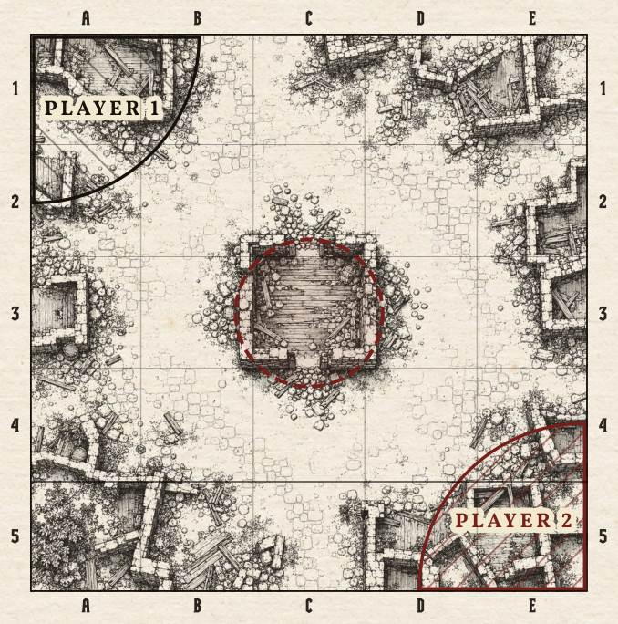

*Objective Area at the centre, up to 8″ across. Terrain is an example; build it from the recommended Regions.*

### Special Rules

#### The centrepiece

The doorways of a House cannot be locked. A Hill that is 3″ high is Elevated Ground on its crown only.

### Scoring

| Goal                                         | VP   |
|----------------------------------------------|------|
| Hold the Objective Area                      | 3 VP |
| Control the Objective Area                   | 1 VP |
| Defeat an enemy model (first time this game) | 2 VP |

**Side Quests.** Lost Relic cannot be completed (no Loot Sites); roll again.

## 03 · Iron Seals

*Standard Mission · 4 turns · Overtime · Difficulty ●●○ · Base · Territory*

The customs seals still bear the sun wheel. The clerk who stamped them is two years dead. Every crew in the ruins has heard what the crates hold.

Four sealed crates lie in the ruins. Carry them home.

### Battlefield

**Recommended Regions**

- **The Kupferkai**: warehouses and customs seals are canon here
- **The Outer Districts**: supply yards of the Tribes

**Terrain · Standard to dense**

- 1 to 2 warehouse shells (large) on the side edges, not in the Deployment Zones
- cargo stacks (Small Objects) as cover along the carry routes
- no piece that blocks every direct way from the centre to an edge

Carriers are slow; leave at least two 3″ lanes from the middle to each edge.

### Setup

|  |  |
|----|----|
| Terrain | Piece by Piece. |
| Roles | None. |
| Objectives | Blind Placement of **four** Crates. |
| Deployment | Roll-off. The winner chooses an edge; the loser chooses who deploys first. Edge Band 6″. Alternate Deployment. |

Small warbands may play this Mission on a 24″ × 24″ battlefield.

### Special Rules

#### Crates

Crates can be carried (see Carrying). A carrier that ends a move wholly within its own Deployment Zone secures the Crate: remove it. In a campaign each secured Crate gives one roll on the Equipment Table.

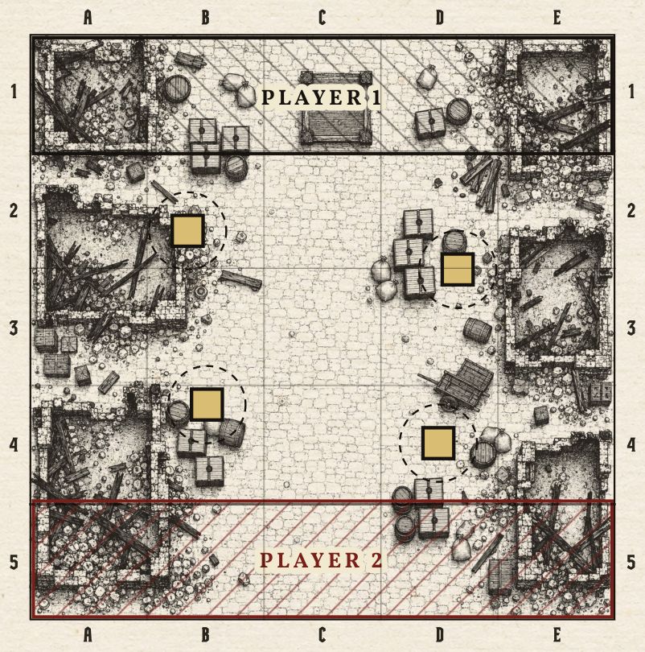

*crates placed in turns before the edges are chosen. Terrain is an example; build it from the recommended Regions.*

### Scoring

| Goal                                         | VP   |
|----------------------------------------------|------|
| Secure a Crate (when it happens)             | 5 VP |
| Each Crate your models carry                 | 1 VP |
| Defeat an enemy model (first time this game) | 2 VP |

**Side Quests.** All Side Quests can be completed. Lost Relic is rolled when a model picks up a Crate.

## 04 · The Buried Index

*Standard Mission · 4 turns · Overtime · Difficulty ●●○ · Base · Territory*

The department for extinct runelore was buried when the Arkanum broke. Dig out its index first, and you know where everything else is hidden.

Both warbands dig at the same spot. Progress scores every turn; the first to finish unearths the Index.

### Battlefield

**Recommended Regions**

- **The Akademiehöhe**: the Arkanum archive
- **The Broken Streets**: a buried cellar in the ruins

**Terrain · Standard**

- the Dig Site at the centre
- a curved wall fragment or small ruin on each side of the Dig Site, 4″ to 6″ away
- a lecture hall or tower toward one side edge

Diggers stand still; give both sides the same Cover near the Dig Site.

### Setup

|  |  |
|----|----|
| Terrain | Set up the Dig Site (a heap of rubble about 3″ across, no more than 1″ high, impassable) at the centre, then Piece by Piece. |
| Roles | None. |
| Objectives | The Dig Site. |
| Deployment | Roll-off. The winner chooses an edge; the loser chooses who deploys first. Edge Band 6″. Alternate Deployment. |

Small warbands may play this Mission on a 24″ × 24″ battlefield.

### Special Rules

#### Digging

A model within 1″ of the Dig Site may INTERACT to dig: its warband gains 1 Progress. Each model digs at most once per turn; a warband gains at most 3 Progress per turn. The first warband to reach 6 Progress unearths the Index (in a campaign: two rolls on the Equipment Table).

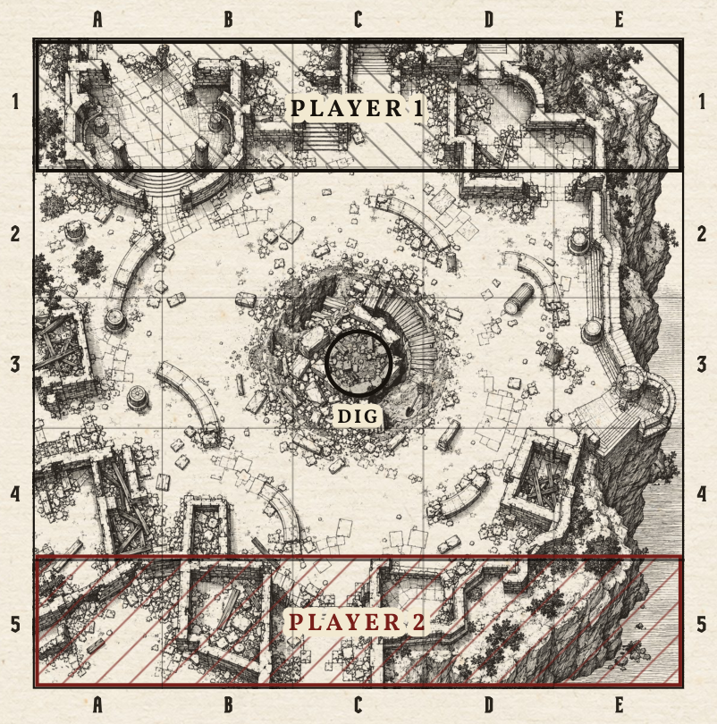

*Dig Site at the centre, both zones 9″ away. Terrain is an example; build it from the recommended Regions.*

### Scoring

| Goal                                         | VP   |
|----------------------------------------------|------|
| Each Progress your warband gained this turn  | 1 VP |
| Hold the Dig Site                            | 1 VP |
| Unearth the Index (once, when it happens)    | 4 VP |
| Defeat an enemy model (first time this game) | 2 VP |

**Side Quests.** All Side Quests can be completed. Lost Relic is rolled at every dig.

## 05 · Bred in the Dark

*Standard Mission · 4 turns · Overtime · Difficulty ●●● · Territory · Solo*

The Brood bred it to guard the deep tunnels. Then the tunnels fell in, and it came up hungry. Its teeth fetch a Goldsolar in the Cauldron.

A beast has broken out of the tunnels. Whoever wounds it takes the trophies.

### Battlefield

**Recommended Regions**

- **The Broken Streets**: the collapsed street over the tunnels
- **The Kupferkai**: broken out of a hold

**Terrain · Standard, centre open**

- a collapse hole or sinkhole at the centre as scenery (the Beast starts there)
- no terrain within 3″ of the centre
- rubble fans and small ruins between the corners and the centre

### Setup

|  |  |
|----|----|
| Terrain | Piece by Piece; keep 3″ around the centre clear. |
| Roles | None. |
| Objectives | The Brood Beast (NPC) at the centre; two Bone Markers by Blind Placement. |
| Deployment | Roll-off. The winner chooses a corner; Corner 9″. The loser chooses who deploys first. Alternate Deployment. |
| First turn | The Beast does not act in turn 1. |

### Special Rules

#### Trophies

Each time the Beast’s VIT drops to 15, 10, 5 and 0 or less, the warband that caused it takes a Trophy.

**Brood Beast**NPC

| MOV | SAV | VIT |
|-----|-----|-----|
| 6″  | 5+  | 20  |

| Weapon          | RNG | ATK | HTV | DMG | CRT |
|-----------------|-----|-----|-----|-----|-----|
| Claws and Teeth | 1″  | 4   | 4+  | 3   | 4   |

Resilient.

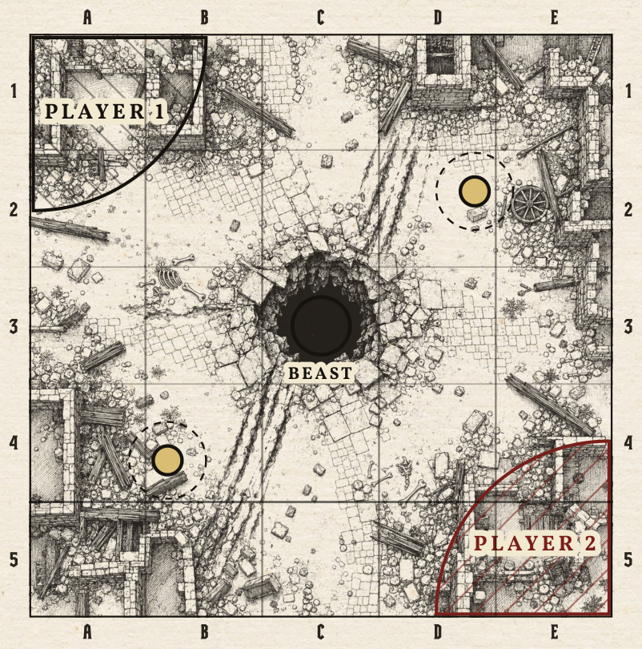

*Bone Markers placed in turns. Terrain is an example; build it from the recommended Regions.*

### Scoring

| Goal                                         | VP        |
|----------------------------------------------|-----------|
| Each Trophy (when taken)                     | 4 VP      |
| Control a Bone Marker                        | 1 VP each |
| Defeat an enemy model (first time this game) | 2 VP      |

**Side Quests.** Slayer counts only enemy models.

**Solo.** you win if the last Trophy falls before the end of the game.

## 06 · The Numbered Dead

*Standard Mission · 4 turns · Overtime · Difficulty ●●● · Base · Territory · Solo*

The newest graves carry no names, only numbers. Tonight the numbers are walking, and someone in a clean coat is counting them.

The dead rise at the side edges while both warbands fight over the markers.

### Battlefield

**Recommended Regions**

- **The Burial Grounds**: the Graveyard of the Nameless
- **The Silent Lines**: near the siege trenches

**Terrain · Standard**

- 2 to 3 grave fields (Difficult Terrain) across the middle
- a mausoleum (medium) off-centre
- the side edges at row 3 kept free: Corpses rise there

Do not combine with the Burial Grounds rule Grave Curse if the table is already crowded with Corpses.

### Setup

|  |  |
|----|----|
| Terrain | Piece by Piece. |
| Roles | None. |
| Objectives | Blind Placement of **three** Objective Markers. |
| Deployment | Roll-off. The winner chooses an edge; the loser chooses who deploys first. Edge Band 6″. Alternate Deployment. |

Small warbands may play this Mission on a 24″ × 24″ battlefield.

### Special Rules

#### Risen Corpses

In each NPC Step the Corpses on the table act, then D3 new ones rise at the two side edges, halfway along (D6: 1 to 3 left, 4 to 6 right). New Corpses act from the next turn. No more than 10 Corpses are on the table at once.

**Risen Corpse**NPC

| MOV | SAV | VIT |
|-----|-----|-----|
| 4″  | 6+  | 6   |

| Weapon         | RNG | ATK | HTV | DMG | CRT |
|----------------|-----|-----|-----|-----|-----|
| Grasping Hands | 1″  | 2   | 4+  | 2   | 4   |

Resilient, Slow.

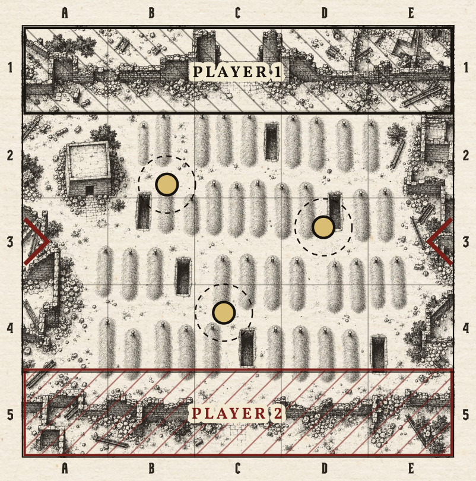

*Corpses rise at the side edges, halfway along. Terrain is an example; build it from the recommended Regions.*

### Scoring

| Goal                                         | VP        |
|----------------------------------------------|-----------|
| Control an Objective Marker                  | 1 VP each |
| Defeat a Risen Corpse                        | 1 VP      |
| Defeat an enemy model (first time this game) | 2 VP      |

**Side Quests.** Slayer counts no Corpses.

**Solo.** D3 + 1 Corpses rise each turn; you win with 12 VP.

## 07 · Cut the Sinews

*Standard Mission · 4 turns · Overtime · Difficulty ●●○ · Territory · Asymmetric*

It came out of the Arsenal in pieces and took a week to rebuild. One more night and it throws stone at the wall. Tonight is all you get.

The Defender guards a siege engine. The Attacker must break it before dawn.

### Battlefield

**Recommended Regions**

- **The Walls**: the engine is meant for the wall
- **The Outer Districts**: the Arsenal’s last stock

**Terrain · Standard**

- the Siege Engine (up to 6″ × 3″)
- timber piles and stacked shot (Small Objects) around it
- broken walls as Field Defenses on the Attacker’s approach

The Defender places the Engine; build the table so that more than one spot 12″ to 18″ from an edge offers Cover.

### Setup

|  |  |
|----|----|
| Terrain | Piece by Piece. |
| Roles | Underdog’s Choice (in campaigns: Campaign Roles). |
| Objectives | The Attacker chooses an edge. Then the Defender places the Siege Engine (Structure: SAV 4+, VIT 12, up to 6″ × 3″) **12″ to 18″** from the Attacker’s edge. |
| Deployment | The Defender uses Deploy All, Around 9″ of the Engine. Then the Attacker deploys, Edge Band 6″. |

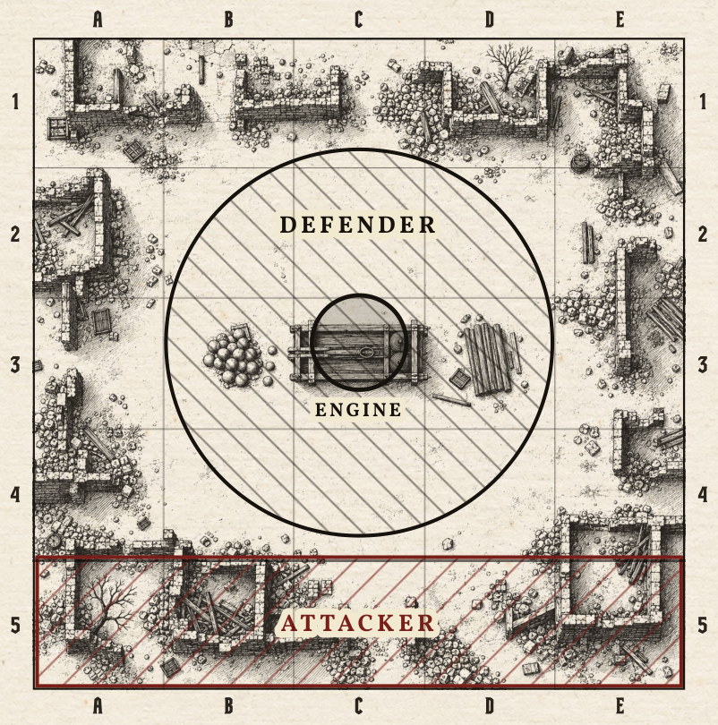

*Engine 12″ to 18″ from the Attacker’s edge. Terrain is an example; build it from the recommended Regions.*

### Scoring

| Goal                                                      | VP   |
|-----------------------------------------------------------|------|
| Attacker: Engine first at 6 VIT or less (when it happens) | 3 VP |
| Attacker: Engine destroyed (when it happens)              | 8 VP |
| Defender: the Engine stands at the end of the turn        | 2 VP |
| Defeat an enemy model (first time this game)              | 2 VP |

**Side Quests.** Lost Relic cannot be completed; roll again.

## 08 · The Pilgrim’s Path

*Standard Mission · 4 turns · Overtime · Difficulty ●●○ · Territory · Asymmetric*

She carries amber for the dying and walks where she was told the sun still reaches. Nobody has told her what lies between here and there.

Escort: the Attacker must bring the Pilgrim across the table; the Defender stands in the way.

### Battlefield

**Recommended Regions**

- **The Broken Streets**: the old pilgrim road through the ruins
- **Basilica Square**: the last stretch to the Last Hearth

**Terrain · Light to standard**

- a clear road 3″ to 4″ wide from edge to edge
- ruins on both sides of the road, 2″ to 6″ from it
- no impassable piece on the road

The Pilgrim walks the shortest open route; the road makes that route obvious.

### Setup

|  |  |
|----|----|
| Terrain | Shared Build; leave a passable route across the table. |
| Roles | Underdog’s Choice. |
| Objectives | The Pilgrim (NPC) starts in the middle of the Attacker’s zone, touching its front edge, 24″ from the Defender’s edge. |
| Deployment | The Attacker chooses an edge and uses Deploy All, Edge Band 6″. The Defender then deploys anywhere, Keep Your Distance 12″ from the Pilgrim and 6″ from Attacker models. |

### Special Rules

#### The Pilgrim walks

In each NPC Step the Pilgrim moves its full MOV toward the Defender’s edge by the shortest passable route, but not while a Defender model is within 1″ of it: the Defender blocks it. When it touches the Defender’s edge it leaves the table and is safe.

**The Pilgrim**NPC

| MOV | SAV | VIT |
|-----|-----|-----|
| 6″  | 5+  | 10  |

Does not fight.

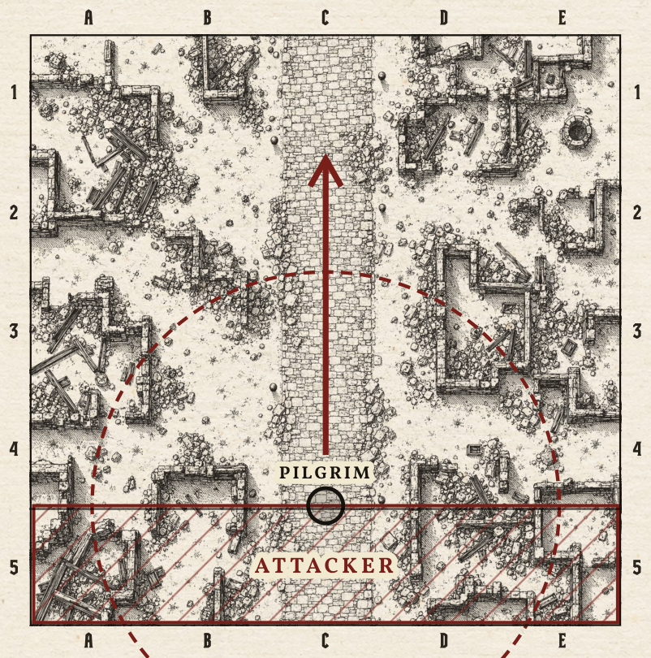

*Defender: anywhere, at least 12″ from the Pilgrim · Defender’s edge at the top. Terrain is an example; build it from the recommended Regions.*

### Scoring

| Goal                                                                 | VP   |
|----------------------------------------------------------------------|------|
| Attacker: the Pilgrim is on the table at the end of the turn         | 2 VP |
| Attacker: the Pilgrim leaves via the Defender’s edge (once)          | 8 VP |
| Defender: the Pilgrim is Defeated (once)                             | 8 VP |
| Defender: a Defender model blocks the Pilgrim at the end of the turn | 1 VP |
| Defeat an enemy model (first time this game)                         | 2 VP |

**Side Quests.** Lost Relic and Threshold cannot be completed; roll again.

## 09 · Run the Checkpoints

*Standard Mission · 4 turns · Overtime · Difficulty ●●○ · Territory · Asymmetric*

Every bridge has its own toll, and some bridges have their own mines. There is one way through, and it runs through them.

Breakthrough: the Attacker wants off the far edge; the Defender sets up wherever the blow will fall.

### Battlefield

**Recommended Regions**

- **The Canal Ward**: the bridges are the checkpoints
- **The Broken Streets**: a barricaded street

**Terrain · Standard**

- a broken barricade line (Field Defenses) across the far third, with 2 to 3 gaps
- ruins below the barricade as cover for the approach
- in the Canal Ward: two bridges as the ways through

At least two routes to the Break-out Edge; one sealed route makes the Mission unwinnable.

### Setup

|  |  |
|----|----|
| Terrain | Piece by Piece. |
| Roles | Underdog’s Choice. |
| Objectives | None. The Defender’s table edge is the Break-out Edge. |
| Deployment | The Attacker chooses an edge; Deploy All, Edge Band 6″. The Defender then deploys anywhere, Keep Your Distance 12″. |

### Special Rules

#### Breaking out

An Attacker model that ends a move touching the Break-out Edge leaves the table. It is not Defeated and takes part in the After Battle Sequence as usual.

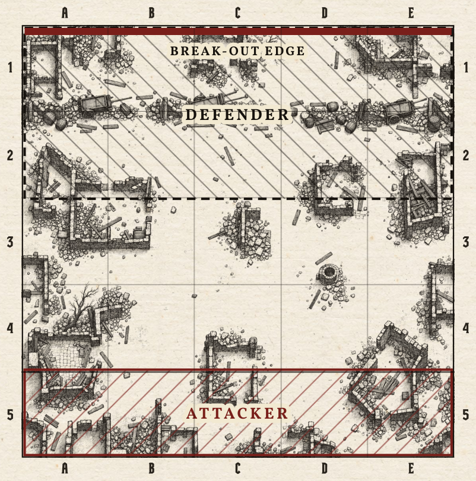

*Defender: anywhere at least 12″ from Attacker models. Terrain is an example; build it from the recommended Regions.*

### Scoring

| Goal | VP |
|----|----|
| Attacker: each model that leaves via the Break-out Edge (when it happens) | 4 VP |
| Defender: no Attacker model left the table this turn | 2 VP |
| Defeat an enemy model (first time this game) | 2 VP |

**Side Quests.** Deep Raid and Lost Relic cannot be completed; roll again.

## 10 · Under the Whisper

*Standard Mission · 4 turns · Overtime · Difficulty ●●○ · Base · Territory*

The search parties went into the ruins at noon. By dusk they were whispering back to something that had whispered first.

Scattered search parties in a maze of small ruins, and something in the air that frays the nerves.

### Battlefield

**Recommended Regions**

- **The Broken Streets**: many small houses, no open plaza
- **The Silent Lines**: the empty ground between the trenches

**Terrain · Dense**

- many small ruins (3″ to 4″) spread evenly, no open plaza
- crooked alleys 2″ to 3″ wide
- a few dead trees as Small Objects

Dense terrain supports the scattered search parties; long sightlines would let one side pick off the scattered models.

### Setup

|  |  |
|----|----|
| Terrain | Piece by Piece. |
| Roles | None. |
| Objectives | **Three** Objective Markers: two on the middle row (row 3), at least 8″ apart, the third by Blind Placement. |
| Deployment | Roll-off. The winner chooses a half of the table (rows 1 and 2, or rows 4 and 5). Each player deploys anywhere in their half, Scattered 4″. The loser chooses who deploys first. Alternate Deployment. |

### Special Rules

#### Madness

At the start of each turn roll a D6. On a 1 to 3, each player chooses one of their models; it gains Fearful. Do not combine this Mission with the Battle Condition Seeping Dread.

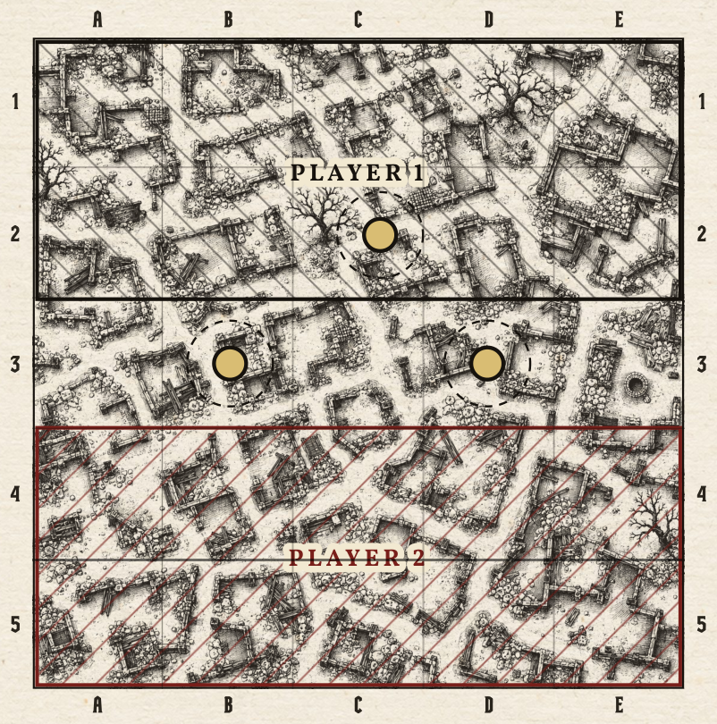

*each model more than 4″ from every friendly model. Terrain is an example; build it from the recommended Regions.*

### Scoring

| Goal                                                | VP         |
|-----------------------------------------------------|------------|
| Control an Objective Marker                         | 1 VP each  |
| Hold an Objective Marker                            | +1 VP each |
| No friendly model is Fearful at the end of the game | 3 VP       |
| Defeat an enemy model (first time this game)        | 2 VP       |

**Side Quests.** All Side Quests can be completed.

## 11 · Until Sunrise

*Standard Mission · 4 turns · Overtime · Difficulty ●●● · Territory · Asymmetric*

Here the only thing that counts is the next sunrise. Hold the ruin until then, and you may see another one.

The smaller warband holds a ruin at the centre; the attackers come from every side.

### Battlefield

**Recommended Regions**

- **The Broken Streets**: a fortified ruin
- **The Wasted Fields**: a burned farmhouse outside the walls

**Terrain · Light around the centre, standard at the edges**

- the Redoubt at the centre: a House Objective Area 4″ to 6″ across with blocked doorways (Field Defenses)
- open ground within 6″ of the Redoubt, only scatter
- ruins near the edges for the attackers’ approach

### Setup

|  |  |
|----|----|
| Terrain | Set up the Redoubt, a House Objective Area 4″ to 6″ across, at the centre, then Piece by Piece. |
| Roles | The player whose warband has fewer models is the Defender (if equal, Roll for Roles). |
| Objectives | The Redoubt. |
| Deployment | The Defender uses Deploy All, Around 8″ of the Redoubt. Then the Attacker deploys within 6″ of any table edges, split as they like, Keep Your Distance 8″. |

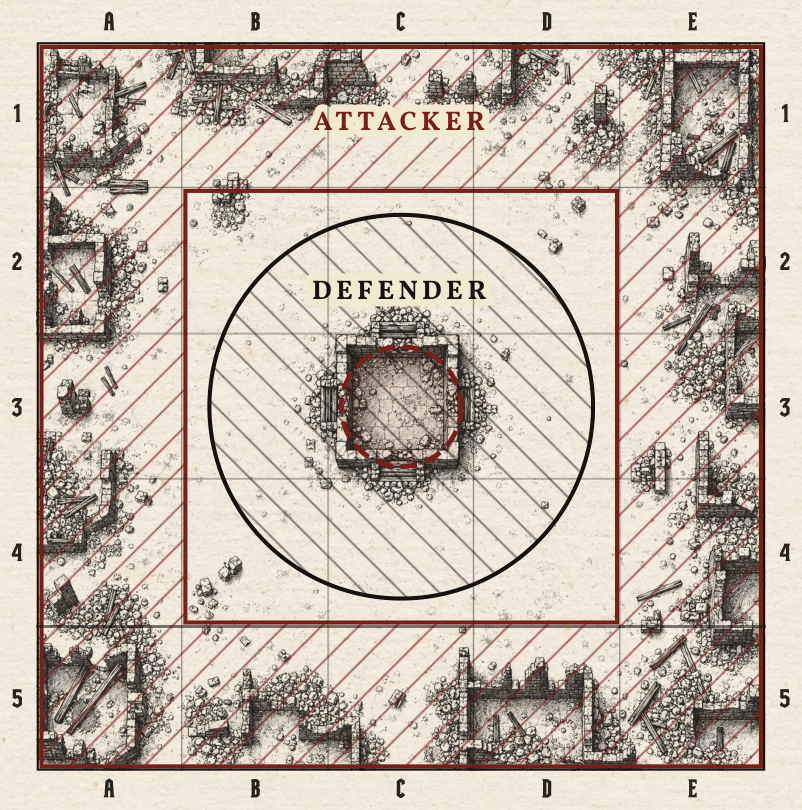

*Attacker: within 6″ of any table edges. Terrain is an example; build it from the recommended Regions.*

### Scoring

| Goal | VP |
|----|----|
| Hold the Redoubt (Attacker or Defender) | 3 VP |
| Defender: a Defender model controls the Redoubt at the end of the turn | 1 VP |
| Defeat an enemy model (first time this game) | 2 VP |

**Side Quests.** Threshold, Deep Raid and Capture the Flag cannot be completed; roll again.

## 12 · The Bruchgasse

*Standard Mission · 4 turns · Overtime · Difficulty ●●○ · Base · Territory · Playtest*

The oldest street in Grimheim, and the only one still standing between here and there. The houses lean in, the paving sags, and somebody is already coming the other way.

One street, two ends, no flanks. Whoever wants through must go through the enemy.

### Battlefield

**Recommended Regions**

- **The Broken Streets**: the Bruchgasse and its lanes
- **The Kupferkai**: a quay lane between warehouses
- **The Canal Ward**: the canal embankment

**Terrain · Dense beside the street, open ground only in the street**

- impassable ruin blocks (large) filling both sides of the street
- 4 to 6 enterable houses along the street (small ruins with doorways)
- the Crossing at the middle: a well-head or marker
- scatter in the street: a cart, rubble fans

No straight line along the street longer than about 12″.

### Setup

|  |  |
|----|----|
| Terrain | Mission Map: build impassable ruins so that the open ground forms one street 8″ to 12″ wide from the middle of one edge to the middle of the opposite edge; it bends at least twice. Buildings along the street can be entered from it. Put the Crossing (an Objective Marker, or a well-head up to 3″ across) where the street meets the middle row. |
| Roles | None. |
| Objectives | The Crossing. |
| Deployment | Roll-off. The winner chooses an end of the street; the loser chooses who deploys first. Each player deploys in the street, wholly within 6″ of their end. Alternate Deployment. |

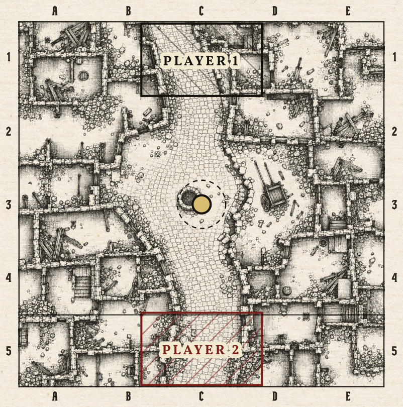

*Mission Map: one street from end to end. Terrain is an example; build it from the recommended Regions.*

### Special Rules

#### Through the lane

A model that ends a move touching the opponent’s end of the street leaves the table. It is not Defeated and takes part in the After Battle Sequence as usual. A model may not leave by its own end.

### Scoring

| Goal | VP |
|----|----|
| Each friendly model that leaves by the opponent’s end (when it happens) | 3 VP |
| Hold the Crossing | 2 VP |
| Defeat an enemy model (first time this game) | 2 VP |

**Side Quests.** Deep Raid and Lost Relic cannot be completed; roll again.

## 13 · Home Before Dark

*Standard Mission · 4 turns · Overtime · Difficulty ●●○ · Base · Territory · Playtest*

A day’s digging on your back and an hour of light left. The ruins are quiet, until you round the corner and find another crew, just as loaded and just as tired.

Both warbands carry their finds home, and both would rather carry the other’s.

### Battlefield

**Recommended Regions**

- **The Broken Streets**: the way back through the ruins
- **The Kupferkai**: from the warehouses to the camps
- **The Wasted Fields**: outside the walls

**Terrain · Standard**

- a medium or large piece in each quarter
- two bent lanes between the quarters, 3″ wide or more
- scatter at the lane junction

Keep the four quarters equally covered; the second player chooses from three quarters.

### Setup

|  |  |
|----|----|
| Terrain | Piece by Piece. |
| Roles | None. |
| Objectives | Each player takes D3 + 1 Finds (tokens that can be carried) and gives them to models of their warband at deployment, one per model. |
| Deployment | Roll-off. The winner chooses to deploy first or second. The first player chooses a table quarter and uses Deploy All, Corner 12″ in the corner of that quarter. The second player then uses Deploy All in any other quarter, Corner 12″, Keep Your Distance 14″. Each player’s home is their own table corner. |
| First turn | Finds cannot be secured in turn 1. |

### Special Rules

#### Finds

Finds are carried (see Carrying) and can be picked up by either side. From turn 2, a carrier that ends a move within 3″ of its own home corner secures the Find: remove it from play. In a campaign each secured Find is worth 20 Gold to the player who secured it, whoever it first belonged to.

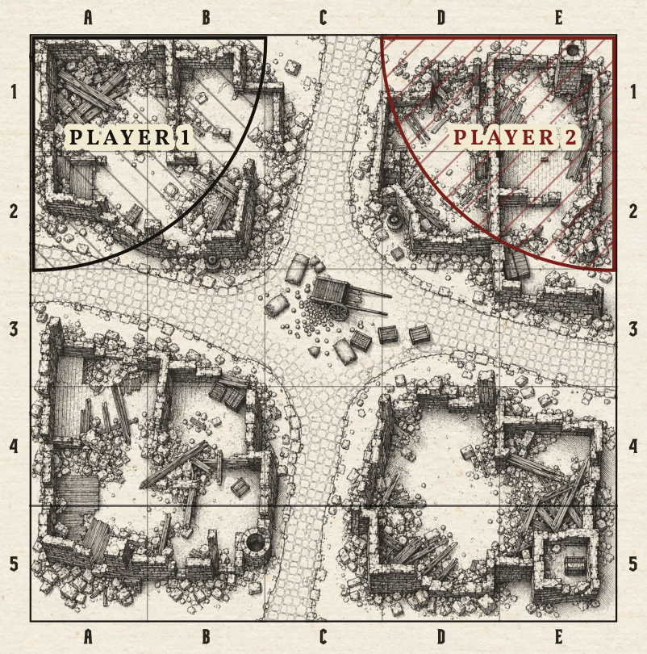

*second player: any other quarter, 14″ from enemy models. Terrain is an example; build it from the recommended Regions.*

### Scoring

| Goal                                               | VP   |
|----------------------------------------------------|------|
| Secure one of your own Finds (when it happens)     | 2 VP |
| Secure an enemy Find (when it happens)             | 4 VP |
| Each Find your models carry at the end of the turn | 1 VP |
| Defeat an enemy model (first time this game)       | 2 VP |

**Side Quests.** Deep Raid and Threshold cannot be completed; roll again.

## 14 · Spades and Knives

*Standard Mission · 4 turns · Overtime · Difficulty ●●● · Territory · Asymmetric · Playtest*

They buried their silver when the city fell and meant to come back for it. They never did. Somebody else did, and then somebody else again.

An ambush on a scattered crew of diggers; half of them are still on their way back.

### Battlefield

**Recommended Regions**

- **The Broken Streets**: a ruin being picked over
- **The Wasted Fields**: a looted farmstead
- **The Outer Districts**: a scrapyard of the Tribes

**Terrain · Standard, low pieces in the middle**

- many small ruins and rubble (up to 3″ high) in the middle 14″ square
- three cellar hatches or dug holes as Caches
- larger pieces near the edges, where attackers and reinforcements come in

Low terrain in the middle lets the scattered diggers see the attack coming; high terrain there favours the Attacker.

### Setup

|  |  |
|----|----|
| Terrain | Piece by Piece. |
| Roles | Underdog’s Choice (in a Conquest Campaign: the owner of the Territory is the Defender). |
| Objectives | The Defender places three Caches (Objective Markers) more than 8″ from every table edge and at least 8″ apart. |
| Deployment | The Defender chooses up to half their models (rounded down) as Reserves. The rest use Deploy All: more than 8″ from every table edge, Scattered 6″. Then roll a D6 for the Attacker’s edge (1 to 4: the four edges clockwise, starting with the edge the Attacker sits at; 5 or 6: the Attacker chooses). The Attacker uses Deploy All, Edge Band 6″, Keep Your Distance 9″. |
| First turn | The Attacker has initiative in turn 1. |

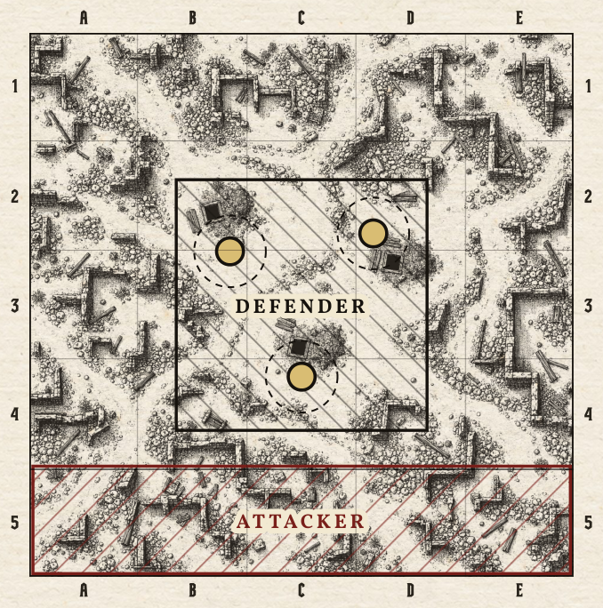

*Attacker’s edge rolled after the Defender has deployed. Terrain is an example; build it from the recommended Regions.*

### Special Rules

#### Reserves

From turn 2, in each NPC Step the Defender rolls a D6 for each model in Reserves; on a 4 or more it arrives. Roll one D6 for the edge of all arrivals this turn (1 to 4: the edges clockwise as above; 5 or 6: the Defender chooses). Arriving models are placed touching that edge, more than 6″ from enemy models, and may act this turn. Models still in Reserves at the start of turn 4 arrive automatically.

### Scoring

| Goal | VP |
|----|----|
| Control a Cache | 1 VP each |
| Hold a Cache | +1 VP each |
| Defender: no Attacker model within 6″ of any Cache at the end of the turn | 2 VP |
| Defeat an enemy model (first time this game) | 2 VP |

**Side Quests.** Threshold cannot be completed; roll again.

## Stronghold Missions

The decisive battles of a campaign. They set their own length and are never extended by Overtime.

## 15 · Stronghold Assault

*Stronghold Mission · 6 turns · no Overtime · Difficulty ●●● · Stronghold · Asymmetric*

Every hold in the ruins is built around one fire. Put it out, and by morning there is no hold, only cold stone and people who used to be a warband.

The decisive battle for a warband’s home: storm the Hold and put out its Hearth.

### Battlefield

**Recommended Regions**

- **The Broken Streets**: a hold in house stumps
- **The Outer Districts**: a Tribes camp
- **The Walls**: a gatehouse

**Terrain · Standard outside the Hold; the Defender builds the Hold**

- up to 30″ of walls (Field Defenses) with two gaps
- the Hearth (about 3″ × 3″)
- up to two pieces inside the Hold
- cover on the Attacker’s approach: 2 to 3 small ruins in rows 3 and 4

### Setup

|  |  |
|----|----|
| Terrain | Shared Build. Then the Attacker chooses the Defender’s edge; the Defender clears cells B1 to D2 along it and builds the Hold: up to 30″ of walls (Field Defenses) along its open sides with at least two 3″ gaps, up to two pieces inside, the Hearth (Structure: SAV 4+, VIT 14) at least 4″ from the open sides, and two Trap Markers within 6″ outside. |
| Roles | Campaign Roles (the owner of the Stronghold defends); otherwise Roll for Roles. |
| Objectives | The Hearth. |
| Deployment | The Defender uses Deploy All inside the Hold, with D3 Hold Militia (Garrison). The Attacker then deploys in row 5 and cells A4 and E4. |

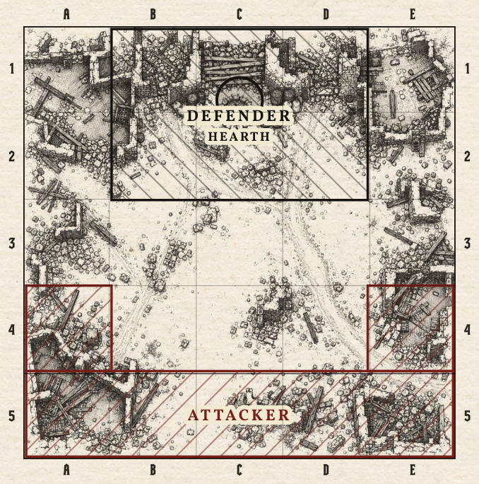

*the Hold: cells B1 to D2. Terrain is an example; build it from the recommended Regions.*

**Hold Militia**Garrison

| ACT | MOV | SAV | VIT |
|-----|-----|-----|-----|
| 2   | 5″  | 5+  | 8   |

| Weapon | RNG | ATK | HTV | DMG | CRT |
|--------|-----|-----|-----|-----|-----|
| Club   | 1″  | 2   | 5+  | 2   | 3   |

No traits.

### Scoring

| Goal                                                      | VP    |
|-----------------------------------------------------------|-------|
| Defender: the Hearth stands at the end of the turn        | 2 VP  |
| Defender: no Attacker model wholly within the Hold        | 1 VP  |
| Attacker: an Attacker model wholly within the Hold        | 1 VP  |
| Attacker: Hearth first at 7 VIT or less (when it happens) | 4 VP  |
| Attacker: Hearth destroyed (when it happens)              | 10 VP |
| Defeat an enemy model (first time this game)              | 2 VP  |

**Side Quests.** Lost Relic cannot be completed; roll again.

## 16 · Burn the Banner

*Stronghold Mission · 4 turns · no Overtime · Difficulty ●●● · Stronghold · Asymmetric*

Every crew in the ruins marches under a rag on a pole. Burn it, and the ones still coming stop knowing where to run.

A short, savage raid on the Defender’s camp: reach the Banner and burn it.

### Battlefield

**Recommended Regions**

- **The Silent Lines**: a camp
- **The Broken Streets**: a street camp

**Terrain · Standard**

- the Banner on a stone cairn (up to 2″ across)
- tents and carts (Small Objects) in the Defender’s zone
- barricades across the approaches

### Setup

|  |  |
|----|----|
| Terrain | Shared Build. |
| Roles | Campaign Roles; otherwise Roll for Roles. |
| Objectives | The Attacker chooses the Defender’s edge. The Defender places the Banner (Structure: SAV 4+, VIT 10) wholly within 6″ of that edge and within 6″ of its middle. |
| Deployment | Alternate Deployment, starting with the Defender. Defender: Edge Band 6″. Attacker: wholly within 12″ of the opposite edge but more than 6″ from it. |

### Special Rules

#### Reinforcements

In each NPC Step one Hold Militia (Garrison) arrives touching the Defender’s edge and may act.

**Hold Militia**Garrison

| ACT | MOV | SAV | VIT |
|-----|-----|-----|-----|
| 2   | 5″  | 5+  | 8   |

| Weapon | RNG | ATK | HTV | DMG | CRT |
|--------|-----|-----|-----|-----|-----|
| Club   | 1″  | 2   | 5+  | 2   | 3   |

No traits.

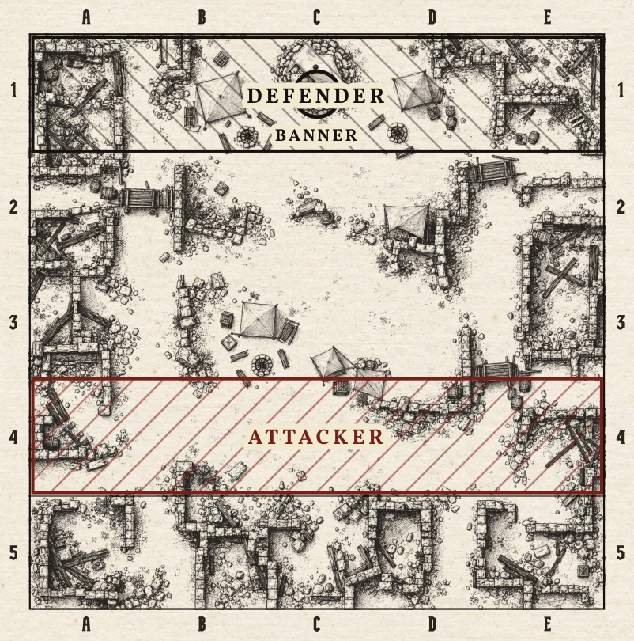

*Attacker: 6″ to 12″ from their own edge. Terrain is an example; build it from the recommended Regions.*

### Scoring

| Goal                                                                | VP   |
|---------------------------------------------------------------------|------|
| Defender: the Banner stands at the end of the turn                  | 3 VP |
| Attacker: an Attacker model wholly within 6″ of the Defender’s edge | 1 VP |
| Attacker: Banner first at 5 VIT or less (when it happens)           | 4 VP |
| Attacker: Banner destroyed (when it happens)                        | 8 VP |
| Defeat an enemy model (first time this game)                        | 2 VP |

**Side Quests.** Lost Relic cannot be completed; roll again.

## 17 · Before He Wakes

*Stronghold Mission · 6 turns · no Overtime · Difficulty ●●● · Stronghold · Asymmetric*

He lies on the bier as still as the dead. Whether that is sleep, fever or something worse, you will learn only if you let him wake.

The Defender’s champion lies helpless at the centre. Kill him before he wakes, or face him when he does.

### Battlefield

**Recommended Regions**

- **Basilica Square**: a ruined hall
- **The Burial Grounds**: a mausoleum

**Terrain · Standard**

- a dais with a bier at the centre (3″ across, 1″ high)
- a ring of column stumps (Small Objects) around it
- ruins toward the edges

### Setup

|  |  |
|----|----|
| Terrain | Shared Build; keep 3″ around the centre clear. |
| Roles | Campaign Roles; otherwise Roll for Roles. |
| Objectives | The Defender’s model with the highest point cost is the Sleeping Lord (on a tie, the Defender chooses among them). Place it at the centre. |
| Deployment | The Defender uses Deploy All, Around 9″ of the centre. The Attacker then deploys within 6″ of any table edges, split as they like. |

### Special Rules

#### The Sleeping Lord

The Lord cannot be activated while asleep but defends normally. In each NPC Step the Defender rolls a D6: on a 4 or more it wakes and stays awake. Once awake it activates normally and gains +1 ACT each turn.

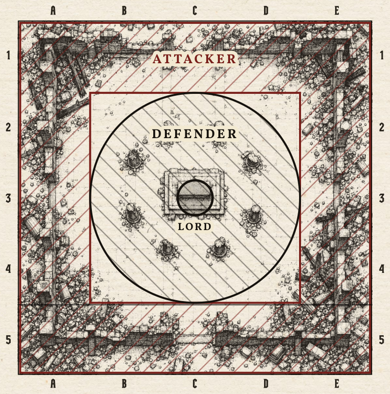

*Attacker: within 6″ of any table edges. Terrain is an example; build it from the recommended Regions.*

### Scoring

| Goal | VP |
|----|----|
| Defender: the Lord is not Defeated at the end of the turn (asleep) | 1 VP |
| Defender: the Lord is awake and not Defeated at the end of the turn | 3 VP |
| Attacker: the Lord is Defeated (once, in addition to the kill VP) | 8 VP |
| Attacker: an Attacker model is within 6″ of the Lord at the end of the turn | 1 VP |
| Defeat an enemy model (first time this game) | 2 VP |

**Side Quests.** Threshold and Lost Relic cannot be completed; roll again.

## 18 · Siege of the Tower

*Stronghold Mission · 6 turns · no Overtime · Difficulty ●●● · Stronghold · Asymmetric*

Three nights ago this tower stopped passing the fire along the chain. Whoever holds the platform now sees every street between here and the wall.

The Defender holds a signal tower; the Attacker must climb it.

### Battlefield

**Recommended Regions**

- **The Walls**: a watchtower of the signal chain
- **The Kupferkai**: the dark lighthouse

**Terrain · Light near the Tower, standard at the edges**

- the Tower (8″ × 8″, 6″ high, four ladders)
- nothing higher than 2″ within 6″ of the Tower
- ruins and walls near the edges as cover for the approach

### Setup

|  |  |
|----|----|
| Terrain | Set up the Tower (8″ × 8″ platform, 6″ high, one ladder in the middle of each side) at the centre, then Shared Build; nothing higher than 2″ within 6″ of the Tower. |
| Roles | Campaign Roles; otherwise Roll for Roles. |
| Objectives | The Tower. |
| Deployment | The Defender uses Deploy All on the Tower. The Attacker then deploys within 4″ of any table edges. |
| First turn | All Defender models begin on Overwatch. |

### Special Rules

#### The Tower

INTERACT at a ladder climbs it completely; a full ladder top blocks it. Fly and Teleport may reach the Tower; Ambush may not be set up on it or within 3″ of it. The Defender Bonuses Sacred Ground and Desperate Resolve cannot be chosen for this Mission.

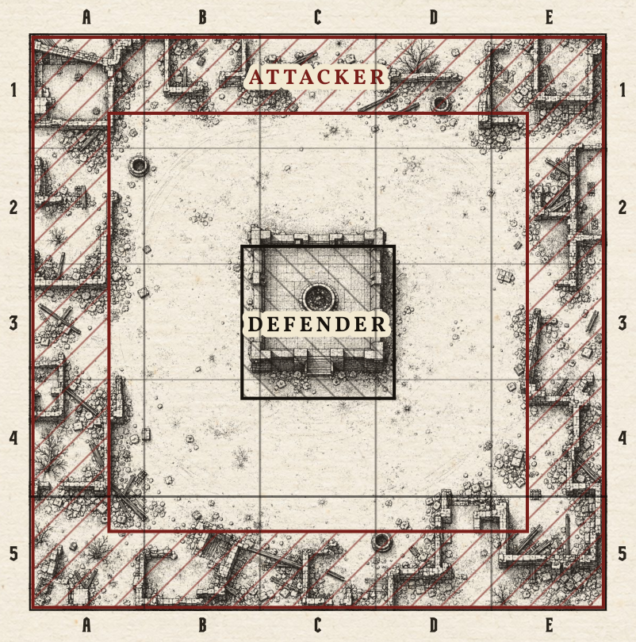

*Attacker: within 4″ of any table edges. Terrain is an example; build it from the recommended Regions.*

### Scoring

| Goal                                                      | VP    |
|-----------------------------------------------------------|-------|
| Defender: no Attacker model on the Tower                  | 3 VP  |
| Attacker: an Attacker model on the Tower                  | 2 VP  |
| Attacker: more Attacker than Defender models on the Tower | +2 VP |
| Defeat an enemy model (first time this game)              | 2 VP  |

**Side Quests.** Threshold, Deep Raid and Lost Relic cannot be completed; roll again.

## Special Modules

Special Modules are Missions with their own play area and their own feel. They use every rule of this chapter, but they are not part of the Mission pools of a Conquest Campaign: play them as single games or as campaign events the players agree on. Their own play area replaces the standard 30″ × 30″ battlefield for these Missions only.

## 19 · Grave Goods

*Special Module Mission · 4 turns · Overtime · Difficulty ●●○ · Territory · Solo*

The rich were buried with amber on their chests and crystal dust on their palms. The catacombs remember every one of them, and so does every grave robber in Grimheim.

A catacomb of three chambers on its own narrow table.

### Battlefield

**Recommended Regions**

- **The Burial Grounds**: the catacombs beneath the city graveyards

**Terrain · Mission Map**

- three chambers 10″ long, walls with one 4″ doorway each
- sarcophagi and rubble (Small Objects) in each chamber
- doorways kept clear

Played on its own 12″ × 30″ area; see Special Modules.

### Setup

|  |  |
|----|----|
| Terrain | Mission Map: a 12″ × 30″ catacomb of three chambers 10″ long, separated by walls with one 4″ doorway each. Add scatter inside the chambers; keep the doorways clear. |
| Roles | None. |
| Objectives | Fixed Points: one Treasure at the centre of each chamber. |
| Deployment | Roll-off. The winner chooses a short end; the opponent takes the other. Edge Band 3″ at the short end. The loser chooses who deploys first. Alternate Deployment. |

### Special Rules

#### Treasures

A model within 1″ may INTERACT to open a Treasure once; in a campaign its player rolls on the Equipment Table.

*12″ × 30″ · three chambers · doorways 4″. Terrain is an example; build it from the recommended Regions.*

### Scoring

| Goal                                         | VP   |
|----------------------------------------------|------|
| Open the Treasure of the chamber at your end | 3 VP |
| Open the middle Treasure                     | 6 VP |
| Open the Treasure at the enemy end           | 8 VP |
| Defeat an enemy model (first time this game) | 2 VP |

**Side Quests.** Deep Raid cannot be completed; roll again.

**Solo.** you win if you open all three Treasures.

## 20 · The Black Moon

*Special Module Mission · 4 turns · Overtime · Difficulty ●○○ · Base*

The stage is gone, the curtains burned. They spread sand where the actors stood, and now the house is full again every night.

A pit fight in front of a paying crowd. No objectives, only the crowd’s favour.

### Battlefield

**Recommended Regions**

- **Basilica Square**: the nearest table; the theatre Zum Schwarzen Mond stands on the Silbergild Promenade

**Terrain · Light inside the pit**

- the Stands: a 3″ band of stepped seating around the edge
- 3 to 4 stone pillars (1″ to 2″) inside the pit
- scatter debris; no building inside the pit

### Setup

|  |  |
|----|----|
| Terrain | Mission Map: the Stands are a 3″ band around the edge, impassable. Scatter terrain inside the pit, Piece by Piece. |
| Roles | None. |
| Objectives | None. |
| Deployment | Roll-off. The winner chooses a corner of the pit; Corner 8″ (measured from the inner corner of the Stands). The loser chooses who deploys first. Alternate Deployment. |

### Special Rules

#### The Crowd

A model pushed against the Stands (a Push that would move it into them) suffers D3 Fatal Damage and stays at the edge. At the end of each turn the player who Defeated more enemy models this turn wins the Crowd’s Favour; on a tie nobody does.

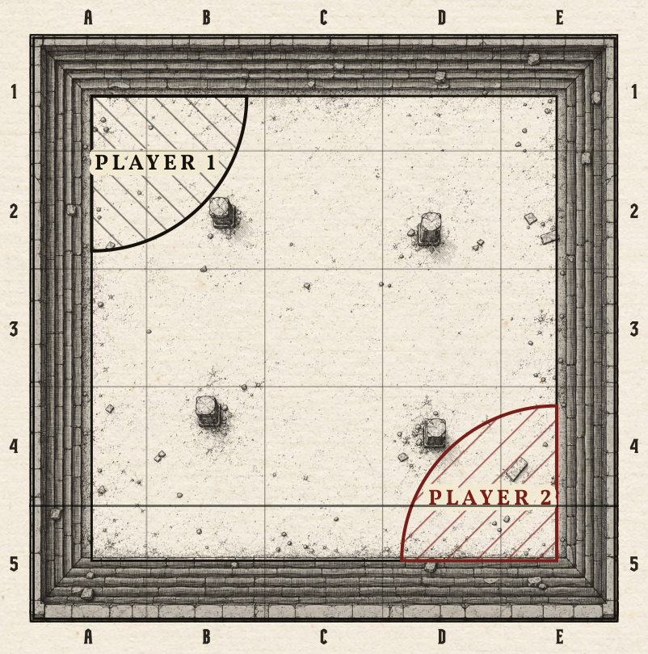

*the Stands: 3″, impassable. Terrain is an example; build it from the recommended Regions.*

### Scoring

| Goal                                         | VP   |
|----------------------------------------------|------|
| Crowd’s Favour                               | 3 VP |
| Defeat an enemy model (first time this game) | 2 VP |

**Side Quests.** Lost Relic, Deep Raid, Threshold and Capture the Flag cannot be completed; roll again.
